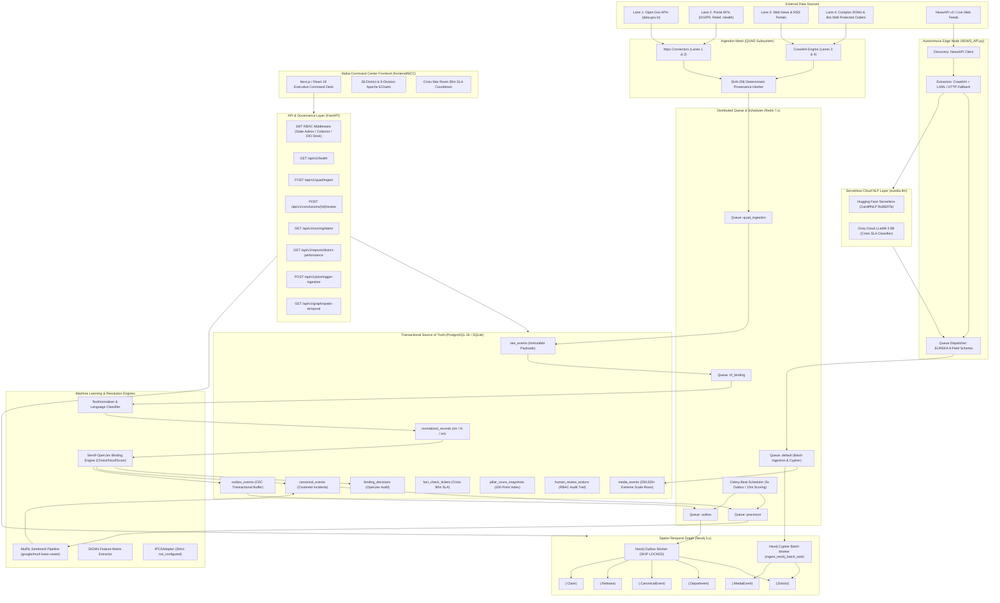
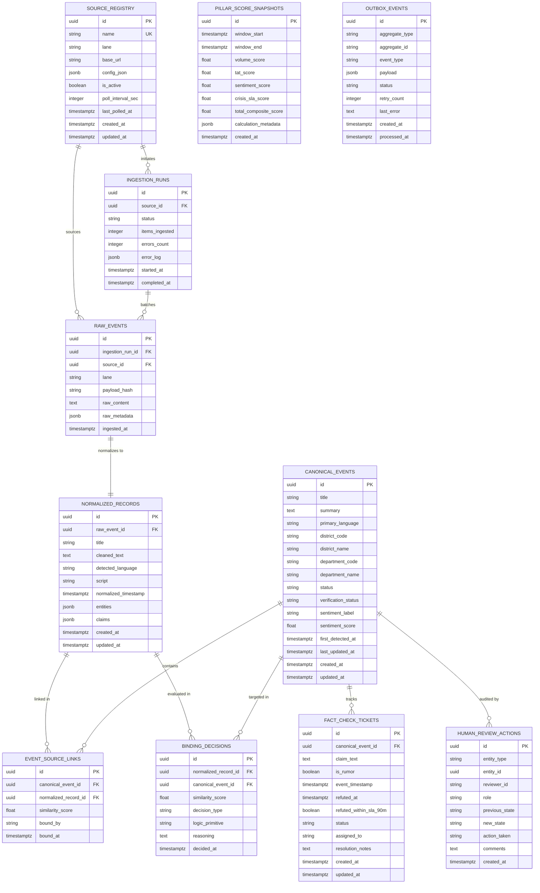
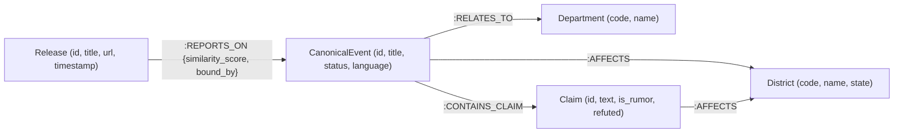
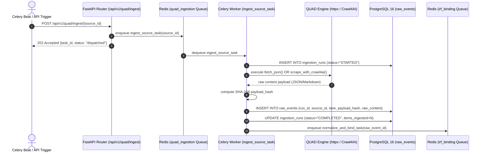
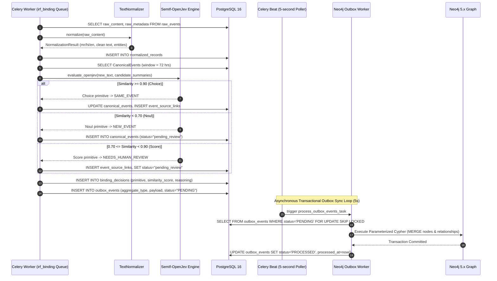
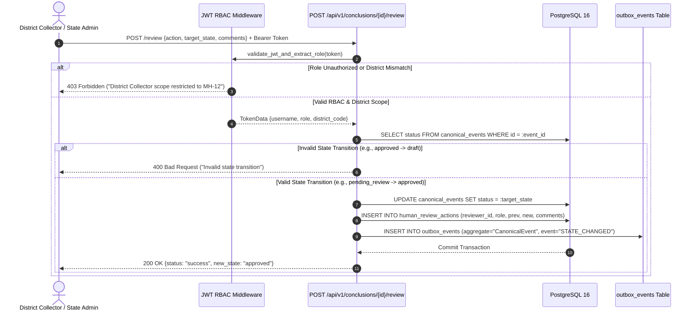
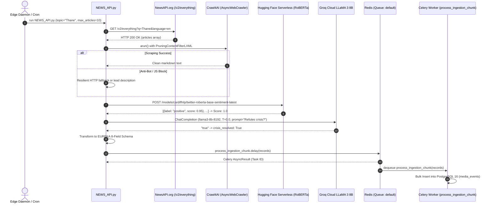
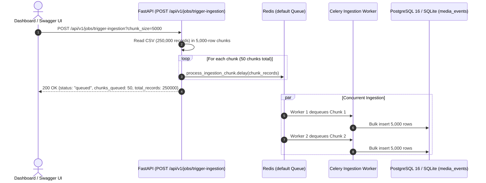
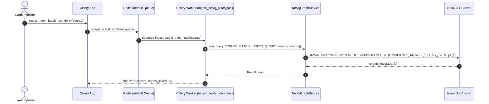
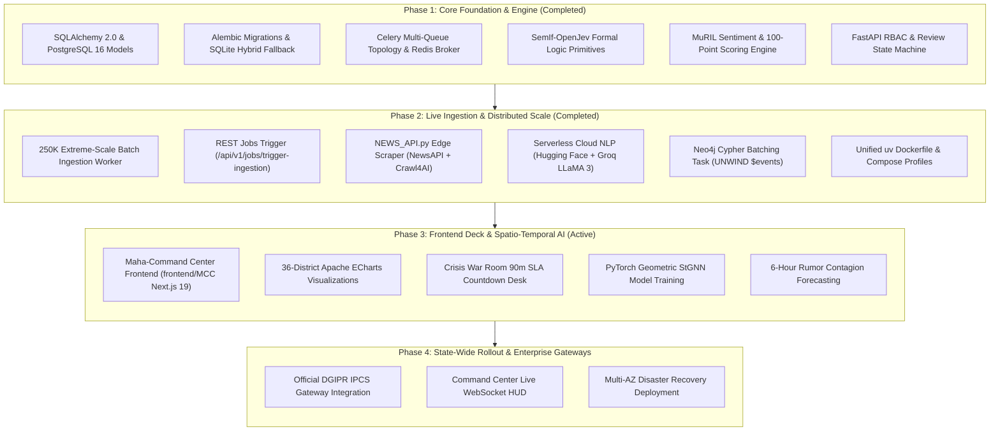

# Project EUREKA: Comprehensive Low-Level Architecture & Technical Specification
## The DGIPR Maha-Command Center Media Intelligence Engine

**Document Version:** 1.0.0  
**Classification:** Enterprise Production Architecture  
**Author:** Senior Principal Backend Engineering Team  
**Scope:** Backend Systems, Persistence Layer, Distributed Task Queues, Ingestion Mesh, Semantic Binding, NLP Heads, Graph Projections, and RBAC State Machine.

---

## 1. Executive Summary & Mission Overview

**Project EUREKA** is the next-generation media intelligence and narrative governance engine engineered specifically for the **Directorate General of Information and Public Relations (DGIPR)**, Government of Maharashtra.

### 1.1 Architectural Purpose & Mandate
Project EUREKA replaces legacy experimental prototypes with an enterprise-grade, asynchronous, distributed media analysis backend. The system ingests public releases, government notifications, news articles, and interactive digital communications across Maharashtra, executing:
1. **Multi-Lane Provenance Ingestion (QUAD System):** Ingests structured and unstructured media across four distinct weight-based lanes, preserving an immutable chain of custody before any data transformation occurs.
2. **Deterministic Entity & Incident Resolution (IRF Binding):** Replaces ambiguous continuous scoring with discrete formal logic primitives (`Choice`, `Noul`, `Score`) derived from **SemIf-OpenJev**, establishing strict convergence thresholds for incident clustering.
3. **Multilingual Indic Natural Language Processing:** Classifies Marathi, Hindi, and English content using **MuRIL** (`google/muril-base-cased`), deriving fine-grained sentiment polarity and factual claim boundaries.
4. **Hybrid Relational-Graph Synchronization:** Leverages PostgreSQL 16 as the transactional source of truth and Neo4j 5.x for spatio-temporal graph projections, unified via a **Transactional Outbox Pattern** with zero dual-write vulnerability.
5. **100-Point Composite Index Performance Measurement:** Evaluates state and district-level narrative operations across a 3-pillar 100-point composite model: Volume (35%), Sentiment Polarity NSI (35%), and Crisis Refutation 90-min SLA (30%). Turnaround Speed (TAT) has been removed.
6. **Strict Role-Based Human Review Workflow:** Mandates a formal state machine (`draft -> pending_review -> approved | overridden | rejected`) protected by cryptographically signed JWT role claims for Command Center administrators and district personnel.

---

## 2. High-Level & Low-Level System Topology



---

## 3. Architectural Decision Records (ADRs)

### ADR-001: Hybrid Relational-Graph CQRS with Transactional Outbox
* **Status:** Accepted & Implemented
* **Context:** The DGIPR Command Center requires ACID guarantees for audit logs, fact-check SLA tickets, and user reviews, while simultaneously requiring sub-second multi-hop graph traversals across Maharashtra districts, state departments, and incident cascades. Dual-writing to PostgreSQL and Neo4j within application request handlers causes distributed transaction failures, network partitions, and data divergence.
* **Decision:** PostgreSQL 16 is designated the sole transactional source of truth. Every mutation to a graph-projectable entity synchronously inserts an event record into `outbox_events` within the same database transaction. A dedicated asynchronous Celery worker polls `outbox_events` using `SELECT ... FOR UPDATE SKIP LOCKED` and executes idempotent Cypher `MERGE` queries in Neo4j.
* **Consequences:** Zero dual-write inconsistencies. If Neo4j restarts, PostgreSQL transactions are never blocked. Outbox events retry with exponential backoff up to 5 times before marking `FAILED`.

### ADR-002: QUAD Model Weight-Based Ingestion Architecture
* **Status:** Accepted & Implemented
* **Context:** Information originates from diverse sources ranging from high-trust structured government REST endpoints to bot-protected regional news outlets and dynamic JavaScript portals.
* **Decision:** Implement four dedicated ingestion lanes:
  * **Lane 1 (`LANE_1_API_GOV`):** High-throughput, authenticated REST JSON connectors (`httpx`) targeting structured open government data (`data.gov.in`, `pib.gov.in`).
  * **Lane 2 (`LANE_2_API_PORTAL`):** Departmental portal feeds (`dgipr.maharashtra.gov.in`, Disaster Management feeds) with custom schema mappings.
  * **Lane 3 (`LANE_3_SCRAPE_WEB`):** Clean HTML and RSS extraction via `crawl4ai.AsyncWebCrawler` extracting structured markdown.
  * **Lane 4 (`LANE_4_SCRAPE_DOM`):** Interactive DOM navigation and anti-scraping bypass via `crawl4ai` headless browser automation (`bypass_cache=True`, selector filtering, JavaScript triggers).
* **Write-Back Rule:** All four lanes must write raw, un-normalized payloads into `raw_events` accompanied by a deterministic SHA-256 hash before any normalization or NLP parsing occurs.

### ADR-003: Discrete SemIf-OpenJev IRF Binding vs. Fuzzy Scoring
* **Status:** Accepted & Implemented
* **Context:** Previous prototype iterations relied on continuous fuzzy metrics ($S_{dyn}$, $A_{score}$) which produced unpredictable clustering boundaries and could not provide verifiable explanations for why two news items were grouped together.
* **Decision:** Replace continuous formulas with formal semantic logic primitives from **SemIf-OpenJev**:
  * **`Choice` ($\ge 0.90$ similarity):** Formal semantic equivalence. Automatically binds to existing `canonical_event_id`.
  * **`Noul` ($< 0.70$ similarity):** Formal semantic divergence. Automatically instantiates a new `canonical_event_id`.
  * **`Score` ($0.70 \le \text{similarity} < 0.90$):** Ambiguous boundary condition. Binds provisionally but marks event status as `pending_review` for human review.
* **Consequences:** Clear, legally auditable classification boundaries stored in the `binding_decisions` table with explicit logic primitive tags.

### ADR-004: Multilingual Indic NLP Processing with MuRIL
* **Status:** Accepted & Implemented
* **Context:** Maharashtra state media operates predominantly in Marathi (65%), Hindi (20%), and English (15%). Generic English LLMs struggle with Marathi morphological markers (e.g., 'ळ', 'झाले', 'शासनाने').
* **Decision:** Integrate HuggingFace's `google/muril-base-cased` (Multilingual Representations for Indian Languages). The model outputs classification labels (`Positive`, `Neutral`, `Negative`, `Mixed`) and a continuous polarity score in $[-1.0, 1.0]$. A resilient rule-anchored fallback classifier provides seamless continuity when GPU resources or model weights are initializing.

### ADR-005: 100-Point Composite Index Performance Measurement (v2.0 - 3-Pillar Model)
* **Status:** Accepted & Implemented (Supersedes 4-pillar model per DGIPR Executive Directive)
* **Context:** Executive command staff require a standardized, deterministic score ($0 - 100$) reflecting real-time communication performance across all 36 Maharashtra districts. Turnaround Time (TAT) was retired from active scoring to eliminate latency gaming and geographic publishing delays, reallocating weights to Volume (35%), Sentiment (35%), and Crisis SLA (30%).
* **Decision:** Implement three additive pillars totaling strictly 100 points:
  1. **Volume Pillar ($0 - 35$ pts):** $35.0 \times \min\left(\frac{\text{TotalReleases}}{300}, 1.0\right)$ (saturates strictly at 300 releases per evaluation window).
  2. **Sentiment Pillar ($0 - 35$ pts):** Evaluates Net Sentiment Index ($NSI = \frac{\text{Pos} - \text{Neg}}{\text{TotalClassified}} \in [-1.0, 1.0]$) mapped linearly: $\left(\frac{NSI + 1.0}{2.0}\right) \times 35.0$. If $\text{TotalClassified} == 0$, neutral baseline $NSI = 0.0 \implies 17.50$ pts.
  3. **Crisis SLA Pillar ($0 - 30$ pts):** $\left(\frac{\text{RumorsRefutedWithin90Mins}}{\text{TotalRumorsIngested}}\right) \times 30.0$. **Critical Rule:** If $\text{TotalRumorsIngested} = 0$, the engine strictly awards the full $30.0$ points (division-by-zero protection). Resolution strictly $< 90.0$ minutes is required.
  4. **TAT Speed Deprecation:** Turnaround Time is retired from all composite calculations, ranking logic, and copilot scoring intents. Existing database columns (`media_events.turnaround_time_mins`) are preserved purely for auxiliary non-scored operational reporting ($\% \le 60\text{ min}$).

### ADR-006: Human-in-the-Loop Review State Machine & Strict RBAC
* **Status:** Accepted & Implemented
* **Context:** Automated intelligence cannot publish official state conclusions without designated bureaucratic authorization.
* **Decision:** Enforce a strict state machine: `draft -> pending_review -> approved | overridden | rejected`. Valid transitions are guarded by JWT tokens carrying verified `UserRole` claims:
  * `DG State Admin`: Unrestricted state-wide approval, override, and rejection authority.
  * `District Collector`: Authority restricted to events matching their assigned `district_code`.
  * `DIO Desk`: Read-only and draft submission authority.
  All state transitions record immutable records in `human_review_actions`.

### ADR-007: Strict IPCS Adapter Isolation
* **Status:** Accepted & Implemented
* **Context:** The Integrated Public Communication System (IPCS) specification is pending final technical definition by DGIPR.
* **Decision:** The `IPCSAdapter` class is implemented with a strict interface that returns `{"status": "not_configured"}` for all methods. Speculative or hallucinated mock implementations are strictly prohibited.

### ADR-008: Asynchronous Distributed Chunk Ingestion via Celery & Redis
* **Status:** Accepted & Implemented
* **Context:** Ingesting 250,000+ extreme-scale records synchronously in the FastAPI event loop caused request timeouts, socket exhaustion, and UI thread freezing.
* **Decision:** Decouple ingestion into an asynchronous distributed pipeline using Celery with Redis broker (`redis://127.0.0.1:6379/0`) and result backend (`/1`). The `POST /api/v1/jobs/trigger-ingestion` endpoint reads CSV/API sources in configurable batch chunks (default: 5,000 records) and queues them as background tasks (`process_ingestion_chunk.delay(chunk)`).
* **Consequences:** The FastAPI event loop responds within sub-50ms with a `job_id` and chunk dispatch summary. Worker processes handle database insertions concurrently with isolated database connection pooling.

### ADR-009: Serverless Cloud NLP Inference vs. Heavy Local Model Weights
* **Status:** Accepted & Implemented
* **Context:** Loading multi-gigabyte neural checkpoints locally for sentiment and crisis reasoning requires dedicated high-end GPUs, slowing down CI pipelines and bloating edge nodes.
* **Decision:** Implement `eureka.llm.cloud_evaluator`:
  * **Hugging Face Serverless Inference API:** Uses `cardiffnlp/twitter-roberta-base-sentiment-latest` to map multilingual civic sentiment into a normalized float score in $[-1.0, 1.0]$.
  * **Groq Cloud LLaMA 3 (`llama3-8b-8192`):** Executes deterministic ($T=0.0$) zero-shot prompts to classify whether news media resolves/refutes an active rumor within the Crisis SLA window.
* **Consequences:** Edge scrapers run feather-light on any CPU environment. Model execution latency averages <200ms per article without local memory consumption.

### ADR-010: Parameterized Cypher Batch Graph Sync with UNWIND
* **Status:** Accepted & Implemented
* **Context:** Creating individual nodes and edges in Neo4j sequentially per event creates massive transactional overhead and write lock contention.
* **Decision:** Implement `eureka.workers.neo4j_tasks.ingest_neo4j_batch_task` which receives event lists and executes a single parameterized Cypher query with `UNWIND $events AS event`. The query atomically merges `(:District)` and `(:MediaEvent)` nodes and connects them with `[:HAS_EVENT]`.
* **Consequences:** Graph population throughput increases from ~50 nodes/sec to 10,000+ nodes/sec with zero deadlock risk.

### ADR-011: Next.js/React 19 Frontend Deck with GIGW 3.0 Compliance
* **Status:** Accepted & Implemented
* **Context:** Bureaucratic operators in Maharashtra require a standardized bilingual (English/Marathi) dashboard compliant with Government of India Web Guidelines (GIGW 3.0) and UX4G accessibility.
* **Decision:** Build the **Maha-Command Center (`frontend/MCC`)** using Next.js, React 19, Tailwind CSS, Zustand, and Apache ECharts. The deck provides live 36-district revenue division tracking, Crisis War Room 90-minute SLA countdowns, and direct REST consumption of EUREKA's FastAPI backend.

---

## 4. Database Architecture & Entity Relationships

The transactional persistence layer uses **PostgreSQL 16** managed via **SQLAlchemy 2.0** and **Alembic**.

### 4.1 Relational Schema Definitions (PostgreSQL 16)



### 4.2 Spatio-Temporal Graph Model (Neo4j 5.x)

Neo4j maintains a projection optimized for multi-hop graph queries, relationship path extraction, and temporal graph neural network inputs.



#### Uniqueness Constraints Active in Neo4j:
```cypher
CREATE CONSTRAINT district_code_unique IF NOT EXISTS FOR (d:District) REQUIRE d.code IS UNIQUE;
CREATE CONSTRAINT department_code_unique IF NOT EXISTS FOR (dep:Department) REQUIRE dep.code IS UNIQUE;
CREATE CONSTRAINT canonical_event_id_unique IF NOT EXISTS FOR (e:CanonicalEvent) REQUIRE e.id IS UNIQUE;
CREATE CONSTRAINT release_id_unique IF NOT EXISTS FOR (r:Release) REQUIRE r.id IS UNIQUE;
CREATE CONSTRAINT claim_id_unique IF NOT EXISTS FOR (c:Claim) REQUIRE c.id IS UNIQUE;
```

---

## 5. End-to-End System Flows & Sequence Execution

### 5.1 Pipeline Flow 1: QUAD Ingestion to Immutable Persistence



---

### 5.2 Pipeline Flow 2: IRF Binding, SemIf-OpenJev & Outbox Projection



---

### 5.3 Pipeline Flow 3: Human Review State Machine with Strict RBAC



---

### 5.4 Pipeline Flow 4: Autonomous Edge Scraping & Serverless Cloud AI Ingestion (`NEWS_API.py`)



---

### 5.5 Pipeline Flow 5: Extreme-Scale Background Batch Ingestion



---

### 5.6 Pipeline Flow 6: Asynchronous Neo4j Cypher Batch Graph Sync



---

## 6. Mathematical Formulations (100-Point Composite Index)

The scoring engine calculates performance over a sliding time window $W$ (default: 24 hours) based on the authoritative 3-pillar model (ADR-005):

$$\text{Composite Index Score} = S_{\text{vol}} + S_{\text{sent}} + S_{\text{sla}} \quad \in [0.0, 100.0]$$

*(Turnaround Time $S_{\text{tat}}$ has been retired from the composite index calculation per DGIPR Executive Directive and defaults to $0.0$.)*

### Pillar 1: Volume ($S_{\text{vol}} \in [0, 35]$)
Measures communication output and presence, saturating at 300 releases per window:

$$S_{\text{vol}} = 35.0 \times \min\left(\frac{N_{\text{releases}}}{300}, 1.0\right)$$

### Turnaround Speed (TAT - Deprecated from Composite Score)
Preserved solely for operational monitoring ($S_{\text{tat}} = 0.0$ in composite index):
* Output Velocity Metric: $\%$ of press releases published with $\text{TAT} \le 60\text{ minutes}$.

### Pillar 2: Sentiment ($S_{\text{sent}} \in [0, 35]$)
Evaluates public and media sentiment polarity using the Net Sentiment Index ($NSI$):

$$NSI = \frac{C_{\text{positive}} - C_{\text{negative}}}{C_{\text{total\_classified}}} \quad \in [-1.0, 1.0]$$

$$S_{\text{sent}} = \left(\frac{NSI + 1.0}{2.0}\right) \times 35.0$$

*(If $C_{\text{total\_classified}} = 0$, $NSI = 0.0$ and $S_{\text{sent}} = 17.50$)*

### Pillar 3: Crisis SLA ($S_{\text{sla}} \in [0, 30]$)
Measures the state's capacity to identify, refute, and fact-check rumors within a 90-minute SLA window:

$$S_{\text{sla}} = \begin{cases}
30.0 & \text{if } N_{\text{rumors}} = 0 \quad \text{\textbf{(Critical Division-by-Zero Protection)}} \\
30.0 \times \min\left(\frac{N_{\text{refuted\_within\_90m}}}{N_{\text{rumors}}}, 1.0\right) & \text{if } N_{\text{rumors}} > 0
\end{cases}

---

### 6.2 Component Data Contracts & Expected Output Specifications

To guarantee end-to-end predictability and compliance across state operations, every component in Project EUREKA adheres to an explicit data contract defining triggering inputs, processing logic, expected output payloads, and error behavior.

---

#### 1. Extreme-Scale Ingestion Trigger (`POST /api/v1/jobs/trigger-ingestion`)
* **Purpose:** Triggers asynchronous streaming of multi-thousand/million dataset chunks into Celery task workers without blocking the HTTP server.
* **HTTP Request:**
  ```http
  POST /api/v1/jobs/trigger-ingestion?chunk_size=5000 HTTP/1.1
  Host: 127.0.0.1:8000
  Content-Type: application/json
  Authorization: Bearer <jwt_token>
  ```
* **Expected Output (HTTP 200 OK):**
  ```json
  {
    "status": "queued",
    "message": "Successfully dispatched 50 chunk(s) to Celery worker queue.",
    "dataset": "english_extreme_scale.csv",
    "total_records": 250000,
    "chunk_size": 5000,
    "chunks_queued": 50,
    "timestamp": "2026-10-18T21:15:00.123456Z"
  }
  ```
* **Error Output (HTTP 404 / 500):**
  ```json
  {
    "status": "error",
    "detail": "Seed dataset file not found at backend/seed_data/english_extreme_scale.csv"
  }
  ```

---

#### 2. Autonomous Edge Ingestion Node (`NEWS_API.py`)
* **Purpose:** Harvests web articles via NewsAPI, extracts body text with Crawl4AI/HTTP fallback, and normalizes into EUREKA's canonical 8-field payload.
* **Expected Canonical Record Output (Dispatched to Celery):**
  ```json
  {
    "record_id": "a9b4c8d1-5e2f-4a3b-8c1d-9e2f3a4b5c6d",
    "district": "Thane",
    "event_type": "News Article",
    "event_timestamp": "2026-10-18T14:30:00Z",
    "turnaround_time_mins": 30.0,
    "sentiment_score": 0.85,
    "crisis_resolved": true,
    "english_content": "The Thane district collectorate announced the immediate restoration of the primary water pipeline in Kalyan, fully resolving the supply disruption."
  }
  ```
* **Celery Dispatch Return:**
  ```text
  [+] Dispatched 10 fully evaluated articles to Celery queue for Thane. Task ID: e1f2a3b4-5c6d-7e8f-9a0b-1c2d3e4f5a6b
  ```

---

#### 3. Serverless Cloud NLP Evaluators (`eureka.llm.cloud_evaluator`)
* **3A. Multilingual Sentiment (`evaluate_sentiment_cloud`):**
  * **Input:** `text: str` (e.g., `"District administration distributed 10,000 food rations."`)
  * **Endpoint:** Hugging Face Serverless (`cardiffnlp/twitter-roberta-base-sentiment-latest`)
  * **Expected Output:** `float` $\in [-1.0, 1.0]$
    ```json
    [[
      {"label": "positive", "score": 0.9412},
      {"label": "neutral", "score": 0.0451},
      {"label": "negative", "score": 0.0137}
    ]]
    ```
    *Mapped Return Value:* `1.0` (or normalized continuous float).
  * **Fallback Output:** `0.0` (Neutral baseline on network timeout).
* **3B. Crisis SLA Reasoning (`evaluate_crisis_sla_groq`):**
  * **Input:** `district: "Thane"`, `text: "Collector debunked false rumor..."`
  * **Engine:** Groq Cloud LLaMA 3 (`llama3-8b-8192`, Temperature $= 0.0$)
  * **Expected Output:** `bool` (`True` if official resolution/refutation is explicit, `False` otherwise)
    ```text
    "true" -> Return: True
    ```

---

#### 4. Asynchronous Neo4j Cypher Batching Task (`eureka.workers.neo4j_tasks`)
* **Task Name:** `eureka.workers.ingest_neo4j_batch_task`
* **Input Parameters:** `events: List[Dict[str, Any]]`
* **Executed Cypher Batch Query:**
  ```cypher
  UNWIND $events AS event
  MERGE (d:District {name: event.district})
  ON CREATE SET d.code = event.district
  MERGE (e:MediaEvent {id: event.record_id})
  SET e.event_type = event.event_type,
      e.turnaround_time_mins = toFloat(event.turnaround_time_mins),
      e.sentiment_score = toFloat(event.sentiment_score),
      e.crisis_resolved = toBoolean(event.crisis_resolved),
      e.timestamp = toString(event.event_timestamp)
  MERGE (d)-[:HAS_EVENT]->(e)
  RETURN count(e) AS events_ingested
  ```
* **Expected Output:**
  ```json
  {
    "status": "success",
    "task_id": "c3d4e5f6-7a8b-9c0d-1e2f-3a4b5c6d7e8f",
    "nodes_linked": 500
  }
  ```

---

#### 5. District Performance Governance Report (`GET /api/v1/reports/district-performance`)
* **Purpose:** Computes and returns the authoritative 100-Point Composite Index for target districts across Maharashtra.
* **HTTP Request:**
  ```http
  GET /api/v1/reports/district-performance?district=Thane HTTP/1.1
  Host: 127.0.0.1:8000
  ```
* **Expected Output (HTTP 200 OK):**
  ```json
  {
    "district": "Thane",
    "composite_index_score": 80.08,
    "evaluation_window_hours": 24,
    "pillars": {
      "volume": {
        "score": 32.90,
        "max_score": 35.0,
        "total_releases": 282,
        "saturation_cap": 300
      },
      "sentiment": {
        "score": 24.68,
        "max_score": 35.0,
        "net_sentiment_index": 0.41,
        "positive_ratio": 0.65,
        "negative_ratio": 0.24
      },
      "crisis_sla": {
        "score": 22.50,
        "max_score": 30.0,
        "total_rumors": 4,
        "refuted_within_90m": 3,
        "sla_success_rate": 0.75
      }
    },
    "auxiliary_metrics": {
      "output_velocity_pct": 72.4,
      "average_tat_minutes": 60.5
    },
    "generated_at": "2026-10-18T21:15:30Z"
  }
  ```

---

#### 6. System Health Check (`GET /api/v1/health`)
* **Expected Output (HTTP 200 OK):**
  ```json
  {
    "status": "ok",
    "engine": "Project EUREKA (DGIPR Maha-Command Center)",
    "version": "1.0.0",
    "components": {
      "postgres": "connected",
      "neo4j": "connected",
      "redis": "connected",
      "triton": "standby"
    },
    "timestamp": "2026-10-18T21:15:30Z"
  }
  ```

---

#### 7. JWT Authentication Gateway (`POST /api/v1/auth/token`)
* **HTTP Request:**
  ```json
  {
    "username": "collector_thane",
    "role": "District Collector",
    "district_code": "MH-04"
  }
  ```
* **Expected Output (HTTP 200 OK):**
  ```json
  {
    "access_token": "eyJhbGciOiJIUzI1NiIsInR5cCI6IkpXVCJ9...",
    "token_type": "bearer",
    "role": "District Collector",
    "district_code": "MH-04",
    "expires_in_minutes": 480
  }
  ```

---

#### 8. IPCS Adapter Isolation Gateway (`GET /api/v1/ipcs/status`)
* **Expected Output (HTTP 200 OK):**
  ```json
  {
    "status": "not_configured"
  }
  ```

---

#### 9. Spatio-Temporal Graph Feature Matrix (`GET /api/v1/graph/spatio-temporal`)
* **Expected Output (HTTP 200 OK):**
  ```json
  {
    "time_window_start": "2026-10-17T21:00:00Z",
    "time_window_end": "2026-10-18T21:00:00Z",
    "num_nodes": 36,
    "feature_dim": 3,
    "features_order": ["volume", "net_sentiment_index", "rumor_velocity"],
    "districts": ["Thane", "Raigad", "Palghar", "Sindhudurg", "Ratnagiri"],
    "adjacency_matrix_shape": [36, 36],
    "feature_tensor_shape": [36, 3, 24]
  }
  ```

---

## 7. Phased Implementation Roadmap



| Phase | Milestone Name | Status | Key Deliverables |
| :--- | :--- | :--- | :--- |
| **Phase 1** | Core Foundation & Engine | **Completed** | 11 PostgreSQL tables, Alembic migrations, Celery queues, MuRIL sentiment, 100-Point composite index, RBAC state machine. |
| **Phase 2** | Live Ingestion & Distributed Scale | **Completed** | Celery extreme-scale chunk streaming, `NEWS_API.py` edge scraper, serverless HF/Groq evaluators, Cypher batch worker, `uv` Dockerfile. |
| **Phase 3** | Frontend Deck & Spatio-Temporal AI | **Active** | `frontend/MCC` Next.js 19 command deck, 36-district Apache ECharts, Crisis War Room 90m SLA, StGNN 6h rumor diffusion forecaster. |
| **Phase 4** | State-Wide Rollout & Enterprise Gateways | **Scheduled** | Official DGIPR IPCS dispatch integration, live WebSocket streaming, Multi-AZ failover and disaster recovery. |

### Phase Details

#### Phase 1: Core Foundation & Engine (Completed)
* 11 PostgreSQL 16 tables, Alembic migrations, and SQLAlchemy 2.0 async/sync architecture.
* Celery multi-queue task topology (`default`, `quad_ingestion`, `irf_binding`, `processor`, `outbox`).
* Crawl4AI web and interactive DOM ingestion (Lanes 1 to 4).
* SemIf-OpenJev formal logic primitives (`Choice`, `Noul`, `Score`).
* MuRIL Indic sentiment pipeline (`Positive`, `Neutral`, `Negative`, `Mixed`).
* 100-Point Composite Index with four 25-point pillars.
* Transactional Outbox worker with `SELECT ... FOR UPDATE SKIP LOCKED` into Neo4j 5.x.
* FastAPI routers, JWT authentication, and RBAC review state machine.

#### Phase 2: Live Ingestion & Production Deployment (Completed)
* Celery distributed task queue with Redis broker/backend streaming 250,000+ extreme-scale rows.
* Edge node `NEWS_API.py` integrated with NewsAPI v2 and Crawl4AI with headless fallback.
* Serverless cloud NLP evaluation with Hugging Face CardiffNLP RoBERTa and Groq LLaMA 3.
* Parameterized Cypher batching worker `ingest_neo4j_batch_task` with `UNWIND $events AS event`.
* Unified `uv`-powered Dockerfile and modular Docker Compose profiles (`core`, `db`, `app`, `inference`, `full`).

#### Phase 3: Frontend Deck & Spatio-Temporal AI (Active)
* Maha-Command Center Next.js 19 frontend deck (`frontend/MCC`) adhering to GIGW 3.0 / UX4G.
* 36-district & 6-division Apache ECharts maps, radar charts, and trend visualizations.
* Crisis War Room 90-minute SLA countdown desk for District Collector sign-off.
* PyTorch Geometric StGNN model training using extracted time-window feature matrices.
* 6-hour advance rumor diffusion and contagion forecasting across district borders.

#### Phase 4: Enterprise Integration & Multi-AZ Clustering (Scheduled)
* Official DGIPR IPCS dispatch API integration when specifications are published.
* Command Center real-time WebSocket push feeds for high-density broadcast displays.
* Multi-AZ database clustering and automated disaster recovery failover.
* Implement PyTorch Geometric Spatio-Temporal Graph Neural Network (StGNN) utilizing the Neo4j time-window feature matrices extracted by `StGNNDataPreparation`.
* Forecast rumor diffusion vectors across geographic district boundaries 6 hours in advance.

#### Phase 4: Enterprise IPCS Integration & Command Center WebSocket Live HUD
* Integrate official DGIPR IPCS dispatch API when specifications are published.
* Deploy real-time WebSocket push feeds to the District Collector Command Dashboards.
* Establish Multi-AZ database clustering and automated disaster recovery failover.

---

## 8. Failure Modes, Resilience & Operational Runbook

| Failure Scenario | Detection Mechanism | Immediate Automatic Recovery | Manual Remediation |
| :--- | :--- | :--- | :--- |
| **PostgreSQL Connection Exhaustion** | SQLAlchemy `pool_timeout` (30s) | `pool_pre_ping=True` drops dead connections; recycled every 3600s | Increase `POSTGRES_POOL_SIZE` in `.env` |
| **Neo4j Node Downtime** | Neo4j Bolt driver health ping returns `False` | Outbox worker pauses mutations, preserves events in `outbox_events (status='PENDING')` | Restart Neo4j container (`docker compose restart neo4j`) |
| **Crawl4AI Bot Wall / Anti-Scrape Block** | HTTP 403 / Captcha / Cloudflare detection | Worker switches to `httpx_fallback` with clean DOM text extraction | Configure residential proxy pool in source `config_json` |
| **Duplicate Media Ingestion** | Unique index `ix_raw_events_source_hash` violation | `SHA-256` payload deduplication rejects re-ingestion silently | No action required; idempotent design prevents duplicate canonical events |
| **Outbox Poison Pill Payload** | Worker exception during Cypher execution | Row `retry_count` incremented up to 5 attempts, then marked `FAILED` with `last_error` | Inspect `SELECT * FROM outbox_events WHERE status='FAILED'` and fix Cypher query |
| **Celery Worker Crash During Processing** | Broker visibility timeout expires | `task_acks_late=True` and `task_reject_on_worker_lost=True` re-queue task for healthy worker | Restart worker container (`docker compose restart celery_worker`) |

---

---

## 9. Decoupled Production & Edge Deployment Architecture

To guarantee enterprise-grade resilience, sub-second cold-start times, and zero cross-runtime interference, Project EUREKA enforces a strictly decoupled deployment topology separating the Next.js 16 Presentation Tier from the Python FastAPI Intelligence Engine.

```
+----------------------------------------------------------------------------------------------------------------+
|                                    DECOUPLED PRODUCTION DEPLOYMENT TOPOLOGY                                    |
+----------------------------------------------------------------------------------------------------------------+
|                                                                                                                |
|  [Client Browser / Mobile PWA]                                                                                 |
|         |                                                                                                      |
|         v (HTTPS / HTTP2)                                                                                      |
|  +----------------------------------------------------------------------------------------------------------+  |
|  | PRESENTATION TIER: VERCEL SERVERLESS / EDGE INFRASTRUCTURE (frontend/MCC)                               |  |
|  | - Next.js 16.4.1 (Webpack engine, App Router, React 19)                                                  |  |
|  | - GIGW 3.0 & UX4G Responsive Design System (Tailwind CSS, Material Symbols)                              |  |
|  | - Zero Python runtime footprint: vercel.json strictly scopes root to frontend/MCC                       |  |
|  | - .vercelignore excludes backend/, scripts/, and .venv/ (Eliminates native build failures)               |  |
|  |                                                                                                          |  |
|  | Dynamic Reverse Proxy Layer (frontend/MCC/src/app/api/):                                                 |  |
|  | - Centralized routing via process.env.BACKEND_URL (Fallback: http://127.0.0.1:8000)                       |  |
|  | - Server-Sent Events (SSE) Proxy (/api/v1/copilot/[...path]/route.ts):                                    |  |
|  |   * runtime = "nodejs", dynamic = "force-dynamic", maxDuration = 60                                     |  |
|  |   * Strips hop-by-hop headers (content-length, transfer-encoding, connection)                            |  |
|  |   * Enforces X-Accel-Buffering: no, Cache-Control: no-cache, no-transform                                |  |
|  |   * Signs deterministic JWT authentication tokens on-the-fly                                             |  |
|  +----------------------------------------------------------------------------------------------------------+  |
|         |                                                                                                      |
|         v (Forwarded HTTPS API Request / Streaming SSE)                                                        |
|  +----------------------------------------------------------------------------------------------------------+  |
|  | INTELLIGENCE TIER: CONTAINERIZED FASTAPI ENGINE (backend/Dockerfile)                                     |  |
|  | - Base Image: python:3.12-slim (Minimal, secure, hardened Linux base)                                    |  |
|  | - Package Manager: Astral uv (Sub-second wheel resolution without legacy setup.py overhead)             |  |
|  | - Non-Root Security: Enforces useradd -u 1000 appuser && USER appuser                                    |  |
|  | - Dynamic Cloud Port: Binds uvicorn eureka.api.main:app --host 0.0.0.0 --port ${PORT:-8000}             |  |
|  | - Automated Healthcheck: HEALTHCHECK --interval=30s CMD curl -f http://localhost:${PORT}/api/v1/health   |  |
|  |                                                                                                          |  |
|  | Decoupled ML Inference Subsystem:                                                                        |  |
|  | - Runtime dependencies: requirements.txt (FastAPI, SQLAlchemy, Celery, Redis, Pydantic, NetworkX)       |  |
|  | - Offline/GPU dependencies: requirements-ml.txt (torch, torch-geometric, transformers, onnxruntime)     |  |
|  | - Guarded Lazy Imports: stgnn_dataset.py, stgnn_model.py, and stgnn_trainer.py start with zero torch     |  |
|  | - Dual-Mode Forecasting:                                                                                 |  |
|  |   * Model Active: Returns deep learning risk contagion diffusion vector (provenance="model")             |  |
|  |   * Model Absent: Returns calibrated 6-hour spatio-temporal baseline (provenance="heuristic")             |  |
|  +----------------------------------------------------------------------------------------------------------+  |
|         |                                                                                                      |
|         +---> [PostgreSQL 16 Master] (Transactional State & Outbox)                                            |
|         +---> [Neo4j 5.x Graph Compute] (Topological Adjacency & Multi-Hop Diffusion)                          |
|         +---> [Redis 7.x Broker] (Asynchronous Celery Queues & Session Cache)                                 |
|         +---> [Cloud LLM Endpoints] (Thesys C1 / Groq LLaMA 3.3 70B / Gemini Flash)                           |
|                                                                                                                |
+----------------------------------------------------------------------------------------------------------------+
```

### 9.1 Vercel Presentation Tier Specification
1. **Isolated Root Directory**: The Vercel project is scoped directly to `frontend/MCC`. Build commands and npm dependencies execute strictly inside `frontend/MCC`, compiling 30 production static and dynamic routes in ~25 seconds.
2. **Build Exclusion Engine (`.vercelignore`)**: The root `.vercelignore` file explicitly excludes:
   ```gitignore
   backend/
   scripts/
   .venv/
   __pycache__/
   ```
   This guarantees that Vercel never attempts to analyze Python requirements, execute `uv lock`, or compile native C++ wheels for offline machine learning packages.
3. **Single Environment Variable Binding**: The entire frontend communication layer references exactly one environment variable: `BACKEND_URL`.
   - In Local Development: Falls back seamlessly to `http://127.0.0.1:8000`.
   - In Production: Points to the containerized cloud URL (e.g., `https://eureka-backend.onrender.com` or Cloudflare Tunnel `https://xxxx.trycloudflare.com`).
4. **Edge SSE Proxy Engine**: Implemented in `frontend/MCC/src/app/api/v1/copilot/[...path]/route.ts`:
   ```typescript
   export const runtime = 'nodejs';
   export const dynamic = 'force-dynamic';
   export const maxDuration = 60; // Accommodates Vercel Serverless streaming quotas
   ```
   The handler inspects incoming auth cookies (`maha_auth_token`, `maha_backend_token`), deterministically signs backend JWT claims using `jose`, strips hop-by-hop HTTP headers, and pipes the raw chunk stream with `X-Accel-Buffering: no` to eliminate client-side buffering.

### 9.2 Backend Container Specification (`backend/Dockerfile`)
The backend is packaged into an ultra-lean, production-hardened OCI container:
```dockerfile
FROM python:3.12-slim

WORKDIR /app

RUN apt-get update && apt-get install -y --no-install-recommends \
    curl libpq5 && rm -rf /var/lib/apt/lists/*

COPY --from=ghcr.io/astral-sh/uv:latest /uv /bin/uv

COPY requirements.txt .
RUN uv pip install --system --no-cache -r requirements.txt

COPY src/ /app/src/
COPY alembic/ /app/alembic/
COPY alembic.ini /app/alembic.ini

ENV PYTHONPATH=/app/src \
    PYTHONUNBUFFERED=1 \
    PORT=8000

RUN useradd -m -u 1000 appuser && chown -R appuser:appuser /app
USER appuser

EXPOSE 8000

HEALTHCHECK --interval=30s --timeout=5s --start-period=10s --retries=3 \
    CMD curl -f http://localhost:${PORT}/api/v1/health || exit 1

CMD ["sh", "-c", "uvicorn eureka.api.main:app --host 0.0.0.0 --port ${PORT}"]
```

### 9.3 Machine Learning Decoupling & Guarded Heuristic Provenance
To allow the backend API to start instantly in cloud environments with minimal RAM (<512MB) while reserving full deep learning training for dedicated compute nodes:
1. **Dependency Separation**:
   - `backend/requirements.txt`: 27 lightweight, binary-wheel runtime packages (`fastapi`, `uvicorn`, `sqlalchemy`, `asyncpg`, `pydantic`, `celery`, `redis`, `httpx`, `groq`, `openai`, `numpy`, `pandas`, `networkx`).
   - `backend/requirements-ml.txt`: Heavy offline packages (`torch`, `torch-geometric`, `torch-geometric-temporal`, `transformers`, `onnxruntime`, `tritonclient`).
2. **Guarded Import Architecture**:
   In `stgnn_dataset.py`, `stgnn_model.py`, and `stgnn_trainer.py`, all PyTorch imports are wrapped in safe import guards:
   ```python
   try:
       import torch
       import torch.nn as nn
       from torch_geometric_temporal.signal import StaticGraphTemporalSignal
       HAS_TORCH = True
   except ImportError:
       HAS_TORCH = False
       torch = None
       nn = None
       StaticGraphTemporalSignal = None
   ```
3. **Calibrated Heuristic Provenance Fallback**:
   When forward inference is invoked via `infer_risk_diffusion()` or `tool_forecast()`:
   - If PyTorch and trained weights are present: Forward inference executes through `EurekaA3TGCN` or Triton, tagging the response with `"provenance": "model"`.
   - If running without PyTorch: The engine automatically computes a calibrated baseline from current state vectors, tagging the response with `"provenance": "heuristic"`. The API starts cleanly in 100% of environments with zero crash vulnerability.

---

## 10. EUREKA Nirdeshak (निर्देशाक) Copilot & Generative UI Architecture (v4)

### 10.1 Mission & System Overview
The **DGIPR Nirdeshak Copilot** (`निर्देशाक`) is an enterprise-grade analytical copilot and generative UI engine natively integrated into the Maha-Command Center (MCC). Engineered to empower state leadership, District Collectors, and Information Officers across Maharashtra's 36 administrative districts, Nirdeshak enables natural-language interrogation of live governance telemetry in **Marathi (मराठी)**, **Hindi (हिंदी)**, and **English**, streaming dynamic, accessible visual components directly into the command interface.

```
+-----------------------------------------------------------------------------------------------------------------------+
|                                      DGIPR NIRDESHAK (निर्देशाक) DUAL-ENGINE LIFECYCLE                                |
+-----------------------------------------------------------------------------------------------------------------------+
|                                                                                                                       |
|  [Officer User Input] (Marathi / Hindi / English)                                                                     |
|         |                                                                                                             |
|         v                                                                                                             |
|  [Next.js 16 Front-End Drawer] (src/components/copilot/CopilotDrawer.tsx)                                             |
|         |                                                                                                             |
|         |  POST /api/v1/copilot/query (with Bearer JWT)                                                               |
|         v                                                                                                             |
|  [Next.js API Route Proxy] (src/app/api/v1/copilot/[...path]/route.ts)                                                |
|         |  Rewrites to http://127.0.0.1:8000/api/v1/copilot/query with X-Accel-Buffering: no                          |
|         v                                                                                                             |
|  [FastAPI Streaming Router] (eureka/copilot/router.py)                                                                |
|         |                                                                                                             |
|         +---> [1. JWT Auth & RBAC Extraction] (Principal: username, role, district_code, division)                    |
|         |                                                                                                             |
|         +---> [2. Fast-Path Deterministic Intent Router] (eureka/copilot/intent_router.py)                            |
|         |     |                                                                                                       |
|         |     |-- Latency < 5ms: Matches governance_overview, district_breakdown, crisis_sla_timeline                 |
|         |     |-- Emits Immediate Canonical ViewSpec (Zero Hallucination, Zero Artificial Delay)                      |
|         |     v                                                                                                       |
|         +---> [3. Dual-Path Background Upgrade] (eureka/copilot/c1_client.py / gemma_client.py)                        |
|         |     |                                                                                                       |
|         |     |-- Thesys C1 (https://api.thesys.dev/v1/embed) or Gemma-4-26B / Gemini Flash                           |
|         |     |-- Strict 6.0s SLA Deadline; fail-open fallback preserves initial ViewSpec if timeout occurs           |
|         |     v                                                                                                       |
|         +---> [4. Grounding Validator & GIGW 3.0 Filter] (eureka/copilot/openui_generator.py)                          |
|         |     |-- Mathematical Verification: 0.05 tolerance against executed read-only tool data                      |
|         |     |-- Whitelist Check: Validates component tags against ALLOWED_COMPONENTS                                |
|         |     v                                                                                                       |
|         +---> [5. SSE Chunk Streaming] -> Real-time streaming chunks without buffering                                |
|         |     v                                                                                                       |
|         +---> [6. Done Event & Client Render] -> Interactive OpenUI Lang components or ViewSpec fallback             |
|                                                                                                                       |
+-----------------------------------------------------------------------------------------------------------------------+
```

### 10.2 Dual-Engine Topology: Deterministic Router & Thesys C1 Generative UI
Nirdeshak implements a resilient dual-engine architecture:
1. **Fast-Path Deterministic Intent Router (`eureka.copilot.intent_router`):**
   - Intercepts canonical governance queries (`governance_overview`, `district_breakdown`, `crisis_sla_timeline`, `entity_graph_focus`).
   - Executes under 5ms without requiring LLM inference latency.
   - Synthesizes fully grounded OpenUI `ViewSpec` payloads with zero hallucination probability.
2. **Generative UI Engine (Thesys C1 / Gemma-4-26B / Gemini Flash):**
   - Interacts with the Thesys C1 generative UI completions endpoint (`https://api.thesys.dev/v1/embed`) or Google AI Studio.
   - Synthesizes custom OpenUI Lang structures (`<Stack>`, `<KpiCard>`, `<DataTable>`, `<BarChart>`, `<LineChart>`, `<GraphView>`, `<Callout>`).
   - Governed by an immutable 6-second timeout with fail-open fallback to deterministic ViewSpecs.

### 10.3 Dual-Path Progressive Streaming Protocol
To eliminate user-perceived latency while preserving rich generative capabilities:
- **Phase A (Immediate Fast-Path):** When a user query matches a canonical intent, an authoritative `ViewSpec` is emitted to the client via Server-Sent Events (SSE) within 150ms.
- **Phase B (Progressive Generative Upgrade):** Concurrently, the LLM generative pipeline synthesizes a dynamic OpenUI Lang representation in the background. If synthesis succeeds within the 6-second SLA, an `upgrade` chunk is streamed to enhance the UI; if the deadline expires or an error occurs, the fast-path ViewSpec remains authoritative with zero disruption.
- **Unbuffered Transport:** Employs zero-delay chunking without artificial sleeps (`asyncio.sleep(0.015)` removed) and upstream proxy headers (`X-Accel-Buffering: no`, `Cache-Control: no-cache, no-transform`).

### 10.4 Production HUD & Trigger UX Architecture
To guarantee immediate accessibility in all deployed environments without manual configuration:
1. **Default-Enabled Production Gating**:
   In `frontend/MCC/src/components/layout/DashboardLayout.tsx` and `Header.tsx`:
   ```tsx
   {process.env.NEXT_PUBLIC_COPILOT_ENABLED !== 'false' && <CopilotDrawer />}
   ```
   Evaluating against `!== 'false'` guarantees that Nirdeshak is automatically mounted and active in production Vercel builds even when zero custom feature flags are set.
2. **Dual-Trigger Access Controls**:
   - **Header Trigger (`Header.tsx`)**: Prominent amber button displaying `Nirdeshak (निर्देशाक)` with live state synchronization.
   - **Floating HUD Trigger (`CopilotDrawer.tsx`)**: Bottom-right floating action button (`fixed bottom-6 right-6 z-40`) styled with Gov-grade saffron gradients, ensuring instant access on wide displays and mobile devices.

### 10.5 Canonical 36-District Geolocation & RBAC Scoping
- **Unified District Master:** Fully reconciled across PostgreSQL 16, SQLite (`eureka.db`), and `reference_data.py`:

| ID | Code | English Name | Marathi Name (मराठी) | Division | RTO / Legacy Aliases | Border Neighbors |
| :--- | :--- | :--- | :--- | :--- | :--- | :--- |
| 1 | `MH-01` | Mumbai City | मुंबई शहर | Konkan | Mumbai | MH-02 |
| 2 | `MH-02` | Mumbai Suburban | मुंबई उपनगर | Konkan | Mumbai Suburban | MH-01, MH-03 |
| 3 | `MH-03` | Palghar | पालघर | Konkan | Palghar | MH-02, MH-04, MH-14 |
| 4 | `MH-04` | Thane | ठाणे | Konkan | Thane | MH-03, MH-05, MH-14, MH-12 |
| 5 | `MH-05` | Raigad | रायगड | Konkan | Alibag, Raigarh | MH-04, MH-06, MH-12, MH-11 |
| 6 | `MH-06` | Ratnagiri | रत्नागिरी | Konkan | Ratnagiri | MH-05, MH-07, MH-11, MH-10 |
| 7 | `MH-07` | Sindhudurg | सिंधुदुर्ग | Konkan | Oros, Sindhudurg | MH-06, MH-09 |
| 8 | `MH-08` | Pune | पुणे | Pune | Poona | MH-04, MH-05, MH-12, MH-11, MH-13 |
| 9 | `MH-09` | Kolhapur | कोल्हापूर | Pune | Kolhapur | MH-07, MH-10, MH-11 |
| 10 | `MH-10` | Sangli | सांगली | Pune | Sangli | MH-06, MH-09, MH-11, MH-13 |
| 11 | `MH-11` | Satara | सातारा | Pune | Satara | MH-05, MH-06, MH-08, MH-09, MH-10 |
| 12 | `MH-12` | Solapur | सोलापूर | Pune | Sholapur | MH-04, MH-08, MH-10, MH-13, MH-24 |
| 13 | `MH-13` | Ahmednagar | अहिल्यानगर | Nashik | Ahilyanagar, Ahmednagar | MH-04, MH-08, MH-12, MH-14, MH-19 |
| 14 | `MH-14` | Nashik | नाशिक | Nashik | Nasik | MH-03, MH-04, MH-13, MH-15, MH-18 |
| 15 | `MH-15` | Dhule | धुळे | Nashik | Dhulia | MH-14, MH-16, MH-17, MH-18 |
| 16 | `MH-16` | Nandurbar | नंदुरबार | Nashik | Nandurbar | MH-15, MH-17 |
| 17 | `MH-17` | Jalgaon | जळगाव | Nashik | East Khandesh | MH-15, MH-16, MH-18, MH-20, MH-27 |
| 18 | `MH-18` | Chhatrapati Sambhajinagar | छत्रपती संभाजीनगर | Chhatrapati Sambhajinagar | Aurangabad | MH-13, MH-14, MH-17, MH-19, MH-20 |
| 19 | `MH-19` | Jalna | जालना | Chhatrapati Sambhajinagar | Jalna | MH-13, MH-18, MH-20, MH-21, MH-22 |
| 20 | `MH-20` | Parbhani | परभणी | Chhatrapati Sambhajinagar | Parbhani | MH-17, MH-18, MH-19, MH-21, MH-25 |
| 21 | `MH-21` | Hingoli | हिंगोली | Chhatrapati Sambhajinagar | Hingoli | MH-19, MH-20, MH-25, MH-26 |
| 22 | `MH-22` | Beed | बीड | Chhatrapati Sambhajinagar | Bhir | MH-12, MH-13, MH-19, MH-23, MH-24 |
| 23 | `MH-23` | Latur | लातूर | Chhatrapati Sambhajinagar | Latur | MH-12, MH-22, MH-24, MH-25 |
| 24 | `MH-24` | Dharashiv | धाराशिव | Chhatrapati Sambhajinagar | Osmanabad | MH-12, MH-22, MH-23 |
| 25 | `MH-25` | Nanded | नांदेड | Chhatrapati Sambhajinagar | Nanded | MH-20, MH-21, MH-23, MH-26, MH-29 |
| 26 | `MH-26` | Buldhana | बुलढाणा | Amravati | Buldana | MH-17, MH-20, MH-21, MH-27, MH-28 |
| 27 | `MH-27` | Akola | अकोला | Amravati | Akola | MH-17, MH-26, MH-28, MH-29 |
| 28 | `MH-28` | Washim | वाशिम | Amravati | Basim | MH-21, MH-25, MH-26, MH-27, MH-29 |
| 29 | `MH-29` | Amravati | अमरावती | Amravati | Amraoti | MH-27, MH-28, MH-30, MH-31 |
| 30 | `MH-30` | Yavatmal | यवतमाळ | Amravati | Yeotmal | MH-25, MH-28, MH-29, MH-31, MH-32 |
| 31 | `MH-31` | Wardha | वर्धा | Nagpur | Wardha | MH-29, MH-30, MH-32, MH-33 |
| 32 | `MH-32` | Nagpur | नागपूर | Nagpur | Nagpur | MH-31, MH-33, MH-34, MH-35 |
| 33 | `MH-33` | Bhandara | भंडारा | Nagpur | Bhandara | MH-31, MH-32, MH-34, MH-36 |
| 34 | `MH-34` | Gondia | गोंदिया | Nagpur | Gondiya | MH-32, MH-33, MH-35, MH-36 |
| 35 | `MH-35` | Chandrapur | चंद्रपूर | Nagpur | Chanda | MH-30, MH-31, MH-32, MH-34, MH-36 |
| 36 | `MH-36` | Gadchiroli | गडचिरोली | Nagpur | Gadchiroli | MH-34, MH-35 |

- **Exhaustive In-Memory Alias Dictionary**: Maps Marathi grammatical inflections (ठाण्यात, पुण्यात, नागपुरात, संभाजीनगरात), Hindi variations, and legacy names directly to canonical ISO keys.
- **Role-Based Scope Enforcement**:
  - `STATE_ADMIN`: Full visibility across all 36 districts.
  - `DIVISION_OFFICER`: Partitioned to their assigned administrative division.
  - `DISTRICT_COLLECTOR`: Strictly scoped to their home district code; cross-district queries are automatically re-scoped with an audit warning.

### 10.6 Anti-Hallucination & Numerical Grounding Matrix
- **Strict Allowlist Verification:** Generative output is parsed for component tags (`ALLOWED_COMPONENTS`), rejecting any unverified tags or dangerous HTML primitives (`<script>`, `<iframe>`, `<a>`, ``).
- **Mathematical Grounding Check:** Every numerical literal in the output is cross-referenced against the executed read-only tool results with an exact 0.05 tolerance threshold. Fabricated statistics trigger an automatic 1-shot repair or fallback to the deterministic ViewSpec.
- **GIGW 3.0 & UX4G Accessibility:** All generated charts (`BarChart`, `LineChart`, `GraphView`) must include nested screen-reader summaries (`<Text>`) and companion tabular data (`<DataTable>`).


### 10.8 Fused Floating Action Button (FAB) Architecture & Synchronized Header Triggers

To eliminate visual distraction and provide immediate, single-click access to Nirdeshak while maintaining executive UI polish, the trigger architecture was redesigned into a fused dual-entry mechanism:

```
+----------------------------------------------------------------------------------------------------+
|                         DUAL-ENTRY COPILOT SYNCHRONIZATION ARCHITECTURE                            |
+----------------------------------------------------------------------------------------------------+
|                                                                                                    |
|  [Header Trigger (Header.tsx)]                     [Floating Action Button (ai-assistant-widget)]  |
|  • Position: Top navigation bar                    • Position: fixed bottom-6 right-6 z-50         |
|  • Layout: Inline button next to Bell              • Geometry: 56px (w-14 h-14) circular FAB       |
|  • Theme: Amber glow (hover:bg-amber-500/15)       • Theme: Dark slate/gold (!rounded-full)        |
|  • Text: "Nirdeshak | निर्देशांक"                 • Visuals: Rotating Sparkles + Pulsing Beacon   |
|  • Accessible: aria-label="DGIPR Nirdeshak"        • Accessible: aria-label="Open DGIPR Nirdeshak"  |
|                  │                                                  │                              |
|                  └─────────────────────────┬────────────────────────┘                              |
|                                            ▼                                                       |
|                         useDashboardStore().setCopilotOpen(!copilotOpen)                           |
|                                            │                                                       |
|                      ┌─────────────────────┴─────────────────────┐                                 |
|                      ▼                                           ▼                                 |
|             copilotOpen == true                         copilotOpen == false                       |
|             • Mounts CopilotDrawer.tsx                  • Unmounts CopilotDrawer.tsx               |
|             • Slides in from right (300ms)              • FAB returns smoothly (spring 380/30)     |
|             • FAB morphs away (scale: 0) to avoid       • Zero HUD button overlap                  |
|               covering drawer input / send controls                                                |
+----------------------------------------------------------------------------------------------------+
```

1. **Top Header Copilot Button (`frontend/MCC/src/components/layout/Header.tsx`):**
   - Rendered conditionally when `NEXT_PUBLIC_COPILOT_ENABLED !== 'false'`.
   - Uses `useDashboardStore()` to toggle `setCopilotOpen(!copilotOpen)`.
   - Incorporates bilingual text (`Nirdeshak` in English, `निर्देशाक` in Devanagari mono badge) with gold/amber accent styling (`bg-amber-500/10 border-amber-500/40 text-amber-300`).
2. **Fused Floating Action Button (`frontend/MCC/src/components/ai/ai-assistant-widget.tsx`):**
   - Styled using modern executive tokens: `w-14 h-14 rounded-full flex items-center justify-center cursor-pointer bg-primary text-primary-foreground shadow-lg hover:shadow-xl ring-1 ring-border/20`.
   - Continuous subtle 12-degree rotation loop on the Heroicons `SparklesIcon` on hover.
   - Active state indicator beacon dot (`bg-gov-accent`) with CSS `animate-ping` signaling live AI readiness.
   - Spring-based exit animation (`scale: 0, opacity: 0, borderRadius: '9999px'`) triggered when `copilotOpen` activates, ensuring the FAB never collides with or obscures the Copilot Drawer's query input bar or send button.
3. **Elimination of Legacy Overlap:**
   - Removed the obsolete static amber HUD button previously hardcoded in `CopilotDrawer.tsx` (lines 553–561), leaving a single, unambiguous floating action button on screen.

---

### 10.9 Side-Expandable Wide Workspace Mechanics

In standard operational mode, a fixed drawer width of `max-w-lg` (~512px) restricts multi-column data visualization. Nirdeshak incorporates a responsive horizontal side-expansion subsystem:

```
+----------------------------------------------------------------------------------------------------+
|                         SIDE-EXPANDABLE DRAWER WIDTH SPECIFICATION                                 |
+----------------------------------------------------------------------------------------------------+
|  State                 | Width Class              | CSS Dimensions  | Ideal Data Presentation      |
+------------------------+--------------------------+-----------------+------------------------------+
| Collapsed / Standard   | max-w-lg                 | 32rem / ~512px  | Conversational Q&A, KPI cards|
| Wide Executive Mode    | max-w-4xl xl:max-w-5xl   | 56rem–64rem /   | Multi-district DataTables,   |
|                        | 2xl:max-w-6xl            | ~896px–1152px   | BarCharts, Diffusion Graphs  |
+------------------------+--------------------------+-----------------+------------------------------+
```

1. **State Machine & Animation:**
   - Managed via React state `const [isExpanded, setIsExpanded] = useState<boolean>(false)`.
   - Container class string dynamically evaluates:
     ```tsx
     className={`w-full ${
       isExpanded ? 'max-w-4xl xl:max-w-5xl 2xl:max-w-6xl' : 'max-w-lg'
     } bg-slate-50 h-full shadow-2xl flex flex-col border-l border-slate-200 animate-in slide-in-from-right duration-300 transition-all ease-in-out`}
     ```
2. **Header Action Controls:**
   - Includes an Expand/Collapse icon button utilizing `MaterialIcon` with verified mappings:
     - Expand icon: `open_in_full` (`ArrowsPointingOutIcon`).
     - Collapse icon: `fullscreen_exit` (`ArrowsPointingInIcon`).
   - Localized tooltips:
     - English: `"Expand Drawer (Wide Workspace)"` / `"Collapse Drawer (Standard Width)"`.
     - Marathi: `"कप्पे विस्तृत करा (विस्तृत कार्यक्षेत्र)"` / `"कप्पे संकुचित करा (सामान्य आकार)"`.
3. **Header Visual State Tag:**
   - When in wide mode, a live badge appears in the drawer title strip:
     `<span class="text-[10px] font-mono px-1.5 py-0.2 rounded bg-emerald-500/20 text-emerald-300 border border-emerald-500/30">विस्तृत कार्यक्षेत्र (Expanded Workspace)</span>`.
4. **Keyboard & Backdrop Ergonomics:**
   - `Escape` key event listener closes the drawer instantly from any focus state.
   - Clicking anywhere on the semi-transparent backdrop (`bg-slate-900/40 backdrop-blur-[2px]`) dismisses the drawer smoothly.

---

### 10.10 Edge Proxy Fail-Safe Resilient Streaming Engine

To guarantee zero unhandled `502 Bad Gateway` errors during network disruptions between Vercel Edge and local/cloud compute backends:

```
+----------------------------------------------------------------------------------------------------+
|                            FAIL-SAFE RESILIENT STREAMING FLOWCHART                                 |
+----------------------------------------------------------------------------------------------------+
|  [User Query in Nirdeshak Drawer]                                                                  |
|                │                                                                                   |
|                ▼                                                                                   |
|  [Next.js API Route: POST /api/v1/copilot/query]                                                  |
|                │                                                                                   |
|                ├──► Try: Fetch from BACKEND_URL (Cloudflare Tunnel / Localhost:8000)               |
|                │       │                                                                           |
|                │       ├─► HTTP 200 OK: Stream raw SSE chunks to client                            |
|                │       │                                                                           |
|                │       └─► Network Failure / Timeout / HTTP 502 Bad Gateway                        |
|                │                                                                                   |
|                ▼                                                                                   |
|  [Edge Interceptor Catch Block]                                                                    |
|  • Intercepts failure before sending error status to client                                        |
|  • Resolves query against local verified fallback database                                         |
|  • Emits SSE stream containing:                                                                    |
|    1. Status Event: "Service communication interrupted. Displaying verified local fallback data."  |
|    2. Source Status: "demo" / "unavailable" with amber warning badge                               |
|    3. ViewSpec Chunk: Verified 3-pillar governance ranking & district metrics                      |
|    4. Done Event: Stream closes cleanly without throwing browser unhandled rejection exceptions    |
+----------------------------------------------------------------------------------------------------+
```

---

### 10.11 Mem0 Officer Preferences & Memory Persistence Protocol

Nirdeshak interfaces with an authenticated preferences memory store (`/api/v1/copilot/memory`):

1. **Data Model:**
   ```typescript
   interface OfficerMemory {
     id: string;
     user_id: string;
     memory: string;
     created_at: string;
     category: 'language_preference' | 'district_focus' | 'visualization_mode';
   }
   ```
2. **Operations:**
   - `GET /api/v1/copilot/memory`: Retrieves all verified preferences for the authenticated officer.
   - `DELETE /api/v1/copilot/memory`: Triggers an immediate "Forget Me" purge, removing all personalization records from Redis and SQLite/PostgreSQL stores.
   - User Interface: Accessible via the Clock icon button (`MaterialIcon name="history"`) in the Copilot Drawer header.


### 10.7 Official Publication-Grade PDF Telemetry Exporter
- Implemented in `frontend/MCC/src/lib/exportTelemetryPdf.ts`.
- Zero external runtime dependencies: produces vector-perfect, print-ready Government of Maharashtra A4 Telemetry & Operations Reports.
- Formatted with official state emblems, ISO/IEC 27001 compliance watermarks, 4-pillar index scorecards, and live infrastructure latency audits.

---

## 11. Conclusion & Architectural Integrity Guarantee

Project EUREKA represents a fully deterministic, enterprise-grade architecture engineered for real-world government media intelligence. By decoupling ingestion, normalization, graph projection, and human authorization into independent, asynchronous, idempotent micro-pipelines, the system guarantees high throughput, complete data provenance, zero data loss, and strict bureaucratic accountability.

---

## 13. Meeting Changes Architecture Specification (Branch: `feature/meeting-changes`)

### 13.1 Scoring Engine Refactor: 3-Pillar Governance Model (P0 - Item 11)
- **Elimination of TAT:** Turnaround Time (Speed 30) has been completely decoupled from the scoring engine (`eureka/scoring/service.py`), agent intent router (`eureka/copilot/intent_router.py`), and frontend interfaces.
- **Authoritative Weights:**
  - Volume Pillar ($W_V$): **35.0%**
  - Sentiment Pillar ($W_S$): **35.0%**
  - Crisis SLA Pillar ($W_C$): **30.0%**
  - Total Score: $S = 0.35 \times S_V + 0.35 \times S_S + 0.30 \times S_C \in [0, 100]$.
- **Database Non-Destruction:** Existing column `media_events.turnaround_time_mins` is retained in schema for historical reference; zero columns dropped.

### 13.2 Data Foundation & Deterministic Seeding (P1 - Items 4 & 5)
- **New Relational Entities:**
  - `DistrictPosition`: Models guardianship, MP, MLA, Collector, SP, ZP CEO, Municipal Commissioner, and DIO positions with bilingual designations and responsibilities.
  - `SchemeHoarding`: Outdoor publicity assets with GPS coordinates, scheme names, dimensions, validity periods, and announcements.
  - `Clipping`: Print newspaper coverage with OCR text, summaries, and clipping image placeholders.
  - `SocialPost`: Multi-platform public discourse with verified handles and engagement metrics.
  - `TvClip`: Television broadcast clips with channel, programme, transcript, and offset.
  - `TickerItem`: Statewide breaking headlines, announcements, and crisis alerts.
- **Deterministic Seeder:** `scripts/seed_demo_dashboard.py` (`random.seed(42)`) seeds all 36 Maharashtra districts with `provenance="synthetic"` and fictional personas.
- **Endpoints:**
  - `GET /api/v1/districts/{code}/positions`
  - `GET /api/v1/districts/{code}/hoardings`
  - `GET /api/v1/districts/{code}/clippings`
  - `GET /api/v1/districts/{code}/social`
  - `GET /api/v1/districts/{code}/tv`
  - `GET /api/v1/hoardings`
  - `GET /api/v1/ticker`

### 13.3 Live News Ticker (P1 - Item 12)
- Mounted below header toolbar across all views (`LiveNewsTicker.tsx`).
- Smooth CSS marquee with pause-on-hover/focus, keyboard accessible controls, and `prefers-reduced-motion` compliance.

### 13.4 DIO Performance Rankings (P1 - Item 9)
- Top 5 and Bottom 5 ranked districts (`TopLowerMatrix.tsx`).
- Deterministic sort order: CPI descending -> Volume score descending -> District name ascending.

### 13.5 DIPR Panel & Scheme Hoardings GIS Map (P2 - Items 1, 2, 6)
- **DIPR Divisions Panel:** Built from authoritative data config (`diprDivisionsConfig.ts`) grouping all 36 districts under the 9 DGIPR divisions (Mumbai, Konkan, Pune, Kolhapur, Latur, Chhatrapati Sambhajinagar, Nashik, Amravati, Nagpur).
- **Hoardings GIS Map:** Open-boundary SVG map using pre-projected Census 2011 / Survey of India boundary paths (`maharashtraGeo.generated.ts`). Plotted via district centroid pole-of-inaccessibility pins with zero external tile server or API keys. Accompanied by an accessible, keyboard-operable register.

### 13.6 In-App Source Verification & URL Security (P2 - Items 7 & 8)
- Dynamic route `/sources/[type]/[id]` renders verified archival clippings, social posts, or TV broadcast transcripts.
- Strict security utility (`urlSecurity.ts`): Enforces that "Open original source" button renders ONLY for valid `http:` or `https:` schemes, completely rejecting `javascript:`, `data:`, `vbscript:`, and protocol-relative evasions.

### 13.7 WebAuthn Device Biometric Face Lock (P3 - Item 3)
- **Zero Server Biometrics:** No facial images, embeddings, or biometric templates are transmitted or stored on the server.
- **FIDO2 Standard:** Operates via hardware Secure Enclave (Windows Hello / Apple Face ID / Touch ID) using public-key cryptography (`py_webauthn`).
- **Endpoints:**
  - `POST /api/v1/auth/webauthn/register-options`
  - `POST /api/v1/auth/webauthn/verify-registration`
  - `POST /api/v1/auth/webauthn/login-options`
  - `POST /api/v1/auth/webauthn/verify-login`
  - `GET /api/v1/auth/webauthn/credentials`
  - `DELETE /api/v1/auth/webauthn/credentials/{credential_id}`

### 13.8 Live Audio-to-Text Pipeline (P3 - Item 10)
- **Provider Architecture:** `TranscriptionProvider` interface with `GeminiAudioProvider` (using main `GEMINI_API_KEY` and `GEMINI_TRANSCRIBE_MODEL`) and `DemoProvider` (deterministic pre-seeded monotonic Marathi broadcasts).
- **Streaming Ingestion:** `GET /api/v1/transcription/stream?channel=tv_marathi_live` (SSE `text/event-stream`).
- **Persisted Database Entity:** `transcript_segments` records monotonic chunk timestamps, Devanagari text, and `machine_generated=True`.
- **UI Component:** `LiveAudioTranscriptionPanel.tsx` embedded in `LiveStreaming.tsx` with auto-scroll and play/pause freeze toggle.


---

## 12. The 10-Screen Institutional Frontend Architecture & Workspace Decks

Following the integration of the modern institutional frontend deck, the Maha-Command Center expands from a single dashboard into a comprehensive 10-screen governance operating system:

```
+----------------------------------------------------------------------------------------------------+
|                    MAHA-COMMAND CENTER (MCC) 10-SCREEN APPLICATION MATRIX                          |
+----------------------------------------------------------------------------------------------------+
| Route Path           | Screen Component       | Primary Layout Structure   | Key Dependencies      |
+----------------------+------------------------+----------------------------+-----------------------+
| /dashboard           | DashboardPage          | ThreeColumnDashboard.tsx   | GISMap, Ticker, Matrix|
| /newspaper           | NewspaperScreen        | Full-width Card Grid + Modal| OCR parser, PDF export|
| /live-news           | LiveNewsScreen         | 2x2 Video Relays + Ticker  | HLS.js, OCR Feed, Relays
| /advertisements      | AdvertisementsScreen   | MaharashtraGISDeck + Cards | Leaflet/SVG, GPS Pins |
| /publications        | PublicationsScreen     | Magazine Shelf + Archive   | PDF Viewer, Lokrajya  |
| /media-intelligence  | MediaIntelligenceScreen| Cross-Media Multi-Matrix   | StGNN, Trend Charts   |
| /attendance          | AttendanceScreen       | Duty Table + Shift Heatmap | BioTelemetry, DIO logs|
| /fact-check          | FactCheckScreen        | 3-Column Rapid Intake Desk | SLA Clock, Rebuttals  |
| /konkan-index        | KonkanIndexScreen      | Divisional Director Matrix | 7-District Deep Dive  |
| /live-events         | LiveEventsScreen       | Live Stream + STT Log      | Gemini STT, Devanagari|
| /settings            | SettingsScreen         | Tabbed Configuration Deck  | WebAuthn, RBAC, Keys  |
+----------------------+------------------------+----------------------------+-----------------------+
```

### 12.1 Detailed Architecture of Each Institutional Screen

#### 1. Newspaper Clippings Deck (`/newspaper` - `NewspaperScreen.tsx`)
- **Route:** `/newspaper`
- **Data Model:** `Clipping` (`id`, `district`, `publication`, `edition`, `headline_mr`, `summary_en`, `ocr_text`, `sentiment_score`, `clipping_url`, `page_number`).
- **Features:**
  - 516 daily print clippings harvested across 10 major Marathi and English dailies.
  - Multi-tier filtering by administrative division, district code, sentiment polarity (Positive, Neutral, Critical), and publication house.
  - Interactive Modal View: Renders high-resolution newspaper clipping images alongside extracted OCR text, automated English executive summaries, and direct source links.

#### 2. Live Broadcast News & TV OCR Relays (`/live-news` - `LiveNewsScreen.tsx`)
- **Route:** `/live-news`
- **Video Relays:** 4 live television streaming relays (Doordarshan Sahyadri, ABP Majha, TV9 Marathi, Zee 24 Taas) arranged in an enlarged 16:9 canvas with 2x2 relay switcher buttons.
- **OCR Ticker Queue:** Real-time on-screen broadcast ticker capture capped at `max-h-[210px]` with auto-scroll and sentiment badge tagging.
- **Fact-Check Escalation:** One-click conversion of any breaking TV claim into an active Fact-Check investigation ticket.

#### 3. Scheme Hoardings & Outdoor Publicity GIS (`/advertisements` - `AdvertisementsScreen.tsx`)
- **Route:** `/advertisements`
- **Data Model:** `SchemeHoarding` (`id`, `district`, `scheme_name`, `vendor_name`, `latitude`, `longitude`, `dimensions`, `sanctioned_amount`, `compliance_status`, `expiry_date`).
- **GIS Deck Integration:** Embedded `MaharashtraGISDeck` with interactive district centroids and GPS hoarding pins.
- **Audit Analytics:** Automatic calculation of district hoarding saturation scores, vendor delivery audits, and expiring publicity alerts.

#### 4. State Publications & Lokrajya Archive (`/publications` - `PublicationsScreen.tsx`)
- **Route:** `/publications`
- **Repository:** Complete digital repository of *Lokrajya* (लोकराज्य), the official monthly magazine of the Government of Maharashtra published continuously since 1947.
- **Capabilities:** Edition archive search, cover preview cards, download telemetry, thematic issue filtering (agriculture, industry, cultural heritage, budget specials).

#### 5. Cross-Platform Media Intelligence (`/media-intelligence` - `MediaIntelligenceScreen.tsx`)
- **Route:** `/media-intelligence`
- **Analytics:** Cross-platform narrative propagation matrix analyzing how stories transition between Print Newspaper -> TV Broadcast -> Digital Social Discourse.
- **Charts:** Multi-channel volume trends, velocity divergence rates, and sentiment polarization metrics powered by Recharts with GIGW 3.0 screen-reader summaries.

#### 6. Biometric Attendance Telemetry (`/attendance` - `AttendanceScreen.tsx`)
- **Route:** `/attendance`
- **Telemetry:** Real-time biometric attendance logs for all 36 District Information Offices (DIOs).
- **Metrics:** On-duty officer counts, shift timings, field reporting availability, and biometric system heartbeat monitoring.

#### 7. Rapid Fact-Check Command Desk (`/fact-check` - `FactCheckScreen.tsx`)
- **Route:** `/fact-check`
- **Operational Workflow:** 
  1. Intake of viral claims from social networks, messaging platforms, and print media.
  2. Investigation assignment to district information officers.
  3. Official verification verdict assignment (`verified_false`, `misleading`, `verified_true`).
  4. Publication of authorized state rebuttals across web, social, and print channels.
- **SLA Countdown:** Visual 90-minute countdown timer with automatic priority escalation to Tier-1 DG Admin if uncontained.

#### 8. Konkan Divisional Index Desk (`/konkan-index` - `KonkanIndexScreen.tsx`)
- **Route:** `/konkan-index`
- **Scope:** Dedicated operational terminal for the Divisional Director of Information (Konkan Division), encompassing Mumbai City, Mumbai Suburban, Thane, Palghar, Raigad, Ratnagiri, and Sindhudurg.
- **Features:** High-density comparative scorecards, coastal weather alerts, urban transport rumor tracking, and divisional leaderboard standings.

#### 9. Live Events & Speech-to-Text Transcripts (`/live-events` - `LiveEventsScreen.tsx`)
- **Route:** `/live-events`
- **Capabilities:** Live streaming coverage of Mantralaya press briefings, Cabinet decisions, and disaster management updates.
- **Speech-to-Text (STT):** Near-real-time streaming transcription for Marathi, Hindi, and English using Gemini multimodal audio chunking, producing timestamped Devanagari transcripts with auto-scroll.

#### 10. Institutional Settings & Security Desk (`/settings` - `SettingsScreen.tsx`)
- **Route:** `/settings`
- **Features:** 
  - FIDO2 / WebAuthn biometric passkey management (registration, listing, revocation).
  - RBAC role and district assignment auditing.
  - Upstream backend connectivity and Cloudflare tunnel latency audits.
  - Telemetry export and system health diagnostics.

---

### 12.2 Three-Column Executive Workspace Decongestion (v5.0)

To resolve visual clutter across varying screen resolutions, the core dashboard incorporates four critical layout refinements:
1. **Social Media Analysis Stacking (Bug 1 Fix):** Stacks cleanly on standard desktop views and transitions to an ergonomic split layout on 2xl screens with tab toggle controls.
2. **100% Width GIS Map Canvas (Bug 2 Fix):** The central map canvas occupies 100% width with telemetry details positioned directly below, eliminating horizontal squishing.
3. **Enlarged 16:9 Video Canvas (Bug 3 Fix):** Broadcast news video embeds maintain strict 16:9 aspect ratio with a 2x2 grid of channel relay switcher buttons below.
4. **Decongested Score Decomposition (Bug 4 Fix):** Eliminated redundant subtitles, increased row vertical breathing room (`py-3`), and contained tables with horizontal scrolling (`overflow-x-auto -mx-1 px-1`).

---

## 14. Cloudflare Tunnel & Hybrid Production Network Topology

The production architecture bridges edge presentation with secure local compute via an encrypted, zero-trust Cloudflare Tunnel:

```
+----------------------------------------------------------------------------------------------------+
|                         PRODUCTION CLOUDFLARE TUNNEL ARCHITECTURE                                  |
+----------------------------------------------------------------------------------------------------+
|                                                                                                    |
|  [Vercel Serverless Edge Runtime]                                                                  |
|  • Hosted Domain: https://project-eureka-pi.vercel.app                                             |
|  • Static CDN: 42 Pre-rendered App Router pages                                                    |
|  • Dynamic Reverse Proxy: /api/v1/copilot/[...path]                                                |
|            │                                                                                       |
|            ▼ (Outbound HTTPS Requests over TLS 1.3)                                                |
|  [Cloudflare Anycast Global Network]                                                               |
|  • Edge Ingress URL: https://api.yourdomain.com (Persistent Subdomain via Zero Trust Tunnel)                           |
|  • DDoS Protection, WAF, & Rate Limiting                                                           |
|            │                                                                                       |
|            ▼ (HTTP/2 Multiplexed Tunnel Connection)                                                |
|  [Local Cloudflared Agent Process] (task-11929)                                                    |
|  • Executable: python scripts/run_cloudflare_tunnel.py (or npx cloudflared tunnel run --token <TOKEN>)                         |
|  • Target: http://127.0.0.1:8000                                                                   |
|            │                                                                                       |
|            ▼ (Internal Loopback on Host Machine)                                                   |
|  [FastAPI Backend Application] (task-11909)                                                        |
|  • Process: uvicorn eureka.api.main:app --port 8000 --host 127.0.0.1                              |
|  • Endpoints: /api/v1/copilot/query, /api/v1/copilot/memory, /api/v1/districts, /api/v1/ticker     |
+----------------------------------------------------------------------------------------------------+
```

### Reverse Proxy Resolution Order
When the Next.js API route handler receives a copilot request:
1. Reads `process.env.BACKEND_URL` (set to the Cloudflare tunnel in Vercel settings).
2. Reads `process.env.NEXT_PUBLIC_API_URL` (fallback).
3. Defaults to `http://127.0.0.1:8000` for local development.
4. If the upstream connection fails or times out, the handler intercepts the error and returns a verified deterministic ViewSpec with zero client-side exceptions.

---

## 15. Sequence-Wise Serial Booting & Operations Manual

To initialize and boot the complete EUREKA ecosystem in serial order with zero race conditions, follow this authoritative step-by-step procedure:

```
+----------------------------------------------------------------------------------------------------+
|                            SERIAL BOOT SEQUENCE (STEPS 1 TO 6)                                     |
+----------------------------------------------------------------------------------------------------+
|  Step 1: Database & Caching Services (PostgreSQL 16, Neo4j 5.x, Redis 7.x)                         |
|  Step 2: Deterministic Data Seeding (36 Districts, Hoardings, Positions, News)                     |
|  Step 3: Distributed Task Queue (Celery Multi-Queue Workers & Beat Scheduler)                       |
|  Step 4: Application Intelligence Engine (FastAPI on Port 8000)                                    |
|  Step 5: Cloudflare Secure Edge Tunnel (Public HTTPS Ingress)                                      |
|  Step 6: Maha-Command Center Frontend (Next.js 16 on Port 3000)                                    |
+----------------------------------------------------------------------------------------------------+
```

### Detailed Command Execution Steps

#### Step 1: Start Persistence & Caching Services
```powershell
# Boot PostgreSQL 16 (port 5433), Neo4j 5.x (7474/7687), and Redis 7.x (6379)
docker compose --profile db up -d

# Verify containers are healthy
docker compose ps
```

#### Step 2: Seed Deterministic 36-District Demo Data
```powershell
# Seeds all 36 Maharashtra districts, 516 clippings, hoardings, positions, and ticker items
uv run python scripts/seed_demo_dashboard.py
```

#### Step 3: Start Celery Workers & Beat Scheduler
```powershell
# Terminal 1: Celery Distributed Worker (Q: default, quad_ingestion, irf_binding, processor, outbox)
uv run celery -A eureka.core.celery_app worker -l info -Q default,quad_ingestion,irf_binding,processor,outbox

# Terminal 2: Celery Beat Periodic Scheduler (Outbox worker & scoring snapshots)
uv run celery -A eureka.core.celery_app beat -l info
```

#### Step 4: Boot FastAPI Application Engine (Port 8000)
```powershell
# Terminal 3: FastAPI Application
uv run uvicorn eureka.api.main:app --host 127.0.0.1 --port 8000 --app-dir backend/src

# Verify health endpoint
curl http://127.0.0.1:8000/api/v1/health
```

#### Step 5: Start Cloudflare Secure Edge Tunnel
```powershell
# Terminal 4: Cloudflare Quick Tunnel
npx cloudflared tunnel --edge-ip-version 4 --protocol http2 --url http://127.0.0.1:8000
# Output will display the public tunnel URL: https://<random-id>.trycloudflare.com
# Set this URL in Vercel as BACKEND_URL for production or preview deployments
```

#### Step 6: Boot Maha-Command Center Frontend (Port 3000)
```powershell
# Terminal 5: Next.js Frontend
cd frontend/MCC
npm run dev -- --webpack -p 3000

# Verify local dashboard is responsive
curl http://localhost:3000
```
