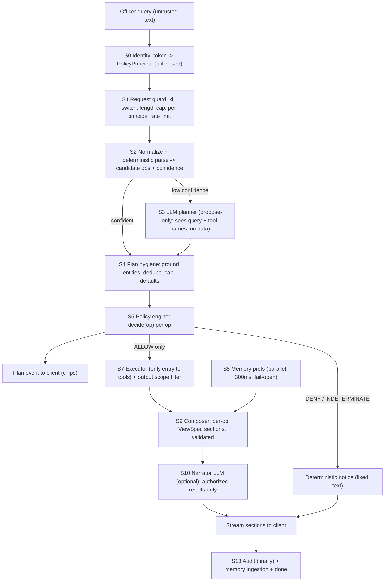

# POLICYENGINE.md

**Nirdeshak Copilot: Policy-Enforced, Multi-Intent Query Pipeline**

| | |
|---|---|
| Status | Implementation plan, ready to build |
| Version | 1.0 |
| Date | 28 October 2026 |
| Basis | `COPILOT_CODE_SUMMARY.md` (read-only code audit). All `file:line` references come from that audit. Items marked **VERIFY** could not be confirmed from it and must be checked in the repo before coding. |
| Scope | `backend/src/eureka/copilot/`, ORM additions in `backend/src/eureka/models/`, `frontend/MCC/src/app/api/v1/copilot/`, `frontend/MCC/src/components/copilot/` |
| Hard constraints | **No dependency changes.** FastAPI, Pydantic, SQLAlchemy, Mem0, Qdrant, Thesys (C1 and embeddings), Google AI Studio (Gemma), Next.js and ECharts stay exactly as they are. Mem0 and Qdrant are consumed, never reconfigured or replaced. |
| Supersedes | Where this document disagrees with `COPILOT_DEEP_DIVE.md`, this document follows the code. The deep dive described behaviour the code does not have (for example Nashik is `MH-21` in code, not `MH-15`). |

---

## 0. TL;DR

**Why "crisis and sentiment analysis of Dhule" returns only one thing.** The router (`intent_router.py`) is a first-match-wins chain that returns a single `(tool, args, result)` tuple. "Crisis" and "sentiment" are not in any trigger list, so the query falls through to the "any district mentioned means district profile" rule. Everything else in the sentence is silently dropped. Even if several tools ran, the fallback view renders only `tools_called_names[0]`.

**Why role blocking "isn't proper".** Authorization is mostly sound inside `tools.py`, but the system around it undermines it:

- Next.js turns any 401 into an admin token.
- It maps `director_konkan` to "DG State Admin".
- The backend has no Division Head role at all.
- Role checks are substring matches.
- One tool leaks statewide rumors.
- Denials are fed to the LLM as data.

**The fix, in one paragraph.** Split the copilot into a pipeline of small, separately testable stages:

1. Deterministically parse the query into a list of typed operations (intents × entities).
2. Authorize each operation independently with an in-process policy engine.
3. Execute only the allowed operations through a single executor that accepts nothing else.
4. Compose the response from per-operation views, built by code rather than by an LLM.
5. Let an LLM (optionally) write short prose about the **authorized results only**.
6. Append deterministic "not available" notices for the rest.

Denied operations never reach an LLM, because the LLM stages are fed from the executor's output and nowhere else.

**What does not change:** dependencies, Mem0, Qdrant, Gemma, Thesys C1, the OpenUI component set, the 10 tool functions (they gain a policy check and an honest data-quality tag, not a rewrite).

---

## 1. Goals, non-goals, constraints

### 1.1 Goals

| ID | Goal |
|---|---|
| G1 | A single query containing several requests ("crisis and sentiment of Dhule", "compare Nashik and Thane and show rumors") is decomposed into several operations, and every permitted one is executed. |
| G2 | Each operation is authorized independently. Allowed operations run, denied ones are reported, and the rest of the answer is unaffected. |
| G3 | **Data belonging to a denied operation never enters any LLM prompt**, and the LLM never decides, narrates or elaborates on a denial. |
| G4 | Authorization has one source of truth (`policy/`), enforced at the executor, again inside the tools, and again on the output. |
| G5 | The system fails closed on any identity, policy or scope uncertainty. |
| G6 | The officer can always see how the query was interpreted (plan chips), so a dropped intent is visible instead of silent. |
| G7 | Synthetic, heuristic or seed data is never presented as live. |

### 1.2 Non-goals

- Replacing Mem0, Qdrant, Gemma, Thesys C1, ECharts or the JWT scheme.
- Adding Redis, Celery, OPA, Cedar, Casbin, YAML loaders or any other package.
- Row-Level Security (the copilot tools are aggregate-level; see §13 for the optional privilege split instead).
- Multi-turn conversation memory. Every request stays stateless, as today. Follow-ups are a later phase; the secure design is sketched in Appendix E so v1 does not paint it into a corner.
- Fixing the data sources behind `trend`, `forecast` and `active_rumors`. This plan only makes their quality **visible and gateable** (§7.4).

### 1.3 Design invariants (must hold after every phase)

1. Identity (role, district, division) comes only from a verified token. Never from query text, memory, an LLM or a browser-readable cookie.
2. A tool function is called only by `execution/executor.py`, and only with an `AuthorizedOp`.
3. Denied operations produce no tool call, no LLM input and no result data. Only a fixed-text notice.
4. `INDETERMINATE` (policy error, unresolved role, missing assignment) is treated as `DENY`.
5. Every district named in any output is a member of the authorized scope, or is a district the officer typed themselves in a notice.
6. Memory can influence presentation only. It cannot expand scope, supply entities or supply facts.
7. Every non-live data source is labelled in the response and in the audit record.

---

## 2. Ground truth: what is broken today

### 2.1 Why multi-intent queries fail (traced from the audit)

| # | Root cause | Evidence |
|---|---|---|
| R1 | First-match-wins; the router both parses **and executes**, returning one tuple | `match_fast_path`, `intent_router.py:30-128`; every block ends in `return` |
| R2 | Lexicon gaps | "crisis", "sentiment", "trend", "संकट", "भावना" appear in no trigger list. "crisis" is only in a code comment (`:76-80`) |
| R3 | "Any district mentioned means profile" pre-empts everything after it | Block 5, `:107-113`. "trend of Dhule" and "profile of Pune division" both become `district_profile` |
| R4 | `" and "` is used as a compare trigger | `:44`. Any sentence with "and" enters the compare block |
| R5 | No multi-operation representation anywhere downstream | `router.py:431-432` uses `tools_called_names[0]` and `executed_tools_data[0]` only |
| R6 | 4 of 10 tools are unreachable from the fast path (`trend`, `pillar_breakdown`, `division_rollup`, `dossier_summary`) | `intent_router.py` has no rule for them |
| R7 | Gazetteer gaps | Hindi "धुले" and "नासिक" are not in the alias data. No Unicode normalization. Devanagari matching is raw substring (`alias in query`). `साताऱ्यात` matches by accident, and `पोलीस ठाणे` (police station) would match Thane |

### 2.2 Why role-based blocking is unreliable

| # | Problem | Location |
|---|---|---|
| A1 | Any backend 401 makes Next.js re-mint a token as **"DG State Admin"** | `route.ts:802-815` |
| A2 | `director_konkan` is silently mapped to "DG State Admin" | `route.ts:15-20` |
| A3 | `UserRole` has no Division Head. `principal.division` is never populated, so division logic in `tools.py` is dead or unsafe | `models/enums.py:61-66`, `router.py:113-117` |
| A4 | Role checks are substring matches (`"admin" in role`, `"dio" in role`, `principal.division` truthiness as a fallthrough) | `tools.py:150-176` |
| A5 | `tool_active_rumors` with no district returns all 36 districts for a Division Head | `tools.py:375-384` |
| A6 | The offline synthesizer applies no RBAC and labels mock data `source_status: "live"`, `fallback: false` | `route.ts:871-878` |
| A7 | `PERMISSION_DENIED` payloads (including role and assigned district) are fed back to the LLM, and the system prompt tells the model to narrate them | `router.py:239-334`, `openui_generator.py` rule 6 |
| A8 | The fast path never calls the Gemma client, so the per-user rate limiter (inside `gemma_client.py`) never applies to it | `gemma_client.py:72-93` |
| A9 | Cookie mapping bug: Thane maps to `MH-03` (Palghar) | `route.ts:85-86` |
| A10 | Hard-coded development fallback secret in both services, and the env var names differ (`FASTAPI_JWT_SECRET` vs `JWT_SECRET_KEY`) | `route.ts:12,22-32`, `core/config.py:90` |
| A11 | Audit write is skipped on client disconnect. Denials are logged as `success` in the LLM loop | `router.py:480-500`, `:281` |
| A12 | `DELETE /memory/{id}` does not check ownership | `memory.py:258-261` |
| A13 | `copilot_feedback.run_id` is accepted without checking it belongs to the caller (**VERIFY**) | `router.py` feedback endpoint |

### 2.3 Data and output honesty problems

| # | Problem | Location |
|---|---|---|
| H1 | `tool_trend` fabricates points with `random.Random(code)` | `tools.py:318-326` |
| H2 | `tool_forecast` returns a hard-coded constant dict | `tools.py:417-425` |
| H3 | `tool_active_rumors` reads an in-memory list from `hermes_router`, not PostgreSQL | `tools.py` / `hermes_router.py` |
| H4 | `ADJACENCY_MAP` covers 8 of 36 districts; the rest fall back to a fixed pair | `tools.py:448-457` |
| H5 | Silent CSV-seed fallback when the DB is down | `tools.py` (`_query_36_districts_from_csv`) |
| H6 | Number grounder scans only `value=` and `delta=`. Prose, `Callout`, `Text`, `Heading` and table cells are unchecked | `openui_generator.py:168-183` |
| H7 | Per-attribute cap of 600 characters rejects legitimate data attributes, and the attribute regex mis-parses JSON containing quotes | `openui_generator.py:67-71` |
| H8 | Deterministic (ViewSpec) output is never validated | `router.py:184-188`, `:434-436` |
| H9 | Preferences are not applied to ViewSpec output; `NUMERIC_STAT_PATTERN` is defined in `memory.py` but never used by `is_allowed_preference` | `router.py:150`, `memory.py` |
| H10 | `compare_districts`, `forecast`, `neighbors`, `dossier_summary` have no ViewSpec builder; they render as a generic key-value table | `viewspec.py:249-449` |

### 2.4 Stop-ship list (Phase 0, independent of the rest)

A1, A2, A9, A10 (Next.js identity); A5 (rumors leak); A12 (memory IDOR); A6 and the mislabelled offline fallback; A11 (audit in `finally`). Details in §10 and §15.

---

## 3. Target architecture



### 3.1 What each stage may see

| Stage | Sees query text | Sees tool results | May call an LLM | Can change authorization |
|---|---|---|---|---|
| S2 parser | Yes | No | No | No |
| S3 LLM planner | Yes (wrapped as data) | **No** | Yes (propose-only) | No |
| S5 policy | Parsed ops only | No | No | It *is* authorization |
| S7 executor | Authorized ops only | Produces them | No | No |
| S9 composer | No | Authorized only | No | No |
| S10 narrator | No | **Authorized only** | Yes | No |
| Notices | Op labels | No | No | No |

The planner is the only LLM stage that sees the user's raw text, and it never sees data. The narrator is the only LLM stage that sees data, and it never sees denied operations or the raw query.

### 3.2 Defence in depth (all six must exist)

1. **Principal validation** (S0): inconsistent identity means HTTP 403.
2. **Policy decision** (S5): per operation, with reason codes.
3. **Capability gate** (S7): the executor accepts only `AuthorizedOp`; an architecture test enforces that nothing else imports the tool callables.
4. **Tool self-check**: `tools.py` keeps calling `verify_district_authorization`, which now delegates to the policy engine (one source of truth, two enforcement points).
5. **Output scope filter**: after every tool call, remove any record whose district is outside the scope, and fail closed if the structure is unrecognised.
6. **Output checks**: the narrator validator and markup scanner confirm that every district name and number in output is authorized and grounded.

---

## 4. Target folder structure

Legend: **[NEW]**, **[MOD]**, **[MOD-small]**, **[SHIM]** (kept thin, deleted after migration), **[=]** unchanged.

### 4.1 Backend

```
backend/src/eureka/copilot/
├── __init__.py              [=]
├── config.py                [MOD]  new settings (§12); wire unused ones
├── router.py                [MOD]  thin orchestrator for pipeline v2; v1 loop kept behind flag until cutover
├── tools.py                 [MOD]  catalog unchanged; authz delegates to policy; rumors leak fixed; role matching removed
├── intent_router.py         [SHIM] match_fast_path() becomes a wrapper over planning.parser; deleted after tests migrate
├── gemma_client.py          [MOD-small] honour COPILOT_TIMEOUT_SECONDS; report effective model id
├── c1_client.py             [=]
├── openui_generator.py      [MOD]  validator hardening (§8.5); planner/narrator prompt builders; delete dead OpenUIPipeline
├── viewspec.py              [MOD]  builders for compare/forecast/neighbors/dossier; build_from_ops(); section helpers
├── memory.py                [MOD-small] ownership check; tighter preference filter. Mem0/Qdrant config untouched
├── audit.py                 [MOD]  finally-safe recording; op-level rows
│
├── policy/                  [NEW]  the only place authorization is decided
│   ├── __init__.py
│   ├── roles.py             Role enum; exact-match mapping from UserRole (no substrings)
│   ├── principal.py         PolicyPrincipal, build_principal(), PrincipalError
│   ├── matrix.py            Intent, ScopeKind, RULES (role x intent -> scope), allowed_districts()
│   ├── decisions.py         Verdict, Reason, Decision, Scope, AuthorizedOp (sealed), POLICY_VERSION
│   ├── engine.py            decide(), authorize_plan()
│   ├── scope_filter.py      filter_result(tool, result, scope): output enforcement, fail closed
│   └── memory_gate.py       the only wrapper the router uses to touch memory
│
├── planning/                [NEW]  turns text into candidate operations; never executes
│   ├── __init__.py
│   ├── normalize.py         NFC, zero-width strip, digit folding, Devanagari phonetic folding, tokenizer
│   ├── gazetteer.py         district/division entity resolution, suffix handling, homonym guards
│   ├── lexicon.py           multilingual intent triggers (en / mr / hi / romanized), stopwords
│   ├── ontology.py          topic -> tool templates (e.g. crisis -> rumors + pillar(crisis_sla))
│   ├── plan.py              Op, Plan, ParsedQuery; dedupe, cap, ordering
│   ├── parser.py            parse_query() -> ParsedQuery (pure function)
│   └── llm_planner.py       propose-only planner on top of existing Gemma function declarations
│
├── execution/               [NEW]
│   ├── __init__.py
│   ├── executor.py          the ONLY caller of tool functions; concurrency, timeouts, request-scoped memo
│   └── results.py           OpResult envelope (data_quality, as_of, result_hash)
│
└── response/                [NEW]
    ├── __init__.py
    ├── composer.py          OpResults -> ordered sections of validated OpenUI markup
    ├── narrator.py          optional LLM prose lane + narrative validator
    ├── notices.py           fixed en/mr/hi texts for denials, clarifications, data-quality banners
    ├── prefs.py             retrieved preference strings -> PresentationPrefs (chart type, language, verbosity)
    └── markup_scan.py       real tag/attribute scanner used by the validators
```

### 4.2 Backend tests

```
backend/tests/
├── (existing test_*.py files)       [=] kept; see §14.5 for which are adapted
├── test_policy_matrix.py            [NEW]
├── test_policy_engine.py            [NEW]
├── test_policy_failclosed.py        [NEW]
├── test_gazetteer.py                [NEW]
├── test_parser_multi_intent.py      [NEW]
├── test_llm_planner_grounding.py    [NEW]
├── test_executor.py                 [NEW]
├── test_composer.py                 [NEW]
├── test_narrator_validation.py      [NEW]
├── test_markup_scan_validator.py    [NEW]
├── test_prompt_leak.py              [NEW]
├── test_architecture_boundaries.py  [NEW]
├── test_audit_ops.py                [NEW]
├── test_memory_gate.py              [NEW]
├── test_sse_protocol.py             [NEW]
└── data/copilot_golden_queries.jsonl [NEW]
```

### 4.3 Frontend

```
frontend/MCC/src/app/api/v1/copilot/[...path]/
├── route.ts       [MOD]  thin handler: auth -> proxy (or guarded offline)
├── auth.ts        [NEW]  resolve identity from a VERIFIED session, mint backend token, fail closed
├── proxy.ts       [NEW]  SSE pass-through (no buffering)
└── offline.ts     [MOD]  synthesizeCopilotQuery moved here; disabled unless demo mode; honest labels

frontend/MCC/src/components/copilot/
├── CopilotDrawer.tsx   [MOD]  handles `plan` event and ordered `section_id` chunks
├── PlanChips.tsx       [NEW]  "Dhule · Sentiment ✓ / Jalgaon · Rumors ✗ not available"
├── markup.ts           [NEW]  parseMarkupAttributes extracted + schema check (defence in depth)
└── OpenUILibrary.tsx   [=]    (no change required)
```

---

## 5. Policy engine specification (`policy/`)

### 5.1 Roles

The backend currently knows three roles (`UserRole`: DG State Admin, District Collector, DIO Desk). Next.js also names a fourth (`director_konkan`), which today is silently promoted. The policy engine defines four roles and **matches them exactly**, never by substring.

```python
# policy/roles.py
class Role(str, Enum):
    STATE_ADMIN        = "STATE_ADMIN"
    DIVISION_HEAD      = "DIVISION_HEAD"
    DISTRICT_COLLECTOR = "DISTRICT_COLLECTOR"
    DIO_DESK           = "DIO_DESK"

_FROM_USERROLE = {
    "DG State Admin":     Role.STATE_ADMIN,
    "Division Head":      Role.DIVISION_HEAD,        # needs UserRole.DIVISION_HEAD, see §10.3
    "District Collector": Role.DISTRICT_COLLECTOR,
    "DIO Desk":           Role.DIO_DESK,
}

def to_role(raw: str) -> Role | None:
    return _FROM_USERROLE.get(raw)       # exact match; unknown -> None -> caller fails closed
```

`Cabinet Observer` and `State Director` appear in the current substring list but exist nowhere else. They are **not** carried over. They are an extension point (add a `Role` and a row in `RULES`), not a hidden grant.

### 5.2 Principal

```python
# policy/principal.py
@dataclass(frozen=True)
class PolicyPrincipal:
    username: str
    role: Role
    district_code: str | None      # required for COLLECTOR / DIO
    division: str | None           # derived (district roles) or signed claim (DIVISION_HEAD)

class PrincipalError(Exception): ...

def build_principal(token: TokenData, *, division_claim: str | None) -> PolicyPrincipal:
    """Raise PrincipalError (router returns HTTP 403, writes a security audit row) when:
       - role does not map via to_role()
       - COLLECTOR/DIO has no district_code, or district_code not in DISTRICTS
       - DIVISION_HEAD has no division claim, or claim not in the canonical division set
       For district roles, division is ALWAYS derived from district_code via DISTRICTS,
       never read from a claim. For STATE_ADMIN no district/division constraint applies."""

def to_legacy(p: PolicyPrincipal) -> CopilotPrincipal:
    """Existing tools take CopilotPrincipal. This adapter populates division, which
       router.py:113-117 currently never does."""
```

**Single source of truth for divisions.** `DIVISION_DISTRICT_MAP` in `tools.py` is replaced by a map derived from `eureka.core.reference_data.DISTRICTS` (each tuple carries `division_code`). A test asserts the two never diverge while both exist.

### 5.3 Intents and the permission matrix

Authorization is expressed over **intents**, one per tool family.

```python
# policy/matrix.py
class Intent(str, Enum):
    PROFILE = "profile"            # tool district_profile
    PILLAR = "pillar"              # tool pillar_breakdown (volume | sentiment | crisis_sla)
    TREND = "trend"                # tool trend
    COMPARE = "compare"            # tool compare_districts
    RUMORS = "rumors"              # tool active_rumors
    FORECAST = "forecast"          # tool forecast
    NEIGHBORS = "neighbors"        # tool neighbors
    LEAGUE = "league"              # tool league_table
    DIVISION_ROLLUP = "division_rollup"
    DOSSIER = "dossier"            # tool dossier_summary

class ScopeKind(str, Enum):
    NONE = "none"                  # not permitted
    OWN_DISTRICT = "own_district"
    OWN_DIVISION = "own_division"
    STATEWIDE = "statewide"
```

**Default matrix.** Rows are roles and cells are the widest scope the role may use for that intent. This reproduces today's intended behaviour and closes its holes. Every cell that differs from "current code" is marked.

| Intent | STATE_ADMIN | DIVISION_HEAD | DISTRICT_COLLECTOR | DIO_DESK |
|---|---|---|---|---|
| profile | statewide | own_division | own_district | own_district |
| pillar | statewide | own_division | own_district | own_district |
| trend | statewide | own_division | own_district | own_district |
| compare | statewide | own_division | own_district (needs ≥2 districts, so effectively unavailable, see D4) | same as collector |
| rumors | statewide | own_division (**fixes A5**) | own_district | own_district |
| forecast | statewide | own_division | own_district | own_district |
| neighbors | statewide | own_division | own_district | own_district |
| league | statewide | own_division | own_district (returns own row only, same as today) | same |
| division_rollup | statewide | own_division | **none** | **none** |
| dossier | statewide | own_division | own_district | own_district |

`allowed_districts(principal, scope_kind)` returns a `frozenset[str]` of district codes:

- `STATEWIDE` returns all 36.
- `OWN_DIVISION` returns the districts of `principal.division`.
- `OWN_DISTRICT` returns `{principal.district_code}`.
- `NONE` returns the empty set.

**Cross-district visibility** (peers, same-division benchmarks, own-rank) is deliberately **off** by default and controlled by `COPILOT_PEER_VISIBILITY` (see D1, D2). Turning it on is a one-line matrix change, not an architecture change.

### 5.4 Decision model

```python
# policy/decisions.py
class Verdict(str, Enum):
    ALLOW = "ALLOW"
    DENY = "DENY"
    INDETERMINATE = "INDETERMINATE"      # treated exactly like DENY at execution

class Reason(str, Enum):
    OK = "OK"
    ROLE_NOT_PERMITTED = "ROLE_NOT_PERMITTED"
    DISTRICT_OUT_OF_SCOPE = "DISTRICT_OUT_OF_SCOPE"
    DEPENDENCY_DENIED = "DEPENDENCY_DENIED"
    UNKNOWN_ENTITY = "UNKNOWN_ENTITY"
    UNGROUNDED_ENTITY = "UNGROUNDED_ENTITY"        # LLM-proposed district not present in the query
    SOURCE_NOT_AVAILABLE = "SOURCE_NOT_AVAILABLE"  # synthetic/heuristic tool outside demo mode
    LIMIT_EXCEEDED = "LIMIT_EXCEEDED"              # more than COPILOT_MAX_OPS
    POLICY_ERROR = "POLICY_ERROR"                  # engine raised -> INDETERMINATE

@dataclass(frozen=True)
class Scope:
    districts: frozenset[str]            # always explicit; never "everything" by omission

@dataclass(frozen=True)
class Decision:
    op_id: str
    verdict: Verdict
    reason: Reason
    scope: Scope | None
    policy_version: str                  # e.g. "2026.10.1", bumped on any matrix/rule change
    decision_id: str                     # uuid4, written to the audit table

_SEAL = object()                         # module-private; only engine.py imports it

@dataclass(frozen=True)
class AuthorizedOp:
    op: "Op"
    scope: Scope
    decision_id: str
    policy_version: str
    _seal: object = field(default=None, repr=False, compare=False)
    def __post_init__(self):
        if self._seal is not _SEAL:
            raise PermissionError("AuthorizedOp can only be created by the policy engine")
```

> **Honesty note.** `_SEAL` stops accidental bypass; it is not a defence against malicious code in the same process (Python cannot offer that). The real controls are the architecture test (§14.4), the tool self-checks and the output scope filter.

### 5.5 Decision procedure

```python
# policy/engine.py
POLICY_VERSION = "2026.10.1"

def decide(p: PolicyPrincipal, op: Op, ctx: PlanContext, settings) -> Decision:
    try:
        kind = RULES[p.role].get(op.intent, ScopeKind.NONE)
        if kind is ScopeKind.NONE:
            return deny(op, Reason.ROLE_NOT_PERMITTED)

        allowed = allowed_districts(p, kind)
        requested = frozenset(op.districts) or default_districts(p, op.intent, kind)

        if not requested or not requested <= allowed:
            return deny(op, Reason.DISTRICT_OUT_OF_SCOPE)        # whole op denied; never silently trimmed
        if any(ctx.verdict(dep) is not Verdict.ALLOW for dep in op.depends_on):
            return deny(op, Reason.DEPENDENCY_DENIED)
        if not source_available(op.tool, settings):             # trend/forecast outside demo mode
            return deny(op, Reason.SOURCE_NOT_AVAILABLE)

        return allow(op, Scope(requested))
    except Exception:                                           # any bug -> fail closed
        log.exception("policy.error")
        return indeterminate(op, Reason.POLICY_ERROR)

def authorize_plan(p, plan, settings) -> PlanDecision:
    """Evaluate ops in dependency order. Enforce COPILOT_MAX_OPS first (excess ops get
       LIMIT_EXCEEDED). Return (allowed: list[AuthorizedOp], denied: list[Decision])."""
```

Rules that matter:

- **A multi-district operation is all-or-nothing.** `compare(Nashik, Thane)` for a Nashik collector is denied as a whole. The engine never drops Thane and returns a "comparison" of one district.
- **Derived operations inherit denial.** An operation with `depends_on` is denied if any input is not `ALLOW`.
- **Default scope.** An op with no explicit district gets `default_districts()`:
  - Collector/DIO: their own district. The chip shows "(your district)".
  - Division Head: own division for `rumors` and `league`.
  - Admin: statewide for `rumors` and `league`.
  - Everything else without a district: the parser emits a clarification (not an op).
- **A "none" cell is a hard deny**, even if the district is the officer's own (for example `division_rollup` for a collector).

### 5.6 Output scope filter

```python
# policy/scope_filter.py
def filter_result(tool: str, result: dict, scope: Scope) -> dict:
    """Remove every record whose district_code is not in scope.
       Knows the record paths of each tool (league_table.districts[], compare.districts[],
       active_rumors.tickets[], division_rollup.districts[], neighbors.nodes[]...).
       UNKNOWN structure -> raise ScopeFilterError -> executor marks the op failed
       (fail closed; never pass through unfiltered)."""
```

This is what makes the `rumors`-without-district call safe even if a future tool bug forgets to scope. Each removal increments a counter `scope_filter_removed_total`. That number must be zero in normal operation, so any non-zero value is an alert (§11.3).

### 5.7 What happens to existing authorization code

| Existing | Change |
|---|---|
| `verify_district_authorization()` | Keeps its signature `(principal, district_code) -> Optional[str]`. Body becomes: build the scope for the tool's intent via `policy.matrix`, return the refusal string if not in `allowed_districts`. Substring role matching is deleted. |
| `DIVISION_DISTRICT_MAP` | Derived from `DISTRICTS`; temporary equality test. |
| `tool_active_rumors` | `district_code=None` resolves through `default_districts()`; Division Head no longer returns statewide. |
| `PERMISSION_DENIED` payloads | Still produced by tools as a last line, but any occurrence at execution time is logged as `policy.drift` (the engine should have denied first). They are never sent to an LLM. |

---

## 6. Query decomposition (`planning/`)

### 6.1 Contract

```python
# planning/plan.py
class Op(BaseModel):
    model_config = ConfigDict(extra="forbid", frozen=True)
    op_id: str                                   # "o1".."o6"
    intent: Intent
    tool: Literal["league_table","district_profile","pillar_breakdown","trend",
                  "compare_districts","active_rumors","forecast","neighbors",
                  "division_rollup","dossier_summary"]
    args: dict[str, Any]                         # validated later by the tool's own Pydantic arg model
    districts: tuple[str, ...]                   # normalized MH-XX codes, never raw text
    group: str                                   # composition group, e.g. "MH-23:crisis"
    label: str                                   # chip text key, e.g. ("MH-23","crisis")
    depends_on: tuple[str, ...] = ()
    defaulted_scope: bool = False                # true when the district came from the principal
    source: Literal["parser", "llm"] = "parser"

class ParsedQuery(BaseModel):
    ops: tuple[Op, ...]
    confidence: float                            # 0..1, see 6.6
    residual_tokens: tuple[str, ...]             # words no rule explained
    clarifications: tuple[str, ...] = ()         # e.g. ("compare_needs_two_districts",)
```

`parse_query(text, principal) -> ParsedQuery` is a **pure function**. It makes no tool call, no DB call and no LLM call, so it is trivially unit-testable and replaces `match_fast_path`.

### 6.2 Normalization (`normalize.py`)

Applied to the query and to every gazetteer alias, so both sides compare identically:

1. Unicode **NFC**; remove zero-width characters (ZWJ, ZWNJ, BOM).
2. Lowercase ASCII; collapse whitespace; map Devanagari and Arabic-Indic digits to ASCII (reuse `normalize_numerals_and_text`).
3. **Phonetic folding of Devanagari** for matching only (the original text is kept for display). Starter table, to be extended by the golden tests:

| Fold | Why |
|---|---|
| `ळ → ल` | धुळे / धुले (Marathi vs Hindi spelling) |
| `श, ष → स` | नाशिक / नासिक |
| `ण → न`, `ऩ → न` | ठाणे / ठाने |
| `ऱ → र` | साताऱ्यात / सातारा |
| `ी → ि`, `ू → ु` | vowel length variants |
| `ँ → ं`; drop nukta `़` | chandrabindu/anusvara and nukta variants |

4. Tokenize on whitespace and punctuation. Devanagari tokens are **whole tokens**, not substrings.

### 6.3 Gazetteer (`gazetteer.py`)

Built once at import from `DISTRICTS` + `DISTRICT_ALIASES` (reuse the existing data) plus `EXTRA_ALIASES` kept in this file (no edit to `reference_data.py`):

- English and Marathi names, former names, romanizations: Nasik, Poona, Bombay, Aurangabad / Sambhajinagar, Osmanabad / Dharashiv, Ahmednagar / Ahilyanagar, and similar.
- Hindi spellings (धुले, नासिक, अहमदनगर, छत्रपति संभाजीनगर), generated through the same fold.
- Division names (English/Marathi/Hindi) as a **separate entity type**, so "Pune division" never resolves to the district Pune (fixes the profile pre-emption defect).

Matching rules:

- ASCII: word-boundary match on folded lowercase text.
- Devanagari: token equals the folded alias, **or** the token is the alias stem plus a known Marathi/Hindi suffix (`ात`, `्यात`, `्याचा/ची/चे`, `्याला`, `मध्ये`, `तील`, `च्या`, `ला`, `ना`, `चा/ची/चे`). `साताऱ्यात` resolves to Satara; `ठाणेदार` does **not** resolve to Thane.
- **Homonym guards.** `ठाणे` also means "police station". A match preceded by `पोलीस` / `पोलिस` / `police` is ignored. The guard table is data, so more can be added: `{alias: {blocking_previous_tokens}}`.
- Explicit `MH-04`, `MH04`, `mh 4` forms resolve directly.
- Possessives: "my district", "माझा/आमचा जिल्हा", "मेरा जिला" resolve to the principal's district, with `defaulted_scope=True`. Never to anything else.
- Longest alias wins; overlapping spans are consumed once.

Output: `EntityMatch(code | division, span, kind)` list in order of appearance.

### 6.4 Lexicon (`lexicon.py`)

Multi-label: **every** matching topic is returned, with the spans it consumed. Triggers are whole tokens or phrases on folded text, not substrings (no more `"sla"` matching inside `"slab"`). Samples (full lists live in the file and are extended from the golden set):

| Topic | English | Marathi | Hindi | Romanized |
|---|---|---|---|---|
| crisis | crisis, emergency, disaster, crisis sla, sla | संकट, आपत्ती, आपत्कालीन | संकट, आपातकाल | sankat, aapatti |
| sentiment | sentiment, mood, opinion, public mood | भावना, जनभावना, जनमत | भावना, जनभावना | bhavna |
| volume | volume, news count, releases, coverage | प्रसिद्धी, बातम्यांची संख्या | प्रसिद्धि, समाचार संख्या | |
| rumors | rumor/rumour, fake news, fact check | अफवा, खोट्या बातम्या, फॅक्ट चेक | अफवाह, अफवाहें, फेक न्यूज़ | afwa |
| trend | trend, over time, history, last N days | कल (only next to a metric word), ट्रेंड | रुझान, ट्रेंड | |
| forecast | forecast, predict, outlook | अंदाज, भविष्यवाणी | पूर्वानुमान | |
| neighbors | neighbor(s), neighbouring, adjacent, border | शेजारी, शेजारील, सीमा (guarded) | पड़ोसी | |
| compare | compare, comparison, versus, vs, against | तुलना, मुकाबला | तुलना, मुकाबला | |
| league | leaderboard, league, rank, ranking, top N, bottom N | क्रमवारी, रँकिंग, सर्वोत्तम | रैंकिंग, सर्वश्रेष्ठ | |
| dossier | dossier, briefing, full report | सविस्तर अहवाल | विस्तृत रिपोर्ट | |
| profile (generic) | profile, performance, overview, analysis, summary | माहिती, कामगिरी, विश्लेषण | जानकारी, प्रदर्शन | |

Rules that fix the observed bugs:

- **`and` / `आणि` / `और` / `व` are conjunctions, never compare triggers.** Compare requires an explicit compare word, or "A vs B".
- **Generic topics (profile) are suppressed whenever a specific topic is present.** "crisis and sentiment analysis of Dhule" produces no extra `profile` op.
- Stopwords are removed before computing confidence (`of`, `the`, `show`, `me`, `आणि`, `दाखवा`, `करा`, `का`...).

### 6.5 Ontology (`ontology.py`): topics expand to operations

A user topic is not the same as a tool. The ontology maps each topic to one or more ops:

| Topic | Expands to | Notes |
|---|---|---|
| crisis | `rumors(d)` + `pillar(d, "crisis_sla")` | Resolves the "what does crisis mean" ambiguity: rumor tickets plus the crisis-SLA pillar (default D9; confirm) |
| sentiment | `pillar(d, "sentiment")` | If a time window or trend word is also present: `trend(d, "sentiment", days)` |
| volume | `pillar(d, "volume")` | |
| rumors | `rumors(d)` | |
| trend | `trend(d, metric, days)` | Metric from a co-occurring topic (default `composite_index`). `days` from "last 30 days" / "३० दिवस" / "पिछले 30 दिन" / "last week"=7 / "last month"=30; clamped 1..90 |
| forecast | `forecast(d)` | |
| neighbors | `neighbors(d, max_hops)` | 1 hop unless "2 hops" / "second-degree" |
| compare | `compare(d1..dn)` | n from 2 to 5. One entity means a clarification, never an op |
| league | `league(view)` | `view` from pie/donut/bar/table words |
| dossier | `dossier(d)` | |
| profile (generic) | `profile(d)` | Only when no specific topic matched |
| division topic | `division_rollup(div)` | Only when a **division** entity is present |

**Binding rule.** Topics are applied *distributively* across the district entities (every entity × every non-compare topic), and `compare` consumes all entities. Identical `(tool, args)` pairs are deduplicated. `group` ties ops that belong to one topic so they render as one section ("Dhule · Crisis" = rumors + crisis-SLA pillar).

### 6.6 Confidence and routing

```
coverage   = chars of tokens explained (entities + lexicon + stopwords + numbers) / chars of all tokens
confidence = coverage, capped at 0.5 when no op was produced, and
             reduced by 0.2 per unresolved clarification
```

| Condition | Route |
|---|---|
| `ops` non-empty and `confidence >= 0.7` | Use parser plan (no LLM, no extra latency) |
| otherwise and `COPILOT_PLANNER_MODE = parser_then_llm` and Gemma key present | Call the LLM planner (§6.7) |
| otherwise | Use the parser plan if non-empty, tagged "partial" (chips show what was understood); else a deterministic "I could not understand" notice with example queries |

### 6.7 LLM planner (`llm_planner.py`): propose-only

Reuses the existing `tool_declarations` (`tools.py:565-685`) and `GemmaClient.generate()`. The change is that **function calls are collected as proposals and never executed by this stage**.

- Prompt contains: tool declarations, the planner instruction, and the query wrapped in `<user_query>…</user_query>` marked as data. It contains **no tool results, no memory, no principal details**.
- Each proposed call becomes a candidate `Op` (`source="llm"`).
- **Grounding check (mandatory).** Every district code in a proposed op must correspond to a gazetteer match in the original query or equal the principal's own district (when "my district" was used). Otherwise the op is dropped with `UNGROUNDED_ENTITY`. The planner therefore cannot introduce a district the officer did not mention.
- Unknown tool names, arguments rejected by the tool's Pydantic arg model, and more than `COPILOT_MAX_OPS` ops are dropped.
- Failure, timeout or open circuit breaker means falling back to the parser plan. The planner is never a hard dependency.
- One call, no loop. The old 4-turn function-calling loop is removed once v2 reaches parity.

### 6.8 Worked examples (expected parser output)

Codes follow the audit (`Nashik = MH-21`, `Dhule = MH-23`, `Thane = MH-04`); confirm against `reference_data.py`.

| Query | Expected ops |
|---|---|
| crisis and sentiment analysis of dhule | `rumors(MH-23)`, `pillar(MH-23, crisis_sla)`, `pillar(MH-23, sentiment)` |
| compare nashik and thane and show rumors | `compare(MH-21, MH-04)`, `rumors(MH-21)`, `rumors(MH-04)` |
| sentiment trend of dhule last 30 days | `trend(MH-23, sentiment, 30)` |
| profile of pune division | `division_rollup(Pune)` (division entity; **not** district Pune) |
| धुळे संकट आणि भावना विश्लेषण | same three ops as the first row |
| धुले संकट और भावना विश्लेषण | same three ops (Hindi spelling resolved by folding) |
| नासिक और ठाणे की तुलना करें और अफवाहें दिखाएं | `compare(MH-21, MH-04)`, `rumors(MH-21)`, `rumors(MH-04)` |
| पोलीस ठाणे मध्ये अफवा | `rumors(<default scope>)` and **no Thane entity** (homonym guard) |
| compare nashik | clarification `compare_needs_two_districts`, no op |
| crisis and sentiment (collector of Nashik) | the same three ops with `MH-21`, `defaulted_scope=True` |
| top 5 districts as a pie | `league(view="pie")` |

---

## 7. Execution (`execution/`)

### 7.1 The executor is the only door to the tools

```python
# execution/executor.py
async def execute(authorized: list[AuthorizedOp], principal: PolicyPrincipal,
                  settings, req_ctx: RequestContext) -> list[OpResult]:
    sem = asyncio.Semaphore(4)

    async def run(a: AuthorizedOp) -> OpResult:
        async with sem:
            t0 = time.monotonic()
            arg_model, fn = COPILOT_TOOLS_MAP[a.op.tool]          # imported ONLY here
            try:
                args = arg_model(**a.op.args)                      # tool's own Pydantic validation
                raw = await asyncio.wait_for(
                    asyncio.to_thread(fn, to_legacy(principal), args),
                    timeout=settings.COPILOT_TOOL_TIMEOUT_SECONDS)
                if isinstance(raw, dict) and raw.get("error") == "PERMISSION_DENIED":
                    log.error("policy.drift", extra={"op": a.op.op_id, "tool": a.op.tool})
                    return OpResult.failed(a, "policy_drift", t0)  # engine should have denied first
                scoped = filter_result(a.op.tool, raw, a.scope)    # output enforcement (§5.6)
                return OpResult.ok(a, scoped, t0)
            except asyncio.TimeoutError:
                return OpResult.failed(a, "timeout", t0)
            except Exception as e:                                 # incl. ScopeFilterError
                return OpResult.failed(a, type(e).__name__, t0)

    return list(await asyncio.gather(*(run(a) for a in authorized)))   # run() never raises
```

Rules:

- **Only `AuthorizedOp` is accepted.** The type is sealed (§5.4).
- **Concurrency.** Today the tools are synchronous and run on the event loop thread (`router.py` audit note), so "parallel" tool calls are actually serial and block other requests. `asyncio.to_thread` fixes both. **VERIFY** before enabling: that each tool call opens its own SQLAlchemy session (no shared session across threads). If the tools share one, keep `to_thread` but set the semaphore to 1.
- **Per-request memo.** Several tools call `tool_query_all_36_districts(include_metrics=True)`, which runs a raw aggregation over `media_events`. A three-op plan would run it three times. The executor wraps that function with a memo keyed by its arguments, valid for **one request only** (principal-independent data, filtered afterwards). No cross-request cache in v1, so no cache-key authorization problem.
- **Failure isolation.** One failed op never fails the others. The composer renders a per-section "temporarily unavailable" notice.
- **No LLM is called here.**

### 7.2 Result envelope

```python
# execution/results.py
class OpResult(BaseModel):
    op_id: str; group: str; tool: str; args: dict
    status: Literal["ok", "error", "timeout", "policy_drift"]
    data: Any | None                      # None unless status == "ok"
    as_of: str | None
    source_status: str | None             # from the tool: live / demo / csv ...
    data_quality: Literal["live", "seed", "synthetic", "heuristic", "pipeline_memory", "partial"]
    duration_ms: int
    result_hash: str | None               # sha256 of canonical JSON of data (audit, not payload)
```

### 7.3 Where `data_quality` comes from

Assigned by the executor, so the ten tool functions need no edits:

| Tool | `data_quality` | Why (audit finding) |
|---|---|---|
| trend | `synthetic` | Points are generated with `random.Random(code)` (H1) |
| forecast | `heuristic` | Hard-coded constants (H2) |
| active_rumors | `pipeline_memory` | In-memory `_ACTIVE_PIPELINES`, not PostgreSQL (H3) |
| neighbors | `partial` | Adjacency map covers 8 of 36 districts (H4) |
| any tool with `source_status` in (`demo`, `csv`, `unavailable`) | `seed` | Silent CSV fallback (H5) |
| everything else | `live` | |

### 7.4 Gating non-live data

`COPILOT_DEMO_MODE` (default `False`) controls it:

| Mode | `synthetic`, `heuristic`, `seed` | `pipeline_memory`, `partial` |
|---|---|---|
| Production (`False`) | **Denied by policy** (`SOURCE_NOT_AVAILABLE`). The notice says the data source is not configured, not "access denied". | Allowed, with a visible banner |
| Demo (`True`) | Allowed, with a mandatory warning banner on every affected section | Allowed, with banner |

This is policy, not presentation. The op never executes in production, so a fabricated trend line cannot be shown as fact. (D7)

### 7.5 What the router does with the old fast path

`match_fast_path` stops executing tools. It becomes a deprecated wrapper (`parse_query` then run the first op) so existing tests keep passing during migration, and is deleted in the final cleanup.

---

## 8. Response composition (`response/`)

### 8.1 Composer

`compose(results, denied, prefs, language) -> list[Section]`. A `Section` is `{section_id, order, markup, provenance}`.

Order: `0` summary (narrator, optional), `10 + n` one section per **group** in query order, `900` notices.

Each group renders:

1. `Heading level=3` with the group label ("Dhule · Crisis").
2. A data-quality `Callout type="warning"` when `data_quality` is not `live` (§8.2 texts).
3. The ViewSpec for each op in the group (below).
4. A deterministic one-line caption per chart (used when the narrator is off or rejected).

**ViewSpec builders to add** (H10; the current generic key-value fallback is replaced for these):

| Tool | View |
|---|---|
| compare_districts | `BarChart` of `composite_index` + nested summary `Text` + `DataTable` of the three pillars and raw metrics per district |
| forecast | `KpiCard` ×2 (diffusion risk, spread velocity) + `DataTable` of contagion districts + heuristic banner |
| neighbors | `GraphView` + nested `Text` + `DataTable` of edges + `partial` banner where applicable |
| dossier_summary | Three sub-sections reusing the profile, rumors and forecast builders |
| pillar_breakdown, district_profile, league_table, trend, active_rumors, division_rollup | existing builders, unchanged |

`ViewSpecBuilder.build_from_ops(results)` replaces the `[0]`-only behaviour (R5).

**Preferences.** `PresentationPrefs` (§9.4) may change only chart variant (`bar` / `pie` / `donut` / `table`) where the tool offers a choice (`league_table`, `compare_districts`), plus language and verbosity. An explicit instruction in the current query always wins over memory.

### 8.2 Notices (`notices.py`)

Fixed strings. **No LLM ever writes these.** Have a Marathi and a Hindi reviewer approve them before release.

| Key | English | Marathi | Hindi |
|---|---|---|---|
| unavailable | Not available for your access level: {labels}. | तुमच्या प्रवेश स्तरासाठी उपलब्ध नाही: {labels}. | आपके पहुँच स्तर के लिए उपलब्ध नहीं: {labels}। |
| source_missing | Data source not configured: {labels}. | डेटा स्रोत उपलब्ध नाही: {labels}. | डेटा स्रोत उपलब्ध नहीं: {labels}। |
| clarify_compare | Which districts should I compare? Please name at least two. | तुलना करण्यासाठी किमान दोन जिल्ह्यांची नावे सांगा. | तुलना के लिए कम से कम दो जिलों के नाम बताइए। |
| synthetic | Illustrative data, not from a live source. | उदाहरणार्थ आकडेवारी, थेट स्रोतावरून नाही. | उदाहरण डेटा, लाइव स्रोत से नहीं। |
| heuristic | Estimated by a rule of thumb, not a trained model. | अंदाजे आकडेवारी, प्रशिक्षित मॉडेलवरून नाही. | अनुमानित डेटा, प्रशिक्षित मॉडल से नहीं। |
| seed | Offline reference data, not live. | ऑफलाइन संदर्भ माहिती, थेट नाही. | ऑफ़लाइन संदर्भ डेटा, लाइव नहीं। |
| unreadable | I could not work out what to look up. Try: "crisis and sentiment of Dhule". | काय शोधायचे ते समजले नाही. उदा. "धुळे संकट आणि भावना". | समझ नहीं आया। उदाहरण: "धुले संकट और भावना"। |

Policy: **one uniform wording for every denial reason** (D5). The audit table records the real reason code; the officer's screen does not distinguish "outside your district" from "role not permitted", which prevents mapping what exists.

### 8.3 SSE protocol (backwards compatible)

Existing events keep their shape. New fields and one new event:

```
event: status   {"step":"init","message":"Processing query...","language":"mr"}

event: plan
data: {"source":"parser","confidence":0.91,"policy_version":"2026.10.1",
       "groups":[
         {"id":"g1","label":"Nashik · Crisis","status":"allowed","defaulted":false},
         {"id":"g2","label":"Nashik · Sentiment","status":"allowed","defaulted":false},
         {"id":"g3","label":"Dhule · Crisis","status":"unavailable"},
         {"id":"g4","label":"Dhule · Sentiment","status":"unavailable"}]}

event: chunk    {"text":"<Heading .../>...","section_id":"g1","order":10,"provenance":"deterministic"}
event: chunk    {"text":"<Heading .../>...","section_id":"g2","order":11,"provenance":"deterministic"}
event: chunk    {"text":"<Callout type=\"info\" message=\"Not available for your access level: Dhule · Crisis, Dhule · Sentiment.\" />","section_id":"notices","order":900}
event: chunk    {"text":"...","section_id":"summary","order":0,"provenance":"narrator"}      # optional, arrives last
event: done     {... existing fields ..., "pipeline":"v2","policy_version":"2026.10.1",
                 "plan_summary":{"requested":4,"available":2,"unavailable":2},
                 "model_id": null}                    # null when no model was called (today it is always set)
```

Client rules: sort chunks by `order`; a chunk without `order` is appended (legacy); `replace:true` (C1 upgrade) still replaces everything. Group `status` is `allowed`, `partial` (some ops in the group failed or were denied), `unavailable` or `clarify`.

A group's label echoes only what the officer typed, so a chip saying "Dhule · Crisis ✗" discloses nothing new.

### 8.4 Narrator lane (`narrator.py`), optional, default off until §14 tests pass

**Input** to the LLM is built only from `OpResult`s with `status == "ok"`:

```
SYSTEM: You write short factual summaries for a government officer. You are given JSON
results for named sections. For each section write 1-2 plain-text sentences.
Rules: use only numbers that appear in that section's data; never mention a district that
is not in that section's data; do not compare sections; no rankings or superlatives unless
a rank field exists; no markup, no links; answer in {language}.
Return ONLY JSON: {"summaries":[{"section_id":"g1","text":"..."}]}
INPUT: {"sections":[{"section_id":"g1","label":"Nashik · Crisis","data":{...}}, ...]}
USER PREFERENCES (presentation only, may be wrong): {prefs}
```

The raw query is **not** included, and neither is any denied or failed section.

**Validator** (per section; failure drops only that section's prose and the deterministic caption stays):

1. Valid JSON; `section_id` ∈ the authorized set; one entry per section.
2. Plain text only: reject `<`, `>`, backticks, URLs, newlines; length ≤ 400 characters.
3. **Numbers.** Normalize numerals (reuse `normalize_numerals_and_text`). Every number must be within 0.005 of a number in **that section's** data, its `args` (for example `days=30`), or 100× a fraction in the data (0.38 → 38%). The 0.05 tolerance used today is too loose for 0–1 metrics.
4. **Districts.** Run the gazetteer over the prose. Every matched district must be in that section's scope.
5. No identifiers beyond what appears in the data (`MH-xx` codes only if present in data).

**Residual risk (be honest in release notes).** Numeric grounding cannot prove semantic correctness. The model can still attach a real number to the wrong label within one section. Mitigation: the deterministic table or chart with exact values always sits beside the prose, and the prompt forbids superlatives.

### 8.5 Validator hardening (`openui_generator.py` + `response/markup_scan.py`)

| # | Change | Fixes |
|---|---|---|
| 1 | Replace the regexes with a small scanner (state machine) that yields tags, attributes (single- or double-quoted, JSON inside), children and spans | H7 |
| 2 | Per-prop caps: text props (`title`, `message`, `content`, `text`, `caption`, `summary`, `label`) ≤ 600 characters; data props (`data`, `rows`, `columns`, `nodes`, `edges`, `categories`, `values`) ≤ 60,000 | H7 |
| 3 | Extract numbers from **every** text-bearing prop and from the parsed JSON cells of data props, not only `value=`/`delta=` | H6 |
| 4 | Tolerance 0.005 on 2-decimal rounding | loose 0.05 |
| 5 | v2 grounds each group against that group's numbers; legacy/C1 keeps the global set | cross-section coincidence |
| 6 | Chart/table consistency: every series value appears in the nested `DataTable` and the reverse | accessibility table can contradict the chart |
| 7 | Always ignore `MH-\d+` codes, ISO timestamps and the op's own `args` numbers | false positives |
| 8 | Validate deterministic output too (`COPILOT_VALIDATE_DETERMINISTIC`, default `True`). On failure: log `viewspec.invalid` at ERROR and swap that section for the generic validated key-value table | H8 |

`validate_openui_output()` keeps its signature and return type, so existing tests still run.

### 8.6 C1 and the legacy markup mode

- `COPILOT_UI_ENGINE="c1"`: after the deterministic sections stream, the existing 6-second upgrade runs with **authorized `OpResult`s only** as input and `replace: true`. Output goes through the hardened validator (global number set). Failure keeps the deterministic view. The narrator is skipped when C1 is active, because C1 writes its own text.
- The old Gemma markup-writing loop (`router.py:239-334`, system prompt rule 6) stays behind `COPILOT_PIPELINE=v1` until cutover, then is deleted.

---

## 9. Memory management (Mem0 + Qdrant unchanged)

### 9.1 What stays exactly as it is

- Mem0 in library mode (`from mem0 import Memory`), Qdrant collection `copilot_user_preferences` (1536 dims), Thesys embedder `thesys-embed`, Gemma as Mem0's extraction LLM.
- `memory.py` public API, HMAC-SHA256 pseudonymization, the allowlist idea, 300 ms fail-open retrieval, background ingestion, the three `/memory` endpoints.

The policy engine adds a **gate in front of memory** and a few small fixes **inside the wrapper**. Nothing about Mem0's or Qdrant's configuration changes.

### 9.2 Where memory sits in the v2 pipeline

| Step | Behaviour |
|---|---|
| Retrieval | Starts right after S5 (policy) as a background task. Awaited with a 300 ms cap just before composition, so it overlaps tool execution and its latency is hidden. Fail-open: on timeout or error use `PresentationPrefs.default()`. |
| Use | Parsed into `PresentationPrefs` (§9.4). Used by the composer (chart variant, language, verbosity) and appended to the narrator prompt as presentation-only text. **Never** given to the planner, the parser or the policy engine. |
| Ingestion | After `done`, in the background, from the **user's query text only**. Never from tool results, narrative or notices. |

### 9.3 `policy/memory_gate.py`

The router and endpoints call only this class, never `CopilotMemoryManager` directly.

```python
class MemoryGate:
    async def prefs_for(self, p: PolicyPrincipal, query: str, lang: str) -> PresentationPrefs
    async def learn(self, p: PolicyPrincipal, query: str, lang: str) -> None
    async def list_for(self, p: PolicyPrincipal) -> list[MemoryView]
    async def delete_one(self, p: PolicyPrincipal, memory_id: str) -> bool   # ownership verified
    async def delete_all(self, p: PolicyPrincipal) -> bool
```

Rules the gate enforces:

1. The user key is always derived from `p.username` through the existing pseudonymizer. Callers cannot pass a user id.
2. `delete_one` first lists the caller's own memory ids (`get_all_user_memories(username)`) and deletes only if the id is in that set. A foreign or unknown id returns the same result ("not found"), so ids cannot be probed.
3. After retrieval, every string is re-filtered with `is_allowed_preference()`, capped at 5 items of ≤ 200 characters, and stripped of control characters, newlines and `<` `>`.
4. Memory can never add an entity, widen a scope, or select a district. A stored "pinned district" is only a hint for the "my district" default and still goes through policy.
5. Ingestion is skipped for requests whose pipeline failed closed (no identity, kill switch).
6. Retrieval and ingestion failures are counted (`memory_timeouts_total`, `memory_init_failed`) so silent degradation is visible.

### 9.4 `response/prefs.py`: preferences become structured

```python
@dataclass(frozen=True)
class PresentationPrefs:
    chart: Literal["bar","line","pie","donut","table"] | None = None
    language: Literal["mr","hi","en"] | None = None
    verbosity: Literal["concise","detailed"] | None = None
    bilingual: bool = False
```

Parsed deterministically from the retrieved strings using whole-token matching on the same allowlist vocabulary. This is what finally makes memory affect the deterministic path (today `router.py:150` feeds it only to the LLM prompt; H9).

### 9.5 Required fixes inside `memory.py` (small, no config change)

| Function | Change | Why |
|---|---|---|
| `delete_user_memory` | Verify ownership before `mem.delete(memory_id=...)` (the gate does this too) | A12 (IDOR, any officer can delete another's memory by id) |
| `is_allowed_preference` | Match keywords as whole tokens (`bar` must not match "Baramati", `line` must not match "deadline"); apply the existing but unused `NUMERIC_STAT_PATTERN` to reject numbers of 3+ digits or `%` (small integers such as "top 5" stay allowed) | H9; substring false positives |
| `add_preference_async` | Keep a module-level `_background_tasks: set[asyncio.Task]`, add each task and `discard` on completion, so tasks are not garbage-collected mid-flight and exceptions are logged | fire-and-forget hazard |
| `search_preferences` | **VERIFY** that the Mem0 search call passes the pseudonymous `user_id` filter; add a test that a second user's memory is never returned | cross-user leakage |
| `get_copilot_health_status()` (in `config.py`) | Report memory state: `disabled`, `enabled`, `init_failed` (without performing a search) | `mem0` is not declared in `pyproject.toml` / `requirements.txt` (audit item 16). If it is missing at runtime the import fails and memory silently disables itself |

> **Dependency note (no change made here).** The audit found `mem0` absent from both dependency files. This plan does not touch dependencies, but you should confirm how Mem0 is installed in each environment, because a clean install would run with memory permanently off and no error.

### 9.6 Failure behaviour

| Failure | Behaviour |
|---|---|
| Qdrant down or slow | 300 ms cap, empty prefs, query unaffected |
| Thesys embedding slow (remote call) | Same. Count timeouts; if the rate is high, memory is effectively off. Measure it. |
| Mem0 import or init failed | `init_failed` in health; empty prefs |
| Ownership check fails | "Not found", no deletion, one audit row |
| Pseudonym salt changed | Old memories become unreachable (by design); document in the runbook |

### 9.7 VERIFY list for memory

- Whether Mem0 OSS keeps a change-history store on disk and whether "Forget me" removes it too (erasure completeness).
- That `delete_all_user_memories` removes only the caller's vectors.
- `COPILOT_MEMORY_TTL_DAYS` is unused today. Decide to implement (payload `created_at` plus a prune job) or delete the setting. Out of scope here, deliberately.

---

## 10. Identity and transport (Next.js and backend)

### 10.1 Trust chain (target)

```
Browser session (verified)  -->  Next.js auth.ts  -->  short-lived backend JWT  -->  FastAPI build_principal()
```

Role, district and division enter only through a **verified** session token. Nothing the browser can edit (a user-info cookie, local storage, request body) may influence the minted claims.

### 10.2 `route.ts` changes (Phase 0)

| Today | Change |
|---|---|
| On backend 401, re-mint token as `admin` / "DG State Admin" (`route.ts:802-815`) | **Delete.** Return 401 so the client re-authenticates. Never mint a token in response to a failure. |
| `director_konkan` mapped to "DG State Admin" (`:15-20`) | Map to `"Division Head"` with a `division` claim. If the backend does not accept that role yet, **refuse to mint** (403). Fail closed, never up-map. Unknown roles are refused. |
| Identity derived from a `maha_auth_user` cookie with a name-to-code table; Thane maps to `MH-03` (`:85-86`) | **VERIFY** the identity source. Role and district must come from `jwtVerify` on `maha_auth_token` (already a `jose` dependency). Remove the name-to-code table and use the `district_code` claim directly. Any unsigned cookie may be used for display only. |
| Secret from `FASTAPI_JWT_SECRET` with a hard-coded development fallback; backend reads `JWT_SECRET_KEY` | Read `FASTAPI_JWT_SECRET ?? JWT_SECRET_KEY`. In production **throw at startup** if it is unset or equals the built-in development value. Remove the fallback from production builds. Deployment docs: both services must hold the same value. |
| 8-hour backend token | Mint per request with a 5-minute `exp` for the copilot route, plus `iss`/`aud` claims. Narrows the revocation window. Backend `iss`/`aud` verification is optional and small. |
| `synthesizeCopilotQuery` always available; emits `source_status: "live"`, `fallback: false` (`:871-878`) | Move to `offline.ts`. **Disabled unless `COPILOT_DEMO_MODE`.** When enabled: `source_status: "demo"`, `fallback: true`, `engine: "offline-demo"`, and a mandatory watermark callout. Scope data by the role using a generated `policyMatrix.json` (below). When disabled and the backend is unreachable, show the "temporarily unavailable" notice with no data. |

**One matrix, two languages.** Add `backend/scripts/export_policy_matrix.py`, which writes `RULES` and the division map to `frontend/MCC/src/app/api/v1/copilot/[...path]/policyMatrix.json`. A backend test fails if the checked-in file is stale. The TypeScript offline mode reads that JSON and does not re-implement rules by hand.

### 10.3 Backend changes

| File | Change |
|---|---|
| `models/enums.py` | Add `UserRole.DIVISION_HEAD = "Division Head"`. **VERIFY** whether the `users.role` column is a native PostgreSQL ENUM. If so, a migration (`ALTER TYPE ... ADD VALUE 'Division Head'`) is required. If it is a string column, no migration. |
| `api/auth.py` | `TokenData` gains optional `division`; `get_current_user` copies the claim. The existing three-role gate is extended by one value. |
| `copilot/router.py` | Replace the inline `CopilotPrincipal(...)` (`:113-117`) with `build_principal(...)`; on `PrincipalError` return 403 and write a security audit row. |
| `copilot/router.py` | **Request guard before parsing:** kill switch, `COPILOT_ENABLED`, query length ≤ `COPILOT_MAX_QUERY_CHARS`, per-principal request limiter (`COPILOT_REQ_RATE_LIMIT_USER_PER_MIN`). The existing limiter lives inside `gemma_client.py`, so fast-path requests escape it today (A8). |
| `copilot/router.py` | New `GET /api/v1/copilot/whoami`, returning the caller's own `{role, district_code, division, allowed_district_count, policy_version}`. Debugging aid and a test hook for the matrix. |

**D6 (Division Head).** Default: the role is created, and the division is a signed claim validated against the canonical set. A Division Head without a valid claim is denied everything. Until the identity team confirms where division assignment lives, no officer is silently promoted.

---

## 11. Audit and observability

### 11.1 Schema additions (all additive and nullable, so rollback is safe)

`agent_runs` (existing, `orm.py:491-509`) gains:

| Column | Type | Purpose |
|---|---|---|
| `principal_division` | String(50), null | Scope at the time of the request |
| `policy_version` | String(32), null | Which rules decided |
| `pipeline_version` | String(8), null | `v1` / `v2` |
| `plan_source` | String(20), null | `parser` / `llm` / `parser+llm` |
| `parser_confidence` | Float, null | For tuning the 0.7 threshold |

New table, one row per **operation**, including denied ones:

```python
class AgentRunOp(Base):
    __tablename__ = "agent_run_ops"
    id = Column(UUID(as_uuid=True), primary_key=True, default=uuid.uuid4)
    run_id = Column(UUID(as_uuid=True), ForeignKey("agent_runs.id"), index=True, nullable=False)
    op_id = Column(String(16), nullable=False)
    intent = Column(String(40), nullable=False)
    tool = Column(String(100), nullable=False)
    districts = Column(JSONB, nullable=False)          # requested codes
    verdict = Column(String(16), nullable=False)       # ALLOW / DENY / INDETERMINATE
    reason_code = Column(String(40), nullable=False)
    decision_id = Column(String(36), nullable=False)
    status = Column(String(20), nullable=True)         # ok / error / timeout / policy_drift / skipped
    data_quality = Column(String(24), nullable=True)
    result_hash = Column(String(64), nullable=True)    # sha256 of canonical JSON; payload NOT stored
    duration_ms = Column(Integer, nullable=True)
    created_at = Column(DateTime(timezone=True), server_default=func.now(), index=True)
```

Migration: **VERIFY** whether the repo uses Alembic. If so, one revision adds the columns and the table. If tables are created from metadata at startup, add the model and run the equivalent `ALTER TABLE` statements manually in each environment.

### 11.2 Recording semantics (fixes A11)

- The router wraps the stream in `try / except / finally`. The `finally` block **schedules** the audit write (`asyncio.create_task`, task kept in a module-level set and discarded on completion). It does not `await` inside a cancelled generator, so a client disconnect can no longer skip the audit.
- Denials are `verdict=DENY` rows, not `tool_status="success"` (today's LLM-loop behaviour).
- Security events get a run row with `validation_result="security_event"` and an `agent_run_ops` row carrying the reason: `PrincipalError`, `policy_drift`, `ScopeFilterError`, memory ownership failures.
- Stored: query text (as today), decisions, hashes, timings. **Not stored:** tool payloads or generated markup.
- Fix `model_id`: store the **effective** model (the Gemma client may fall back to a flash-lite model) or `null` when no model was called.

### 11.3 Metrics and alerts

No metrics package is assumed. Emit structured log lines (`event=...`) and rely on the audit tables.

| Event / counter | Alert |
|---|---|
| `policy.decision{verdict,reason,role}` | DENY or INDETERMINATE for one principal > 20 in 10 min |
| `policy.drift` (tool returned PERMISSION_DENIED after ALLOW) | **any** |
| `scope_filter.removed` | **any** (should be zero) |
| `principal.error` | spike |
| `planner.fallback_to_llm` rate and `parser.confidence` histogram | Tuning signal for the 0.7 threshold |
| `narrator.rejected{reason}` | > 20% of narrations |
| `memory.timeout`, `memory.init_failed` | sustained |
| `viewspec.invalid` | **any** (a bug in a builder) |
| `executor.timeout{tool}` | sustained |

### 11.4 Retention and access (D14)

The audit table keeps the raw `user_query`. Decide retention period, who can read `agent_runs`, and whether queries are redacted after N days. "Forget me" clears memory only; document that audit rows are retained under the audit policy.

---

## 12. Configuration additions (`config.py`)

All are new Pydantic settings; no new packages.

| Setting | Default | Meaning |
|---|---|---|
| `COPILOT_PIPELINE` | `"v1"` | `v1` legacy, `shadow` (v1 serves, v2 decides silently and logs diffs), `v2` |
| `COPILOT_V2_ROLES` | `""` | Comma-separated roles served by v2 during canary. Empty means all, once `COPILOT_PIPELINE=v2` |
| `COPILOT_DEMO_MODE` | `False` | Allows synthetic, heuristic and seed data and the Next.js offline mock, always watermarked |
| `COPILOT_PLANNER_MODE` | `"parser_then_llm"` | `parser_only` or `parser_then_llm` |
| `COPILOT_NARRATOR_MODE` | `"off"` | `off` or `prose`. Enable after §14 narrator tests pass |
| `COPILOT_VALIDATE_DETERMINISTIC` | `True` | Run the validator on ViewSpec output |
| `COPILOT_MAX_OPS` | `6` | Hard cap on operations per request |
| `COPILOT_MAX_QUERY_CHARS` | `1000` | Input length cap |
| `COPILOT_REQ_RATE_LIMIT_USER_PER_MIN` | `30` | Per-principal limiter at the router (covers the fast path) |
| `COPILOT_TOOL_TIMEOUT_SECONDS` | `8.0` | Per-tool timeout in the executor |
| `COPILOT_REQUEST_DEADLINE_SECONDS` | `30.0` | Whole-request deadline; every stage timeout is clamped to the time remaining (Appendix D) |
| `COPILOT_SSE_HEARTBEAT_SECONDS` | `10.0` | Keep-alive comment on the SSE stream while work is in progress |
| `COPILOT_PEER_VISIBILITY` | `"none"` | `none` (current behaviour) or `division_aggregate` (D1) |
| `COPILOT_DB_READONLY_URL` | `None` | Optional (Phase 6): read-only DSN for tool queries |

Existing settings to fix:

- `COPILOT_TIMEOUT_SECONDS` (25.0) is unused. Wire it into `GemmaClient` instead of the hard-coded `httpx.Timeout(...)` at `gemma_client.py:68`, and replace the hard-coded `timeout=6.0` at `router.py:218` with a named setting.
- `COPILOT_MEMORY_TTL_DAYS` is unused (see §9.7).
- `POLICY_VERSION` is a code constant, **not** an env var, so it changes only with a reviewed code change.

---

## 13. Optional data-layer hardening (Phase 6)

Today the copilot's tool queries and the audit INSERTs share one read-write pool as `eureka_user`, with no schemas, views or RLS. Because the copilot's tools are aggregate-level, row-level security is not needed yet. A **privilege split** is the right-sized control:

```sql
CREATE ROLE eureka_copilot_ro LOGIN PASSWORD '<from secret manager>' NOINHERIT;
GRANT CONNECT ON DATABASE eureka_master TO eureka_copilot_ro;
GRANT USAGE ON SCHEMA public TO eureka_copilot_ro;
GRANT SELECT ON <only the tables/views the 10 tools read, e.g. media_events, districts, ...> TO eureka_copilot_ro;
ALTER ROLE eureka_copilot_ro SET default_transaction_read_only = on;
ALTER ROLE eureka_copilot_ro SET statement_timeout = '5s';
```

- Tool queries use a second session factory built from `COPILOT_DB_READONLY_URL`. Audit writes keep the existing factory.
- **VERIFY** which factory `tools.py` uses today (it calls `session.query(...)` synchronously) and enumerate the exact tables by reading the tool code.
- Test: an `INSERT` through the copilot read session must fail.
- Later, if officers ever get record-level access (articles, posts), expose them only through separate views or functions the copilot role can select from, and revisit RLS then.

---

## 14. Test plan

Principle: **test the trace, not only the screen.** A denial message proves nothing if the denied data was already queried or sent to a model.

### 14.1 Policy matrix (`test_policy_matrix.py`, `test_policy_engine.py`)

- A **hand-written expectation table** (not generated from `RULES`) for the cells that matter. Examples:

| Principal | Op | Expected |
|---|---|---|
| Collector Nashik | `pillar(MH-21, sentiment)` | ALLOW |
| Collector Nashik | `pillar(MH-23, sentiment)` (Dhule) | DENY `DISTRICT_OUT_OF_SCOPE` |
| Collector Nashik | `compare(MH-21, MH-04)` | DENY (whole op) |
| Collector Nashik | `division_rollup(Nashik)` | DENY `ROLE_NOT_PERMITTED` |
| Collector Nashik | `rumors()` no district | ALLOW, scope = {MH-21} |
| Division Head Nashik | `rumors()` no district | ALLOW, scope = Nashik division only (**regression for A5**) |
| Division Head Nashik | `pillar(MH-04, ...)` | DENY |
| DIO Dhule | any op on MH-21 | DENY |
| State Admin | any op, any district | ALLOW |
| Any role, `trend` outside demo mode | | DENY `SOURCE_NOT_AVAILABLE` |

- **Property tests** (loop over all roles × intents × 36 districts): ALLOW implies the requested set ⊆ `allowed_districts`; a `NONE` cell never allows; the result is deterministic.

### 14.2 Fail-closed (`test_policy_failclosed.py`)

- Engine raises → `INDETERMINATE` → executor never called.
- Unknown role, missing district for a collector, Division Head without a valid division claim → `PrincipalError` → HTTP 403 + audit row.
- `AuthorizedOp(...)` constructed without the seal raises.
- Tool returns `PERMISSION_DENIED` after ALLOW → `policy_drift` logged, op failed.
- `filter_result` on an unrecognised structure → op failed, nothing returned.

### 14.3 Parser and gazetteer (`test_parser_multi_intent.py`, `test_gazetteer.py`)

- **Golden set** `data/copilot_golden_queries.jsonl`, at least 200 queries at release, covering English, Marathi, Hindi, romanized and code-mixed. Format in Appendix C.
- **Release gates:** op-level precision and recall ≥ 0.95 on the golden set; **zero dropped intents** on the multi-intent subset; every row of §6.8 passes.
- Gazetteer: all 36 districts in English, Marathi, Hindi, romanized, with suffix forms; negative cases (`ठाणेदार`, `पोलीस ठाणे`); division vs district (`Pune division`).
- Determinism: `parse_query` makes no tool, DB or LLM call (assert with spies).

### 14.4 Boundary tests (`test_architecture_boundaries.py`)

- AST scan: `COPILOT_TOOLS_MAP` and the `tool_*` callables are imported only by `execution/executor.py` (and `tools.py` itself).
- Prompt-building modules (`openui_generator.py` prompt functions, `llm_planner.py`, `narrator.py`) do not import `tools`.
- `policy/` imports nothing from `response/`, `planning/` or `execution/`.
- `test_key_isolation_grep_codebase` still passes: the new modules reach Gemma only through `GemmaClient`.

### 14.5 Prompt-leak test (`test_prompt_leak.py`), the one that proves G3

Use a fake `GemmaClient` that records every request body. Seed fake tool data with **sentinel values** that appear nowhere else (for example Dhule `composite_index = 9191.17`, a rumor ticket text "SENTINEL-DHULE-7731").

For a Nashik collector asking "crisis and sentiment of nashik and dhule", assert that **no recorded LLM request** (planner or narrator) contains "Dhule", "धुळे", "धुले", `MH-23`, "9191.17" or "SENTINEL-DHULE-7731". The planner request may contain the raw query text only if the product accepts that (D11); the **narrator** request must not. Repeat for every role × denied-district pair.

### 14.6 Executor, composer, validator

- Executor: timeout isolates one op; an exception in one op leaves the others intact; the memo calls `tool_query_all_36_districts` once per request; results are not cross-contaminated.
- Composer: every builder's output passes `validate_openui_output` (this test would have caught H7, the 600-character cap); long tables (36 rows) pass; data-quality banners appear exactly when expected.
- Validator: prose numbers are caught in `Text`, `Callout` and `Heading`; 0.40 does not ground against 0.38; chart/table mismatch is caught; JSON attributes containing quotes parse correctly.
- Narrator: JSON with an unknown `section_id` is rejected; a district not in the section is rejected; markup in prose is rejected; a rejected section falls back to the deterministic caption.

### 14.7 Memory (`test_memory_gate.py`)

- Officer A cannot delete officer B's memory id (and gets the same response as for an unknown id).
- Search is filtered by the caller's pseudonym (two users, overlapping text).
- `Baramati` does not satisfy the `bar` keyword; a 4-digit statistic is rejected; "top 5 as a pie" is accepted.
- Memory timeout and init failure leave the response unchanged.
- Memory content never appears in the planner request.

### 14.8 SSE (`test_sse_protocol.py`)

`status(init)` → `plan` → `chunk`s with `section_id` and `order` → `done`. `done.model_id` is `null` when no model ran. `plan` precedes any `chunk`. A request with zero allowed ops still emits `plan`, a notice chunk and `done`, with **zero tool calls and zero LLM calls** (spy).

### 14.9 Existing tests

| Existing test | Action |
|---|---|
| `test_copilot.py` RBAC tests | Keep (shim keeps signatures). Extend `test_rbac_active_rumors_scoping` and `test_rbac_division_head_scoping` with the Division Head no-district case |
| `test_extract_numbers_from_openui`, `test_grounding_*` | Adapt: extraction now covers prose; tolerance 0.005 |
| `test_fast_path.py` | Run through the shim, then re-point to `parse_query` |
| `test_phase2_security_correctness.py::test_multi_function_call_parallel_execution` | Valid for v1; add the executor equivalent for v2 |
| `test_c1_client.py`, key-isolation tests | Unchanged |
| `test_viewspec_builder_and_fallback` | Extend for new builders and `build_from_ops` |

### 14.10 Frontend (no test runner assumed; **VERIFY** whether one exists)

Manual checklist until a runner is confirmed:

1. Expire or delete the backend session → the response is 401, **never** an elevated token.
2. Log in as the Division Head account → the request carries role "Division Head", not "DG State Admin".
3. Edit any user-info cookie to claim another district or role → the minted token is unchanged.
4. Backend down, demo mode off → "temporarily unavailable", no data.
5. Backend down, demo mode on → watermark visible, `done.source_status="demo"`, `fallback=true`, data scoped to the role.
6. Plan chips match the interpreted plan; unavailable chips show ✗ with the fixed text.
7. Sections render in `order` even if chunks arrive out of order.
8. Marathi and Hindi text renders and the accessible table toggle works.

---

## 15. Rollout plan

Effort: **S** < 1 week, **M** 1-2 weeks, **L** 2-4 weeks of one engineer (rough).

| Phase | Name | Size | Contents | Exit criteria |
|---|---|---|---|---|
| 0 | Stop-ship fixes (independent of everything else) | S | `route.ts`: delete 401→admin, fix role map (fail closed), identity from verified token, secret handling, honest offline labels. `tools.py`: rumors default-scope fix. `memory.py`: ownership check. `router.py`: audit in `finally`. `feedback`: ownership check (**VERIFY**, A13) | Frontend checklist 1-5 pass; matrix test for A5 and the memory-ownership test pass |
| 1 | Policy core and shadow mode | M | `policy/` (roles, principal, matrix, decisions, engine, scope_filter); `UserRole.DIVISION_HEAD`; `verify_district_authorization` delegates; `COPILOT_PIPELINE=shadow` logs v2 decisions next to v1 outcomes; export script and `policyMatrix.json` | §14.1, §14.2 pass; shadow log reviewed for N days with zero unexplained differences |
| 2 | Planning | L | `planning/` (normalize, gazetteer, lexicon, ontology, plan, parser); `intent_router.py` becomes the shim | §14.3 gates met on the golden set; every §6.8 row passes |
| 3 | Execution, composition, protocol, UI | L | `execution/`, `response/composer.py`, `notices.py`, `prefs.py`, new ViewSpec builders, request guard and limiter, `whoami`, SSE `plan` and `section_id`, `PlanChips.tsx`, drawer ordering; `COPILOT_PIPELINE=v2` available behind `COPILOT_V2_ROLES` | §14.4, §14.5, §14.6 (executor/composer), §14.8 pass; DIO canary on v2 |
| 4 | LLM lanes and validator hardening | M | `llm_planner.py`, `narrator.py`, `markup_scan.py`, validator changes (§8.5), C1 input from authorized results | §14.6 (validator/narrator) pass; narrator enabled for canary |
| 5 | Audit and observability | S-M | `agent_run_ops`, new `agent_runs` columns, migration, events and alerts (§11) | `test_audit_ops` passes; alerts firing in staging |
| 6 | Data-layer privilege split (optional) | M | §13 | INSERT through copilot session fails |
| 7 | Cleanup | S | Delete the v1 loop, the shim, `OpenUIPipeline`, dead settings; update docs | v2 is the only path for 2 weeks without regressions |

**Cutover rules**

1. Shadow mode first. v2 runs the parser and policy silently; any case where v2 would deny what v1 allowed (or the reverse) is investigated, because it means the matrix or v1 is wrong.
2. Canary by role with `COPILOT_V2_ROLES` (start with `DIO_DESK`, then `DISTRICT_COLLECTOR`, then the rest).
3. Rollback is a flag flip to `v1`. All schema changes are additive.
4. Never cut over while a Phase 0 item is open.

**Definition of done**

- "crisis and sentiment analysis of dhule" returns both sections for an authorized officer, in English, Marathi and Hindi.
- For an unauthorized officer it returns the fixed notice, with zero tool calls and zero LLM calls (spy-verified).
- §14.5 passes for every role and denied-district pair.
- No code path other than the executor calls a tool.
- No non-live data is shown outside demo mode, and none is shown without a banner inside it.

---

## 16. Decisions register

Defaults let the build proceed now. Each is a deliberate, reversible choice that someone with authority should confirm.

| ID | Decision | Default in this plan | Confirm with | Affects |
|---|---|---|---|---|
| D1 | May Collector/DIO see same-division peers' aggregates? | **No** (`COPILOT_PEER_VISIBILITY=none`) | DGIPR leadership | matrix cells |
| D2 | Show an officer their own statewide rank? | No | DGIPR leadership | `league` rule |
| D3 | Cross-district identifiers (names/codes only) inside `forecast` / `neighbors` output | Allowed, no metrics for out-of-scope districts | DGIPR leadership + security | scope filter rules |
| D4 | "Compare with state average or benchmark" for district roles | Unsupported in v1 | Product owner | new intent |
| D5 | Denial wording | One uniform "not available for your access level" | Security | notices |
| D6 | Division Head role and where division assignment lives | New role; signed `division` claim; no claim means deny all | Identity team | §10.3 |
| D7 | Synthetic / heuristic / seed data outside demo mode | **Blocked** (`SOURCE_NOT_AVAILABLE`) | Product owner | §7.4 |
| D8 | `active_rumors` source: in-memory pipeline vs `fact_check_tickets` table | Keep, tagged `pipeline_memory`; recommend moving to the table | Backend owner | data layer (out of scope) |
| D9 | Meaning of "crisis" | `rumors` + `pillar(crisis_sla)` | Product owner | ontology |
| D10 | Multi-intent behaviour | Execute all matched ops (cap 6), concurrently | Product owner | planner |
| D11 | LLM planner for low-confidence queries; does the raw query go to the vendor? | Yes, parser first | Security + procurement | §6.7 |
| D12 | Narrator prose lane | Built, **off** until tests pass | Product owner | §8.4 |
| D13 | Division list: 6 revenue divisions vs 9 DGIPR offices | 6 revenue divisions from `DISTRICTS.division_code` | DGIPR | principal/division |
| D14 | Audit retention and access to `user_query` | Undefined, must be set | Security / legal | §11.4 |

**Answers to the audit's ten "what I'd need to know" items**

| # | Item | Where addressed |
|---|---|---|
| 1 | JWT claim schema from the identity provider | §10.1-10.3, D6; needs the identity team |
| 2 | Frozen role list | §5.1: four roles, exact match |
| 3 | 6 vs 9 divisions | D13 |
| 4 | Collector cross-district access | D1, D3 |
| 5 | District-scoped comparison against benchmarks | D4 |
| 6 | Multi-intent: execute all or ask? | D10: execute all (cap 6); ask only for compare with one entity |
| 7 | Source of historical trends | D7: blocked until a real table is named |
| 8 | Fact-check tickets: DB or memory? | D8 |
| 9 | Prose verification before transmission | §8.4, §8.5: yes, all prose is number- and district-checked |
| 10 | Watermark offline fallbacks | §10.2: mandatory, demo mode only |

---

## Appendix A: Defect traceability

| Audit defect | Fix | Phase |
|---|---|---|
| 1 first-match-wins | §6 parser | 2 |
| 2 `" and "` trigger | §6.4 conjunction rule | 2 |
| 3 missing "crisis" trigger | §6.4, §6.5 | 2 |
| 4 profile pre-emption | §6.4 generic suppression; §6.3 division entity | 2 |
| 5 unrouted tools | §6.5 ontology | 2 |
| 6, 7 synthetic trend / mock forecast | §7.3, §7.4 | 3 |
| 8 adjacency covers 8 of 36 | §7.3 `partial` banner (data fix out of scope) | 3 |
| 9 Division Head rumors leak | §5.7 | 0 |
| 10 prose grounding blind spot | §8.5 #3 | 4 |
| 11 600-character cap | §8.5 #2 | 4 |
| 12 multi-tool fallback discard | §8.1 `build_from_ops` | 3 |
| 13 unvalidated deterministic output | §8.5 #8 | 4 |
| 14 audit lost on disconnect | §11.2 | 0 |
| 15 memory IDOR | §9.3, §9.5 | 0 |
| 16 `mem0` not in dependency files | §9.5 note (no change made) | verify |
| 17 JWT secret name mismatch | §10.2 | 0 |
| 18 Thane cookie mapping | §10.2 | 0 |
| 19 401 → admin elevation | §10.2 | 0 |
| 20 offline mislabelled as live | §10.2 | 0 |
| A1-A13, R1-R7, H1-H10 (§2 of this document) | as cited in §2 tables | 0-4 |

## Appendix B: End-to-end behaviour for "crisis and sentiment analysis of dhule"

Plan produced by the parser: groups **Dhule · Crisis** (`rumors(MH-23)`, `pillar(MH-23, crisis_sla)`) and **Dhule · Sentiment** (`pillar(MH-23, sentiment)`).

| Officer | Policy | Tools executed | LLM sees | Officer sees |
|---|---|---|---|---|
| Collector, **Dhule** | 3 × ALLOW | 3 | Planner: none (parser confident). Narrator (if on): Dhule data only | Both sections, both chips ✓ |
| Collector, **Nashik** | 3 × DENY `DISTRICT_OUT_OF_SCOPE` | **0** | **Nothing** | Chips ✗ + one fixed "not available" notice |
| DIO, **Dhule** | 3 × ALLOW | 3 | As above | Both sections |
| Division Head, **Nashik division** (Dhule in that division, **VERIFY** in `reference_data`) | 3 × ALLOW | 3 | As above | Both sections |
| Division Head, **Konkan** | 3 × DENY | **0** | **Nothing** | Fixed notice |
| State Admin | 3 × ALLOW | 3 | As above | Both sections (rumors and trend flagged if non-live) |

Mixed case, Nashik collector asks "crisis and sentiment of nashik and dhule": Nashik groups execute and render, Dhule groups produce chips ✗ and one notice, and the narrator receives only the Nashik sections.

## Appendix C: Golden query file format

`backend/tests/data/copilot_golden_queries.jsonl`, one JSON object per line:

```json
{"id":"g001","lang":"en","query":"crisis and sentiment analysis of dhule","principal":null,
 "expect_ops":[["rumors",["MH-23"],{}],["pillar",["MH-23"],{"pillar_name":"crisis_sla"}],["pillar",["MH-23"],{"pillar_name":"sentiment"}]],
 "expect_clarify":[],"min_confidence":0.7}
{"id":"g014","lang":"mr","query":"पोलीस ठाणे मध्ये अफवा","principal":"collector_MH-21",
 "expect_ops":[["rumors",["MH-21"],{}]],"expect_not_entities":["MH-04"],"expect_clarify":[]}
{"id":"g022","lang":"en","query":"compare nashik","principal":null,
 "expect_ops":[],"expect_clarify":["compare_needs_two_districts"]}
```

`principal` is a fixture name (for example `collector_MH-21`) used to resolve "my district" defaults.

## Appendix D: Request time budget

Today the timeouts are independent: per-tool 8 s (§12), C1 6 s (`router.py:218`), Gemma 25 s (unused, §12), memory 300 ms. Nothing bounds their sum, and the Next.js route has its own `maxDuration` (**VERIFY** the value in `route.ts`; the deep dive says 60 s). A request that is slow at every stage can outlive the transport and leave the officer with a dead stream.

**Rule: one deadline, owned by the request guard.** `router.py` computes `deadline = now + COPILOT_REQUEST_DEADLINE_SECONDS` (default 30 s, comfortably under the transport limit) and passes a `Budget` object to every stage. Each stage uses `min(its own cap, budget.remaining())`.

| Stage | Cap (default, **VERIFY** against measurements) | Skippable? | On budget exhaustion |
|---|---|---|---|
| S0 principal + request guard | 50 ms | No | n/a |
| S2 parser | 50 ms | No | n/a (pure CPU) |
| S3 LLM planner (low-confidence queries only) | 3 s | **Yes** | Use the parser plan; if the parser plan is empty, return the clarification notice |
| S5 policy | 10 ms | No | n/a (pure) |
| S7 executor (concurrent) | 8 s per tool, clamped to remaining | Per op | Op becomes `timeout`; the other ops still render |
| Memory retrieval | 300 ms | **Yes** | `PresentationPrefs.default()` |
| S9 composer (deterministic) | 100 ms | No | n/a (pure) |
| S10 narrator | 4 s | **Yes** | Ship the deterministic views with no prose |
| C1 (legacy markup mode only) | 6 s | **Yes** | Ship the deterministic views |
| Audit write | Runs in `finally`, outside the budget | No | Logged on failure |

**Design properties**

1. **Deterministic output never waits on an LLM.** The composer runs as soon as the executor finishes. The narrator and C1 are enhancements layered on top: they can add to an already-complete answer, never gate it.
2. **Stream early.** Emit the SSE `plan` event (chips) right after S5, then each section as its op completes. The officer sees their interpreted request within roughly the parse time, not after the slowest tool.
3. **Heartbeat.** While work is in progress, send an SSE comment line every `COPILOT_SSE_HEARTBEAT_SECONDS` so proxies do not close an idle connection.
4. **Honest partial results.** If the deadline expires with some ops unfinished, those sections get a fixed "could not complete in time" notice (distinct wording from the denial notice, so a timeout is never confused with a policy denial), then `done` is emitted. Never hang, never swallow silently.
5. **Cancellation.** Client disconnect cancels outstanding tool and LLM tasks; the audit row is still written (§11.2).

**Tests (add to §14.6)**: with a stubbed 40 s tool, the response completes within the deadline plus a small tolerance; with a stubbed hung planner the parser plan is used; with a hung narrator the views still ship; timeout notices and denial notices are never interchangeable; a heartbeat appears on a stream that is idle for longer than the interval.

## Appendix E: Follow-up questions (post-v1 design sketch)

Not built in v1 (§1.2). The risk is that the obvious implementation ("send the chat history back to the model") reopens exactly the leak this document closes, so the shape is fixed here in advance.

**Examples to support:** "and Jalgaon?" (same intents, new district), "last week instead" (same ops, new parameter), "now show rumors too" (add an intent to the same entities).

**Mechanism**

1. After each request the server stores a **plan skeleton** and nothing else: `{request_id, principal_id, ops: [(intent, district_codes, params)], created_at}`. It never stores tool results, narrated prose, or rendered markup. Store it in the process-local cache or an existing table; **VERIFY** which fits the deployment (multiple workers need a shared store, which this plan does not otherwise add). TTL 15 minutes.
2. The client may send `follow_up_of: <request_id>`. The server loads the skeleton only if `principal_id` matches the caller; otherwise it behaves as if there were none (same response as an unknown id, so ids cannot be probed).
3. The parser treats the skeleton as **default context**, not as authority: an elliptical query inherits the intents, entities or parameters it omits and overrides the ones it names. The merged result is an ordinary `Plan`.
4. That plan then goes through the **entire pipeline from S5 again**: policy is evaluated against the current principal, so a role or scope change between turns takes effect immediately, and nothing authorized earlier is carried forward as authorized.
5. No prior turn's text or data is ever sent to any LLM. If the LLM planner is invoked, it receives the inherited skeleton as structured fields (codes and enums), never as prose.
6. Denial wording and the notice mechanism are unchanged (D5). A follow-up naming a denied district gets the same uniform notice as a first-turn query.

**Explicit non-features:** no free-form conversational memory, no pronoun resolution beyond "same intents / same districts", no cross-session carry-over (Mem0 presentation preferences remain the only persisted per-user state, §9).

**Tests (future, mirroring §14.3 and §14.5)**: skeleton owned by another principal is ignored; a follow-up after a simulated role downgrade is denied under the new role; the prompt-leak test (§14.5) still passes with follow-ups enabled; golden follow-up pairs in en/mr/hi/Hinglish with expected merged ops; expired skeleton behaves as no context.
