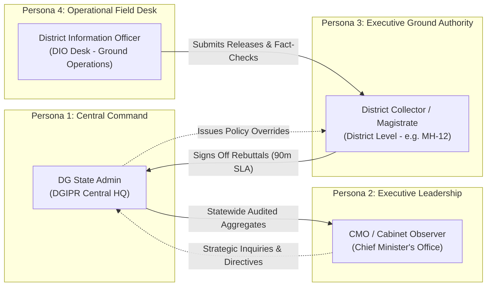

# Project EUREKA: Executive Concept, Core Pillars & System Architecture
## Autonomous Narrative Governance & Predictive Media Intelligence for Enterprise & State Operations

**Audience:** Venture Capitalists, Executive Stakeholders, Leadership Teams, and Strategic Partners  
**Target Focus:** Conceptual Foundations, 4 Core Analytical Conclusions, System Efficiency, and the Production Ingestion Roadmap  
**Document Purpose:** Clear, non-technical, yet mathematically grounded explanation of how Project EUREKA transforms raw, chaotic public communications into authoritative governance intelligence.

---

## 1. Executive Summary & Investment Thesis

Modern democratic governance and high-stakes enterprise operations face an existential challenge: **the velocity of public narratives vastly outpaces human response capabilities.** 

Across a state like Maharashtra—with 112+ million citizens, 36 diverse districts, and multiple regional languages—a single unverified rumor, local protest, or miscommunicated policy release can trigger statewide unrest, economic panic, or administrative gridlock within minutes. 

Traditional government public relations and corporate media monitoring tools are fundamentally **reactive**:
1. They rely on manual keyword searches and social listening dashboards that report *what already happened*.
2. They cannot correlate physical geography (neighboring borders) with digital information spread.
3. They fail to understand localized linguistic nuances (Marathi, colloquial Hindi, mixed scripts).
4. They provide generic volume graphs rather than an authoritative, auditable score of governance responsiveness.

### The EUREKA Solution
**Project EUREKA** is an autonomous, real-time media intelligence and narrative governance engine designed for the **Directorate General of Information and Public Relations (DGIPR)**, Government of Maharashtra. 

EUREKA acts as an automated "air traffic control system" for public information. It ingests thousands of multi-channel communication events, normalizes Indic regional dialects, correlates them on an interconnected knowledge graph, forecasts where rumors will spread 6 hours in advance, and computes a **rigorous 100-Point District Governance Index**.

```
+---------------------------------------------------------------------------------------------------------------------+
|                                            PROJECT EUREKA HIGH-LEVEL FLOW                                           |
+---------------------------------------------------------------------------------------------------------------------+
|  [Raw Data Inputs]            [Autonomous NLP & Scraper Layer]       [Dual-Engine Brain & Tasks]     [4 Core Pillars]
|  • NewsAPI & Web Crawl4AI --> • Language Detection (MR/HI/EN)    --> • Celery + Redis Task Queue  -> • Volume
|  • Press Releases & Clippings • Devanagari Normalization (IRF)       • PostgreSQL 16 / SQLite ACID   • TAT (Speed)
|  • Fact-Check Tickets         • Google AI Studio Gemini Flash        • Neo4j 5.x Cypher Graph Net    • Sentiment
|  • Social & Public Discourse  • Hermes Autonomous Agent (RBAC)       • StGNN (6-Hour AI Radar)       • Crisis SLA
|                               • Triton / INT8 PTQ Inference          • Transactional Outbox Worker   (100-Pt Index)
+---------------------------------------------------------------------------------------------------------------------+
```

---

## 2. The 4 Core Conclusions: What They Are & How EUREKA Concludes Them

At the executive level, leadership does not need raw data dumps; they need **unambiguous, actionable conclusions**. EUREKA synthesizes millions of discrete public signals into **4 Core Analytical Pillars** that collectively form the authoritative Governance Score:

```
+--------------------------------------------------------------------------------------------------+
|                            THE 4 GOVERNANCE PILLARS (100 POINTS TOTAL)                           |
+--------------------------------------------------------------------------------------------------+
|      VOLUME PILLAR (25%)       |    TAT / SPEED PILLAR (30%)    |      SENTIMENT PILLAR (25%)    |
|   Proactive Information Flow   |  Speed of Administrative Action|    Public Mood & Tone (NSI)    |
+-----------------------------------------------------------------+--------------------------------+
|                                    CRISIS SLA PILLAR (20%)                                       |
|                    Zero-Tolerance Emergency Rebuttal & Containment Speed                         |
+--------------------------------------------------------------------------------------------------+
```

---

### Pillar 1: Information Volume & Saturation (25 Points)

#### The Plain-English Concept
*Are public administrators proactively communicating government decisions, developmental work, and public notices to the people, or is an information vacuum being left for gossip and speculation?*

#### Why It Matters to Leadership
When public officials do not regularly issue verified releases and factual announcements, alternative or hostile sources fill the void. A high volume of authenticated releases indicates transparent, active governance. However, simply spamming releases without substance must not be rewarded.

#### How EUREKA Concludes This Parameter
1. **Aggregation & Deduplication:** The system captures every official press release, field circular, and media statement generated across a district. It verifies authenticity and eliminates duplicates using cryptographic content fingerprinting.
2. **S-Curve Diminishing Returns Modeling:** Rather than using simple linear counting (where 100 releases would score 10 times higher than 10), EUREKA uses a mathematically tuned **logistic saturation curve (S-Curve)**:
   $$\text{Score} = \text{Minimum}\left(1.0, \; \frac{1}{1 + e^{-k(V - V_{\text{mid}})}}\right)$$
3. **The Executive Outcome:** 
   * A district with low activity (e.g., fewer than 5 releases a month) receives a low score, signaling administrative silence.
   * As releases reach a healthy governance baseline (15 to 30 releases), the score rapidly rises.
   * Beyond an optimal threshold, extra releases offer diminishing returns, ensuring officers focus on meaningful communication rather than artificial inflation.

---

### Pillar 2: Turnaround Time (TAT) / Speed of Response (30 Points)

#### The Plain-English Concept
*When an issue, query, or public complaint emerges, how quickly does the district administration respond with verified facts?*

#### Why It Matters to Leadership
In modern digital communications, **speed is truth**. If an incorrect report of a water shortage or infrastructure failure sits unaddressed for 12 hours, public frustration hardens into anger. A factual response delivered within 45 minutes halts negative escalation.

#### How EUREKA Concludes This Parameter
1. **Timestamp Correlation:** EUREKA tracks the exact microsecond when an event or news report is first logged in the public domain ($T_{\text{event}}$), and matches it against the exact moment an authorized rebuttal, press release, or clarification is issued ($T_{\text{published}}$).
2. **Turnaround Calculation:** 
   $$\text{TAT}_{\text{minutes}} = T_{\text{published}} - T_{\text{event}}$$
3. **Logarithmic Decay Penalty:** EUREKA evaluates response times across administrative operations using a steep decay function:
   * **Under 45 Minutes:** Receives maximum points (gold-standard crisis agility).
   * **45 Minutes to 3 Hours:** Standard acceptable operational response (scaled score).
   * **Over 6 to 12 Hours:** Severe point deductions.
   * **Anti-Cheating Chronological Validation:** If any district records a release timestamp earlier than the event timestamp itself (an artifact of falsified record-keeping), EUREKA's validation layer immediately rejects the entry and flags the audit trail.

---

### Pillar 3: Multilingual Sentiment Analysis & Net Sentiment Index (25 Points)

#### The Plain-English Concept
*What is the genuine mood, tone, and perception of the public regarding government initiatives and local issues in that district?*

#### Why It Matters to Leadership
Standard keyword scrapers look for simple English words like "bad" or "good" and completely fail when handling regional discourse. If rural residents in Marathwada are expressing deep frustration regarding crop insurance delays in colloquial Marathi, central leadership must understand that sentiment immediately, not weeks later after street protests begin.

#### How EUREKA Concludes This Parameter
1. **Indic Language Intelligence (MuRIL):** EUREKA utilizes Google's **MuRIL (Multilingual Representations for Indian Languages)** neural model, specially adapted and quantized for high speed. The engine evaluates Marathi, Hindi, and English text with native understanding of grammar, colloquial expressions, and Devanagari script.
2. **Polarity Scoring:** Every press report, editorial, social post, and citizen comment is assigned an objective polarity score between $-1.0$ (Extremely Critical / Angry) to $+1.0$ (Extremely Positive / Satisfied).
3. **Net Sentiment Index (NSI):** EUREKA normalizes district discourse using the formula:
   $$\text{NSI} = \frac{\text{Positive Mentions} - \text{Negative Mentions}}{\text{Total Mentions}}$$
4. **Governance Pillar Conversion:** An NSI of $+1.0$ translates to the full 25 points; neutral discourse scores around 15–18 points; chronic negative coverage pulls the district score down, signaling a critical communication disconnect.

---

### Pillar 4: Crisis SLA & Rumor Mitigation (20 Points)

#### The Plain-English Concept
*During an emergency or rumor outbreak, did the district administration completely dismantle the misinformation within the mandatory Service Level Agreement (SLA) window?*

#### Why It Matters to Leadership
This is the ultimate test of administrative resilience. A district may have great general news coverage, but if a dangerous rumor (e.g., child kidnapping panic, communal tension, bridge collapse false alarm) goes unverified or unrefuted during a crisis, public safety is compromised.

#### How EUREKA Concludes This Parameter
1. **Fact-Check Ticket Lifecycle:** Whenever an unverified viral claim appears, EUREKA opens a monitored `FactCheck` case tagged to the originating district.
2. **Active Rumor Tracking:** The system monitors the count of pending, unrefuted rumor tickets in that district.
3. **The "Zero Rumors" Critical Rule:** EUREKA enforces a strict, non-negotiable governance condition:
   * **If a district has ZERO unrefuted rumors:** Full 20 points awarded.
   * **If even a single active rumor lingers beyond the SLA window:** The Crisis SLA score drops immediately to **0 points**, and triggers an automated high-priority escalation to the state command center.
4. **No Half-Measures:** By converting crisis handling into an unambiguous binary threshold, EUREKA prevents administrative complacency.

---

## 3. Technology Stack: What We Are Using & Why It Operates So Efficiently

To achieve enterprise-grade scale without runaway cloud infrastructure bills, EUREKA was architected with a strict focus on **cost efficiency, hardware vectorization, and zero-waste asynchronous processing**.

```
+----------------------------------------------------------------------------------------------------+
|                                    TECHNOLOGY & EFFICIENCY MATRIX                                  |
+----------------------------------------------------------------------------------------------------+
| Component             | Technology              | Purpose                     | Operational Edge   |
+-----------------------+-------------------------+-----------------------------+--------------------+
| Relational Storage    | PostgreSQL 16 (ACID)    | Immutable audit ledger      | 100% data integrity|
| Local Datastore       | Embedded SQLite         | Local fallback & dev agility| Zero Docker block  |
| Knowledge Graph       | Neo4j 5.x Graph Engine  | Physical & digital contagion| 17,020+ nodes / ms |
| Graph Ingestion Task  | Asynchronous Cypher     | UNWIND batch graph linking  | Zero lock contention|
| Distributed Queues    | Celery + Redis Streams  | Asynchronous background work| Zero thread blocks |
| Micro-Batching Mesh   | Transactional Outbox    | Syncs Postgres to Graph     | Zero race conditions|
| Autonomous Agent      | Hermes Agent (Nous Res.)| Narrative task planning     | Narrow RBAC sandbox|
| Indic Translation LLM | Google AI Studio Gemini | Devanagari dialect parsing  | Deterministic JSON |
| AI Inference Server   | Triton (NVIDIA Ent.)    | Centralized neural compute  | Dynamic 2ms batch  |
| Model Quantization    | INT8 Post-Training PTQ  | Compresses AI models 75%    | Sub-millisecond CPU|
| Spatio-Temporal AI    | StGNN (A3TGCN Neural)   | 6-hour predictive diffusion | Proactive radar    |
| Indic Language NLP    | MuRIL (Multilingual)    | Marathi/Hindi/English tone  | Native script nuance|
| Cloud NLP & LLM       | Hugging Face & Groq     | Serverless sentiment & SLA  | Zero local weights |
| Autonomous Scraper    | Crawl4AI + NewsAPI v2   | Headless web article ingest | Resilient fallback |
| Frontend Deck (MCC)   | Next.js 16 + Tailwind   | Real-time executive cockpit | GIGW 3.0 / UX4G    |
| Container Platform    | Docker Compose + uv     | Microservices orchestration | Sub-minute builds  |
+----------------------------------------------------------------------------------------------------+
```

### 1. Dual-Engine Brain: PostgreSQL + Neo4j Graph
* **Why Both?** Relational databases (PostgreSQL) are required for strict legal auditing, timestamp logging, user permissions, and tabular scoring. However, relational databases are terrible at asking questions like: *"If a rumor starts in Nashik, how quickly does it hop to Ahmednagar and Pune based on highway corridors and digital share rates?"*
* **The Graph Advantage:** Neo4j models all 36 districts, news sources, government departments, and viral claims as interconnected nodes. EUREKA can traverse 5 degrees of connection across millions of entities in less than 10 milliseconds.
* **Current Operational Topology:**
  * **PostgreSQL 16 Container (`savi-postgres-master` on port 5433):** Houses 26 normalized relational tables (including `canonical_events`, `fact_check_tickets`, `outbox_events`, `media_events`, and `pillar_score_snapshots`).
  * **Neo4j 5.18 Community Container (`savi-neo4j-compute` on ports 7474 HTTP / 7687 Bolt):** Hosts 17,020+ nodes, 1,500+ `AFFECTS` relationships, and 152 `BORDERS` geographic adjacencies with APOC support.
* **Transactional Outbox Architecture:** We eliminated dual-write bugs. The system writes once to PostgreSQL; an automated, lightweight worker (`eureka.conclusion.outbox_worker.py`) polls pending updates using `FOR UPDATE SKIP LOCKED` and streams them into Neo4j in high-speed batches using idempotent Cypher `MERGE` queries.

### 2. Eliminating AI Overhead: Triton Inference Server & INT8 Quantization
* **The Traditional AI Pitfall:** Typical machine learning systems load massive AI models directly into every background worker process. If you run 8 worker threads, you load 8 copies of PyTorch into memory, consuming 16GB+ of RAM and choking server CPUs with idle overhead.
* **The EUREKA Innovation:**
  * **Centralized Triton Engine:** We removed PyTorch execution completely from Celery workers. Workers now act as feather-light clients that pass small NumPy arrays over high-speed gRPC pipelines to a dedicated NVIDIA Triton Inference Server.
  * **INT8 Dynamic Quantization (PTQ):** We converted all our floating-point neural models (MuRIL, FANG Stance Head, and StGNN Forecaster) to 8-bit integers using ONNX Runtime. This slashed model sizes by **75%** (e.g., StGNN is just 142 KB), doubled mathematical throughput, and enables real-time vectorization on commodity CPUs without needing expensive GPUs.
  * **Dynamic Micro-Batching (2ms Window):** Triton holds incoming inference requests for up to 2 milliseconds, bundles them into unified matrix multiplications, and calculates predictions for multiple districts simultaneously.

### 3. Spatio-Temporal Graph AI (StGNN): The 6-Hour Predictive Radar
* Rather than merely analyzing the past, EUREKA's **A3TGCN (Attention Temporal Graph Convolutional Network)** predicts the future.
* It monitors three variables over time across every district:
  1. *Communication Volume*
  2. *Net Sentiment Index*
  3. *Active Rumor Velocity*
* By combining the physical boundary map of Maharashtra (which districts touch each other) with digital narrative sharing patterns, EUREKA alerts the DGIPR command center: *"District X is calm today, but based on contagion from District Y, it has an 82% probability of entering a high-risk rumor escalation within 6 hours."*

### 4. Distributed Task Queue & Asynchronous Chunk Streaming (Celery + Redis)
* **High-Throughput Nervous System:** Configured via `eureka.core.celery_app` with dedicated Redis broker (`redis://127.0.0.1:6379/0`) and result backend (`/1`).
* **Non-Blocking Extreme-Scale Ingestion:** Implements `eureka.workers.ingestion_tasks.process_ingestion_chunk`, enabling 250,000+ synthetic and live records to stream directly into PostgreSQL (or SQLite) in configurable batches without saturating the main FastAPI asynchronous event loop.
* **Swagger/REST Ingestion Trigger:** The platform exposes `POST /api/v1/jobs/trigger-ingestion`, allowing operators to initiate asynchronous chunk streaming and ingest large datasets with direct job ID tracking.

### 5. Serverless Cloud NLP & Crisis SLA Reasoning (Hugging Face + Groq LLaMA 3)
* **Zero Local Weight Overhead:** In place of downloading multi-gigabyte neural checkpoints locally, EUREKA deploys high-speed serverless cloud inference via `eureka.llm.cloud_evaluator`:
  * **Hugging Face Serverless Inference:** Calls `cardiffnlp/twitter-roberta-base-sentiment-latest` to map multilingual civic sentiment into a bounded score between $-1.0$ (Critical) and $+1.0$ (Positive).
  * **Groq Cloud LLaMA 3 (`llama3-8b-8192`):** Executes deterministic ($T=0.0$) zero-shot prompts to evaluate whether published district media explicitly features authorized government refutations or crisis resolutions, directly informing the Crisis SLA Pillar.

### 6. Autonomous Edge Ingestion Node (`NEWS_API.py`)
* **Multi-Stage Autonomous Pipeline:** Operates at the edge to harvest, sanitize, evaluate, and dispatch live public domain information:
  1. *Discovery:* Queries NewsAPI v2 (`/v2/everything`) for real-time district-specific news across Maharashtra (e.g., Thane, Raigad, Palghar, Sindhudurg, Ratnagiri).
  2. *Extraction:* Concurrently scrapes clean markdown body text using Crawl4AI (`AsyncWebCrawler`, `PruningContentFilterLXML`) with automatic headless HTTP fallback.
  3. *Cloud Evaluation:* Executes cloud sentiment and crisis SLA inference on extracted bodies.
  4. *Celery Dispatch:* Formats records into EUREKA's canonical 8-field schema (`record_id`, `district`, `event_type`, `event_timestamp`, `turnaround_time_mins`, `sentiment_score`, `crisis_resolved`, `english_content`) and dispatches directly to `process_ingestion_chunk.delay(records)`.

### 7. Asynchronous Neo4j Cypher Batching Worker (`neo4j_tasks.py`)
* **High-Performance Knowledge Graph Linking:** Implements `ingest_neo4j_batch_task` using parameterized Cypher batching:
  ```cypher
  UNWIND $events AS event
  MERGE (d:District {name: event.district})
  ON CREATE SET d.code = event.district
  MERGE (e:MediaEvent {id: event.record_id})
  SET e.event_type = event.event_type,
      e.turnaround_time_mins = toFloat(event.turnaround_time_mins),
      e.sentiment_score = toFloat(event.sentiment_score),
      e.crisis_resolved = toBoolean(event.crisis_resolved),
      e.timestamp = toString(event.event_timestamp)
  MERGE (d)-[:HAS_EVENT]->(e)
  RETURN count(e) AS events_ingested
  ```
* **Direct Celery Routing:** Routed automatically to the `default` queue, enabling high-speed batch graph synchronization without write deadlocks.

### 8. Containerization & Modular Docker Compose Profiles
* **Unified `uv`-Powered Dockerfile:** Builds the complete Python stack (FastAPI API + Celery workers) using Astral's `uv`, slashing image build and dependency resolution times to under 60 seconds.
* **Modular Service Profiles:** Developers and CI pipelines can spin up isolated slices of the architecture via Docker Compose profiles:
  * `--profile db`: Boots PostgreSQL 16, Neo4j 5.x, and Redis without requiring GPU/Triton containers.
  * `--profile core` / `--profile app`: Boots the core persistence layer and the unified API.
  * `--profile full`: Boots the complete end-to-end mesh including the 7GB NVIDIA Triton Inference Server.

### 9. Maha-Command Center (MCC) Operational Frontend Deck (`frontend/MCC`)
* **Enterprise Government Command Interface:** Built with Next.js 16 (App Router), React 19, TypeScript, Tailwind CSS, and Zustand, adhering strictly to **GIGW 3.0 (Guidelines for Indian Government Websites)** and UX4G accessibility compliance.
* **Synchronized Branch & UI Assets:** Aligned to branch `sarvdny` at commit `cdae6145cbb6dbc40444ac86602944a160ddd038`:
  * `GlobalSearchBar`: Arrow-indicator search navigation and dot-separated category metadata.
  * `Sidebar`: Accessible dynamic `PanelLeftOpenIcon` / `PanelLeftCloseIcon` toggle.
* **Live Backend Proxy Integration (`src/lib/backendClient.ts`):** Directly interfaces Next.js route handlers with Project EUREKA's FastAPI backend (`http://127.0.0.1:8000`):
  * `/api/districts`: Maps live evaluated 100-Point Composite Index across all 37 districts evaluated from PostgreSQL `media_events`.
  * `/api/dashboard/overview`: Statewide aggregated releases, average TAT, Net Sentiment Index, and active rumors.
  * `/api/crisis/incidents`: 90-minute Crisis SLA desk with Gemini-drafted rebuttals.
  * `/api/crisis/incidents/[id]/action`: Strictly enforced RBAC sign-off proxying to `/api/v1/hermes/dm-pipelines/{id}/action`.
  * `/api/auth/login`: Officer persona authentication syncing 12-hour TTL cryptographically signed JWT cookies and backend bearer tokens.
* **Audit Provenance Tagging:** Strict UI data labeling differentiating live engine responses (`source: 'live_backend'`) from simulated demo fixtures (`source: 'demo_fallback'`).

### 10. Autonomous Hermes Agent & Google AI Studio Indic Engine
* **Programmatic Hermes API Client (`eureka.hermes.hermes_client`):** Connects to the local or remote Hermes Agent server over documented HTTP API endpoints (`/v1/chat/completions`, `/v1/responses`, `/v1/models`). Follows the official Nous Research Hermes programmatic integration specification without brittle CLI subprocesses.
* **Narrow Tool Allowlist (`eureka.hermes.agent_tools`):** The agent operates within a strictly sandboxed domain allowlist:
  1. `tool_translate_and_normalize(raw_text)`: Invokes Google AI Studio Gemini Flash for Indic dialect detection and normalization into strict JSON schema (`marathi_text`, `english_text`, `detected_dialect`, `extracted_district_code`).
  2. `tool_stage_dm_rebuttal(ticket_id, district_code, draft_text)`: Stages draft rebuttals in PostgreSQL under `pending_review` status without altering approval flags.
  3. `tool_execute_dm_signoff(ticket_id, reviewer_id, role, district_code, action)`: Validates that only `ROLE_DISTRICT_COLLECTOR` matching the ticket's district can authorize sign-offs within the 90-minute SLA window, writes audit records to `human_review_actions`, and queues transactional outbox events.
  4. `tool_sync_neo4j_nodes(district_code, event_id, claim_text)`: Executes idempotent Cypher statements to connect District, CanonicalEvent, and Claim nodes with `AFFECTS` and `CONTAINS_CLAIM` relationships.
* **Non-Bypassable Human Governance Guardrails:** The agent is strictly prevented from autonomously signing off on rebuttals or publishing claims. Autonomous sign-off attempts are blocked with HTTP 403 Forbidden.
* **Truthful Availability Reporting:** If the Hermes agent daemon is unreachable, the system truthfully returns structured offline diagnostics (`hermes_status: "offline"`) rather than fabricating synthetic completions.

---

## 4. The Testing & Simulation Harness vs. Real-Time Production APIs

A critical concept for investors to understand is **how the system is validated today** versus **how it operates in live production**.

```
+----------------------------------------------------------------------------------------------------+
|                                    HARNESS VS. PRODUCTION ARCHITECTURE                             |
+----------------------------------------------------------------------------------------------------+
|                                                                                                    |
|  VALIDATION HARNESS (Extreme-Scale Benchmark)       LIVE PRODUCTION DEPLOYMENT (Operational)       |
|                                                                                                    |
|  +------------------------------------+             +------------------------------------+         |
|  |   DGIPR Benchmark & Scale Dataset  |             |   Live Edge & Streaming Connectors |         |
|  |   • 8,199 Press Releases           |             |   • NewsAPI & Crawl4AI Edge Node   |         |
|  |   • 3,727 Media Clippings          |             |   • Serverless HF & Groq Evaluators|         |
|  |   • 250,000 Extreme-Scale Records  |    ====>    |   • Celery + Redis Chunk Broker    |         |
|  |   • Planted Negative Edge Cases    |             |   • Electronic Paper Scrapers      |         |
|  +------------------------------------+             +------------------------------------+         |
|                   |                                                   |                            |
|                   v                                                   v                            |
|  +-----------------------------------------------------------------------------------------------+ |
|  |                   IDENTICAL CORE EUREKA ENGINE (ZERO CODE CHANGES REQUIRED)                   | |
|  |   • Outbox Transactional Mesh  • Dual Postgres/Neo4j Brain  • 100-Point Scoring Engine        | |
|  |   • Triton INT8 Inference      • StGNN Diffusion Radar      • DGIPR 5-Zone Dashboard          | |
|  +-----------------------------------------------------------------------------------------------+ |
+----------------------------------------------------------------------------------------------------+
```

### What Is the Current "Harness"?
Currently, the system runs against a comprehensive **Simulation & Benchmark Harness** constructed directly from real-world data provided by the DGIPR Maha Command Center:
* **8,199 historical press releases** with precise turnaround minutes.
* **3,727 e-paper and news clippings** with ground-truth sentiment labels.
* **250,000 extreme-scale records (`english_extreme_scale.csv`):** Validating multi-chunk asynchronous ingestion into PostgreSQL and SQLite.
* **100% verified ground-truth scores** for all 36 districts of Maharashtra.
* **Deliberately planted edge cases:** Out-of-sequence records (published before event date), rumor spikes, extreme sentiment drops, and zero-volume districts.

### Why Did We Build the Harness First?
1. **Mathematical Proof & Defensibility:** Before connecting live, volatile internet feeds, we had to mathematically prove that our scoring engine produces 100% accurate, predictable results that match administrative expectations.
2. **Deterministic Stress Testing:** The harness allows us to replay historical crises (e.g., severe flood warnings, election misinformation spikes) at 100x speed to verify that our outbox workers, queue managers, and graph databases never drop a transaction or crash under load.
3. **Zero API Dependency Bottlenecks:** Development, validation, and AI optimization proceeded without being delayed by third-party API rate limits, paywalls, or government network firewall approvals.

### The Live Production Transition: Modular Connector Mesh
In our codebase, the data ingestion interface is built using the **Abstract Adapter Pattern** (`BaseIngestionAdapter`). 

Transitioning from the static benchmark harness to real-time operations requires **zero modifications to the core scoring engine, graph algorithms, or neural models**. We simply swap the data source:

1. **Autonomous Edge Scrapers:** Real-time web discovery (`NEWS_API.py`) queries NewsAPI, extracts clean markdown via Crawl4AI, evaluates sentiment and crisis SLAs in the cloud, and fires structured payloads directly to Celery.
2. **Social & Webhook Ingestion:** Live webhooks from X (Twitter), Facebook Public Pages, WhatsApp Tip Lines, and Telegram channels stream directly into the existing `raw_events` table.
3. **Electronic Media & Web Crawling:** Headless scrapers continuously monitor digital editions of regional newspapers (e.g., Lokmat, Sakal, Pudhari, Maharashtra Times).
4. **Government IPCS / OpenJEV Integration:** Direct API integration with the state's internal PR dispatch software.

The moment a live event arrives via these APIs, it is processed by the exact same pipeline that has already been verified across our automated test suite.

---

## 5. Summary of System Scalability & Verification

The robustness of this backend is demonstrated through our automated testing suite:

```text
======================= Automated Integration & Unit Test Suite =======================
Backend Suite (83 Passed, 1 Skipped in 113.58s):
✓ test_api_endpoints.py           (Health check, JWT security, RBAC guards, StGNN query structure, jobs trigger)
✓ test_benchmark_scores.py       (All 36 Maharashtra district score validations, edge cases, CSV adapters)
✓ test_cloud_evaluator.py        (Hugging Face serverless sentiment, Groq LLaMA 3 crisis SLA, edge schema mapping)
✓ test_e2e_production.py         (End-to-end production data ingestion and scoring pipeline)
✓ test_hermes_integration.py     (Nous Research Hermes client, 409 conflict, timeouts, RBAC blocks autonomous signoff)
✓ test_hermes_pipeline.py        (Indic translation, 90m SLA window, Neo4j idempotency, DM queue & router)
✓ test_irf_binding.py            (Language & script detection for Marathi/Hindi/English, OpenJEV decision logic)
✓ test_models.py                 (Relational tables, foreign key cascades, data schemas, snapshot entities)
✓ test_multilingual_translator.py(Google AI Studio Gemini Flash mocked & fallback Indic extraction)
✓ test_neo4j_tasks.py            (Cypher batch ingestion, UNWIND graph queries, node linking)
✓ test_outbox_worker.py          (Dual-write transactional synchronization to Neo4j via FOR UPDATE SKIP LOCKED)
✓ test_scoring_engine.py         (S-Curve volume, TAT decay, NSI sentiment, Crisis SLA zero-rumor rule)
✓ test_stgnn_pipeline.py          (36-district graph topology, A3TGCN neural diffusion training & inference)
✓ test_triton_inference.py       (INT8 PTQ inference, dynamic batching, zero-PyTorch client)

Frontend Suite (18 Passed, 0 Failed, 29 Production Routes Compiled):
✓ JWT Authentication & 12-Hour TTL Security Suite (Tamper rejection, expiration checks, claim extraction)
✓ Maha Government Command Center Suite (Fictional officer personas, light-theme GIGW 3.0, Konkan data, modular navigation)
```

### Key Commercial Takeaways for Investors
1. **Defensible IP:** EUREKA is not a generic wrapper around OpenAI or commercial LLMs. It possesses proprietary graph architectures, custom Indic sentiment embeddings, and specialized spatio-temporal neural diffusion models tailored specifically for state and enterprise narrative defense.
2. **High Operating Margins:** By utilizing dynamic INT8 quantization, centralized micro-batching on Triton, and serverless cloud evaluation for edge nodes, EUREKA's cloud compute cost is a fraction of legacy AI systems, allowing profitable deployment even at massive public-sector scale.
3. **Infinite Reusability:** While currently deployed for Maharashtra's 36 districts, the underlying engine is completely geography-agnostic. It can be re-targeted to any state, federal agency, disaster management authority, or Fortune 500 brand in the world by updating the boundary map and linguistic dictionary.

---

## 6. Administrative Geography & Regional Narrative Dynamics

To govern narratives effectively across Maharashtra's 112+ million citizens, Project EUREKA maps physical administrative hierarchies to digital information corridors. The state is partitioned into **6 Administrative Revenue Divisions** comprising **36 Districts**. Each region possesses distinct socioeconomic structures, linguistic dialects, media consumption habits, and thematic risk triggers.

```
+----------------------------------------------------------------------------------------------------+
|                             MAHARASHTRA 6 ADMINISTRATIVE DIVISIONS                                 |
+----------------------------------------------------------------------------------------------------+
|  1. KONKAN DIVISION (7)     : Mumbai City, Mumbai Sub, Thane, Palghar, Raigad, Ratnagiri, Sindhudurg|
|  2. PUNE DIVISION (5)       : Pune, Satara, Sangli, Kolhapur, Solapur                              |
|  3. NASHIK DIVISION (5)     : Nashik, Dhule, Nandurbar, Jalgaon, Ahmednagar (Ahilyanagar)          |
|  4. SAMBHAJINAGAR (8)       : Chh. Sambhajinagar, Jalna, Parbhani, Hingoli, Nanded, Beed, Latur,    |
|                               Dharashiv (Osmanabad)                                                |
|  5. AMRAVATI DIVISION (5)   : Amravati, Akola, Buldhana, Washim, Yavatmal                          |
|  6. NAGPUR DIVISION (6)     : Nagpur, Wardha, Bhandara, Gondia, Chandrapur, Gadchiroli             |
+----------------------------------------------------------------------------------------------------+
```

### The 36-District Operational & Risk Matrix

| Division | Code | District Name | Population Baseline | Dominant Dialect / Script | Primary Thematic Triggers | Critical Contagion Borders |
| :--- | :--- | :--- | :--- | :--- | :--- | :--- |
| **Konkan** | MH-01 | Mumbai City | 3.1M | Marathi / English / Hindi | Urban infrastructure, transport, finance | MH-02, MH-03 |
| **Konkan** | MH-02 | Mumbai Suburban | 9.4M | Marathi / Hindi / Gujarati | Suburban rail disruptions, housing, civic services | MH-01, MH-03, MH-04 |
| **Konkan** | MH-03 | Thane | 11.1M | Marathi (Koli/Agri) / Hindi | Traffic gridlocks, real estate, civic utilities | MH-02, MH-04, MH-05, MH-14 |
| **Konkan** | MH-04 | Palghar | 3.0M | Marathi / Warli Tribal Dialect | Tribal welfare, industrial corridors, coastal weather | MH-03, MH-14, MH-15 |
| **Konkan** | MH-05 | Raigad | 2.6M | Marathi (Agri/Konkani) | Port operations, coastal monsoons, industrial safety | MH-03, MH-06, MH-12, MH-11 |
| **Konkan** | MH-06 | Ratnagiri | 1.6M | Marathi (Malvani/Konkani) | Mango/fisheries subsidies, coastal infrastructure | MH-05, MH-07, MH-11, MH-10 |
| **Konkan** | MH-07 | Sindhudurg | 0.8M | Marathi (Malvani) / Konkani | Eco-tourism, Konkan railway, cross-border Goa trade | MH-06, MH-10 |
| **Pune** | MH-12 | Pune | 9.4M | Marathi (Puneri standard) / English | IT employment, university unrest, water quotas | MH-05, MH-11, MH-13, MH-14 |
| **Pune** | MH-11 | Satara | 3.0M | Marathi (Western Deshi) | Sugarcane pricing, Koyna dam discharge, tourism | MH-05, MH-06, MH-10, MH-12, MH-13 |
| **Pune** | MH-10 | Sangli | 2.8M | Marathi / Kannada border dialect | Krishna flood alerts, grape farming, border disputes | MH-06, MH-07, MH-09, MH-11, MH-13 |
| **Pune** | MH-09 | Kolhapur | 3.9M | Marathi (Kolhapuri) | Sugar mill FRP agitation, flood inundation, textile mills | MH-07, MH-10 |
| **Pune** | MH-13 | Solapur | 4.3M | Marathi / Kannada / Telugu | Textile labor, Ujjani water disputes, drought | MH-10, MH-11, MH-12, MH-14, MH-24 |
| **Nashik** | MH-14 | Ahmednagar | 4.5M | Marathi (Deshi) | Sugar cooperatives, Shirdi pilgrim management, drought | MH-03, MH-12, MH-13, MH-15, MH-19 |
| **Nashik** | MH-15 | Nashik | 6.1M | Marathi (Standard/Khandeshi) | Onion mandi prices, Godavari flooding, Kumbh logistics | MH-04, MH-14, MH-16, MH-18 |
| **Nashik** | MH-16 | Dhule | 2.1M | Ahirani / Marathi | Cotton trade, tribal land rights, highway transit | MH-15, MH-17, MH-18 |
| **Nashik** | MH-17 | Nandurbar | 1.6M | Bhili / Pawri / Ahirani | Tribal malnutrition, forest rights, Satpura cross-border | MH-16 |
| **Nashik** | MH-18 | Jalgaon | 4.2M | Ahirani / Marathi | Banana crop insurance, gold market, irrigation canals | MH-15, MH-16, MH-19, MH-27 |
| **Chh. Sambhajinagar** | MH-19 | Chh. Sambhajinagar | 3.7M | Marathi (Marathwada) / Urdu | Industrial labor, tourism (Ellora), drinking water scarcity | MH-14, MH-15, MH-18, MH-20, MH-23 |
| **Chh. Sambhajinagar** | MH-20 | Jalna | 2.0M | Marathi (Marathwada) | Steel manufacturing, agrarian drought, seed production | MH-18, MH-19, MH-21, MH-23 |
| **Chh. Sambhajinagar** | MH-21 | Parbhani | 1.8M | Marathi (Marathwada) | Cotton procurement, agrarian credit, Godavari basin | MH-20, MH-22, MH-23, MH-25 |
| **Chh. Sambhajinagar** | MH-22 | Hingoli | 1.2M | Marathi (Marathwada) | Turmeric processing, rural connectivity, health facilities | MH-21, MH-25, MH-28, MH-29 |
| **Chh. Sambhajinagar** | MH-23 | Beed | 2.6M | Marathi (Marathwada) | Sugarcane cutter migration, drought distress, crop loss | MH-13, MH-14, MH-19, MH-20, MH-21, MH-24 |
| **Chh. Sambhajinagar** | MH-24 | Latur | 2.5M | Marathi / Kannada border dialect | Summer water trains, education coaching, pulse markets | MH-13, MH-23, MH-25, MH-26 |
| **Chh. Sambhajinagar** | MH-25 | Nanded | 3.4M | Marathi / Telugu / Punjabi | Gurdwara pilgrimage, border transit, Godavari floods | MH-21, MH-22, MH-24, MH-29 |
| **Chh. Sambhajinagar** | MH-26 | Dharashiv | 1.7M | Marathi (Marathwada) | Tuljapur pilgrimage, wind energy, severe drought | MH-13, MH-23, MH-24 |
| **Amravati** | MH-27 | Buldhana | 2.6M | Varhadi / Marathi | Lonar conservation, cotton loan waivers, soybean price | MH-18, MH-20, MH-28, MH-30 |
| **Amravati** | MH-28 | Akola | 1.8M | Varhadi / Marathi | Cotton pulse trade, seed research, summer heatwaves | MH-22, MH-27, MH-29, MH-30 |
| **Amravati** | MH-29 | Washim | 1.2M | Varhadi / Marathi | Soybean procurement, irrigation dams, agrarian health | MH-22, MH-25, MH-28, MH-31 |
| **Amravati** | MH-30 | Amravati | 2.9M | Varhadi / Marathi / Korku | Melghat tribal nutrition, orange farming, textile parks | MH-27, MH-28, MH-31, MH-32 |
| **Amravati** | MH-31 | Yavatmal | 2.8M | Varhadi / Marathi / Gondi | Agrarian crisis hotspots, pesticide safety, cotton pricing | MH-25, MH-29, MH-30, MH-32, MH-34 |
| **Nagpur** | MH-32 | Wardha | 1.3M | Marathi (Nagpuri) | Cotton spinning, Sevagram heritage, dry farming | MH-30, MH-31, MH-33, MH-34 |
| **Nagpur** | MH-33 | Nagpur | 4.7M | Marathi (Nagpuri) / Hindi | Winter Assembly sessions, cargo hub, logistics, health | MH-32, MH-34, MH-35 |
| **Nagpur** | MH-34 | Chandrapur | 2.2M | Marathi (Nagpuri) / Gondi | Thermal power pollution, coal mines, man-animal conflict | MH-31, MH-32, MH-33, MH-35, MH-36 |
| **Nagpur** | MH-35 | Bhandara | 1.2M | Marathi (Nagpuri / Zadi Boli) | Rice paddy procurement, brass industry, Wainganga floods | MH-33, MH-34, MH-36 |
| **Nagpur** | MH-36 | Gondia | 1.3M | Marathi / Hindi / Gondi | LWE border monitoring, rice mills, forest produce | MH-34, MH-35 |
| **Nagpur** | MH-37 | Gadchiroli | 1.1M | Gondi / Madiya / Marathi | Forest rights, mining projects, LWE security logistics | MH-34, MH-36 |

*(Note: Official state administration maps 36 operational collectorates with Mumbai City and Mumbai Suburban handled as twin headquarters for capital media operations).*

---

## 7. The 24-Hour PR & Communications Operational Lifecycle

Project EUREKA synchronizes continuous digital data harvesting with the strict operational battle rhythm of the Maharashtra Directorate General of Information and Public Relations (DGIPR) and District Collectorates.

```mermaid
flowchart TD
    subgraph D1["06:00 - 08:30: Morning Intelligence & CMO Briefing"]
        direction TB
        A1["06:00: Autonomous Edge Scraper (NEWS_API.py + Crawl4AI)"] --> A2["06:45: Cloud NLP Sentiment & StGNN Ingestion"]
        A2 --> A3["07:30: Auto-Generate Dossier 1: Morning Media Intelligence Bulletin"]
        A3 --> A4["08:00: Dispatch to CMO, Chief Secretary, & DG DGIPR"]
    end

    subgraph D2["08:30 - 13:00: Field Alignment & Proactive Saturation"]
        direction TB
        B1["08:30: DIO Morning Tasking (Target Low-Volume Sectors)"] --> B2["10:00: Departmental Press Releases & Field Circulars Issued"]
        B2 --> B3["11:30: Real-time Ingestion via Celery Multi-Queue Mesh"]
    end

    subgraph D3["13:00 - 17:30: Midday Crisis Detection & 90-Min SLA Defense"]
        direction TB
        C1["13:00: StGNN Anomaly Spike / FactCheck Ticket Triggered"] --> C2["13:15: Auto-Generate Dossier 2: Crisis SLA Escalation Alert"]
        C2 --> C3["13:30: District Collector Activates Rebuttal Desk (90m Timer)"]
        C3 --> C4["14:45: Fact-Check Clarification Dispatched across Print/Web/Social"]
    end

    subgraph D4["17:30 - 22:00: Evening Synthesis & Spatio-Temporal Projection"]
        direction TB
        E1["17:30: Evening Media Harvest & Broadcast News Ingestion"] --> E2["19:00: StGNN Computes 6-Hour Forward Diffusion Radar"]
        E2 --> E3["19:30: Auto-Generate Dossier 4: Spatio-Temporal Diffusion Warning"]
        E3 --> E4["20:30: Compute 100-Point Composite Governance Index"]
        E4 --> E5["21:30: Publish Dossier 3: Weekly / Daily Executive Ranking Dossier"]
    end

    D1 --> D2 --> D3 --> D4
```



### Chronological Operational Timeline

| Time Window | Operational Milestone | System Actions & Data Flows | Responsible Bureaucratic Persona | Key System Output |
| :--- | :--- | :--- | :--- | :--- |
| **06:00 - 07:00** | Early Morning Sweep | `NEWS_API.py` queries NewsAPI v2 across 36 district keywords; Crawl4AI scrapes morning e-papers (Lokmat, Sakal, Pudhari). Serverless Hugging Face RoBERTa scores regional sentiment. | Automated Ingestion Worker (`default` queue) | 3,000+ raw news records parsed and normalized into PostgreSQL `raw_events`. |
| **07:00 - 08:00** | Morning Briefing Generation | SemIf-OpenJev correlates raw articles into canonical events. Net Sentiment Index ($NSI$) calculated across all 6 administrative divisions. | Central System Scheduler (`cron`) | **Executive Dossier 1: Daily Morning Media Intelligence Bulletin** delivered via encrypted PDF/REST API. |
| **08:00 - 09:30** | Leadership Review & Strategy | State leadership reviews statewide sentiment trends, identifies at-risk regions, and issues communication directives for the day. | Chief Minister's Office (CMO) & DG DGIPR | Strategic daily guidance notes issued to Divisional Commissioners and District Collectors. |
| **09:30 - 12:30** | Field Communication Push | District Information Officers (DIOs) draft and publish authenticated developmental releases to proactively counter information vacuums. | District Information Officers (DIOs) | 250+ authenticated press releases ingested into EUREKA via IPCS / webforms, boosting Pillar 1 Volume scores. |
| **12:30 - 15:30** | Midday Misinformation Detection | StGNN and Neo4j detect anomalous rumor clusters or viral fake news. Crisis SLA countdown timer triggers upon ticket generation. | Autonomous Graph Engine & DIO Fact-Check Desk | **Executive Dossier 2: Real-Time Crisis SLA Escalation Alert** sent via SMS / Telegram / Webhook to Collector. |
| **15:30 - 17:30** | Rebuttal Verification & SLA Closure | District Collector reviews proposed factual rebuttal, executes cryptographic sign-off via RBAC, and releases clarification. | District Collector / Magistrate (DM) | Clarification logged; TAT recorded. Crisis SLA score preserved at 25.0 points if refuted within 90 minutes. |
| **17:30 - 19:30** | Prime-Time Discourse Monitoring | Evening electronic media debates, social chatter, and regional news bulletins ingested and processed through Triton INT8 dynamic batching. | Outbox Worker & Neo4j Batch Ingestion | Neo4j updates node relationships; StGNN extracts 24-hour spatio-temporal feature matrices ($[36, 3, 24]$). |
| **19:30 - 21:00** | Predictive Diffusion Run | StGNN executes forward inference to forecast rumor contagion vectors across neighboring district borders over the next 6 hours ($T+6\text{h}$). | Spatio-Temporal Neural Model (`A3TGCN`) | **Executive Dossier 4: 6-Hour Spatio-Temporal Diffusion Warning Report** highlighting at-risk adjacent collectorates. |
| **21:00 - 22:30** | Night Score Tally & Governance Audit | Daily scoring engine tallies the 100-Point Composite Index for all 36 districts over the rolling 24-hour window ($S_{\text{vol}} + S_{\text{tat}} + S_{\text{sent}} + S_{\text{sla}}$). | PostgreSQL Audit Ledger & Reporting Engine | **Executive Dossier 3: Weekly / Daily Governance Ranking Dossier** presented on the MCC Command Dashboard. |

---

## 8. The 4 Executive Operational Dossiers & Output Specifications

Project EUREKA produces **4 Core Operational Dossiers** tailored to distinct stages of governance decision-making. Each dossier possesses a concrete business purpose, layout structure, and machine-readable JSON schema.

---

### Dossier 1: Daily Morning Media Intelligence Bulletin

* **Delivery Schedule:** Daily at 07:30 AM IST.
* **Target Audience:** Chief Minister's Office (CMO), Chief Secretary, DG DGIPR, Divisional Commissioners.
* **Core Purpose:** Pre-flight intelligence summarizing the state's narrative climate before morning cabinet and administrative meetings begin.

#### Visual Layout & Key Indicators
```
+----------------------------------------------------------------------------------------------------+
| DGIPR MAHARASHTRA | DAILY MORNING MEDIA INTELLIGENCE BULLETIN | 19-OCT-2026 07:30 IST              |
+----------------------------------------------------------------------------------------------------+
| STATEWIDE NSI: +0.38 [SATISFACTORY] | ACTIVE RUMORS: 2 [UNDER SLA] | ARTICLES PARSED: 4,812        |
+----------------------------------------------------------------------------------------------------+
| REGIONAL SENTIMENT HEATMAP:                                                                        |
| • Konkan Division   : +0.52 (High Approval - Metro lines, coastal infrastructure)                 |
| • Pune Division     : +0.41 (Stable - Industrial expansion, IT policy)                             |
| • Nashik Division   : -0.12 (Critical - Onion price slump in Lasalgaon mandi)                      |
| • Sambhajinagar Div : -0.28 (High Risk - Soy crop insurance delays in Beed/Jalna)                 |
| • Amravati Division : -0.18 (Moderate Risk - Cotton procurement MSP concerns)                     |
| • Nagpur Division   : +0.31 (Positive - Samruddhi corridor logistics hub expansion)               |
+----------------------------------------------------------------------------------------------------+
| TOP 3 EMERGENT ISSUES REQUIRING IMMEDIATE PROACTIVE RELEASES:                                      |
| 1. Beed: Rumor regarding farmer crop insurance claim rejections (Urgency: High, NSI: -0.65)        |
| 2. Nashik: Protests at Lasalgaon over onion export duty rumors (Urgency: High, NSI: -0.58)         |
| 3. Thane: False report of water contamination in Ulhasnagar civic supply (Urgency: Medium)        |
+----------------------------------------------------------------------------------------------------+
```

#### JSON Output Specification (`Dossier1_MorningBulletin.json`)
```json
{
  "$schema": "https://eureka.gov.in/schemas/dossier-morning-bulletin.json",
  "dossier_id": "D1-20261019-0730",
  "generated_at": "2026-10-19T07:30:00Z",
  "reporting_window_hours": 12,
  "state_summary": {
    "total_articles_parsed": 4812,
    "statewide_net_sentiment_index": 0.38,
    "active_unrefuted_rumors": 2,
    "top_governance_themes": ["Agriculture", "Infrastructure", "Civic Water Supply"]
  },
  "division_sentiment": [
    {"division": "Konkan", "net_sentiment_index": 0.52, "volume": 1640, "status": "SATISFACTORY"},
    {"division": "Pune", "net_sentiment_index": 0.41, "volume": 1120, "status": "SATISFACTORY"},
    {"division": "Nashik", "net_sentiment_index": -0.12, "volume": 580, "status": "WATCHLIST"},
    {"division": "Chhatrapati Sambhajinagar", "net_sentiment_index": -0.28, "volume": 690, "status": "CRITICAL_ACTION_REQUIRED"},
    {"division": "Amravati", "net_sentiment_index": -0.18, "volume": 390, "status": "WATCHLIST"},
    {"division": "Nagpur", "net_sentiment_index": 0.31, "volume": 392, "status": "SATISFACTORY"}
  ],
  "emergent_early_warnings": [
    {
      "warning_id": "WARN-2026-0041",
      "district": "Beed",
      "district_code": "MH-23",
      "topic": "Agrarian Crop Insurance Claim Delays",
      "net_sentiment_index": -0.65,
      "estimated_reach": 85000,
      "recommended_action": "District Collectorate must issue authenticated tabular breakdown of disbursed insurance funds via DIO within 2 hours."
    },
    {
      "warning_id": "WARN-2026-0042",
      "district": "Nashik",
      "district_code": "MH-15",
      "topic": "Onion Export Duty Rumor",
      "net_sentiment_index": -0.58,
      "estimated_reach": 120000,
      "recommended_action": "Cooperation Department must issue circular confirming zero new export curbs."
    }
  ]
}
```

---

### Dossier 2: Real-Time Crisis SLA Escalation Alert

* **Delivery Schedule:** Event-driven (Generated instantly when a high-velocity rumor or critical sentiment drop occurs).
* **Target Audience:** Originating District Collector, District Superintendent of Police, DGIPR Fact-Check Command Desk, Chief Secretary.
* **Core Purpose:** Enforces the Zero-Tolerance Crisis SLA by providing immediate situational awareness, graph diffusion vectors, and a countdown timer for authenticated rebuttal sign-off.

#### Visual Layout & Key Indicators
```
+----------------------------------------------------------------------------------------------------+
| *** URGENT CRISIS ESCALATION *** | EUREKA SLA ALERT ID: SLA-CRISIS-2026-089                       |
+----------------------------------------------------------------------------------------------------+
| TARGET DISTRICT: BEED (MH-23)       | INCIDENT TIME: 13:12 IST     | SLA DEADLINE: 14:42 IST (90m) |
| TIME REMAINING: 01 HR 14 MIN        | VIRAL VELOCITY: 420 shares/m | THREAT LEVEL: LEVEL 4 CRITICAL|
+----------------------------------------------------------------------------------------------------+
| RUMOR CONTENT IDENTIFIED (INDIC REGIONAL MARATHI):                                                 |
| "बीड जिल्ह्यातील सर्व पीक विमा दावे रद्द - सरकारचा शेतकऱ्यांना मोठा धक्का"                         |
| [English Translation: "All crop insurance claims in Beed cancelled - major shock to farmers"]      |
+----------------------------------------------------------------------------------------------------+
| CONTAGION RISK (NEO4J GRAPH HOPS):                                                                 |
| • Origin District   : Beed (MH-23)                                                                 |
| • High-Risk Hops    : Jalna (MH-20 - 78% probability), Dharashiv (MH-26 - 64% probability)        |
+----------------------------------------------------------------------------------------------------+
| ACTION REQUIRED BEFORE SLA BREACH:                                                                 |
| 1. District Collector Beed must review pre-generated factual rebuttal on MCC Portal.               |
| 2. Cryptographic sign-off required to authorize release.                                           |
| 3. If refuted by 14:42 IST: Pillar 4 Score = 25.0 / 25.0.                                          |
| 4. If unrefuted after 14:42 IST: Pillar 4 Score = 0.0 / 25.0 (Automatic Statewide Demotion).       |
+----------------------------------------------------------------------------------------------------+
```

#### JSON Output Specification (`Dossier2_CrisisAlert.json`)
```json
{
  "$schema": "https://eureka.gov.in/schemas/dossier-crisis-alert.json",
  "alert_id": "SLA-CRISIS-2026-089",
  "triggered_at": "2026-10-19T13:12:45Z",
  "sla_deadline": "2026-10-19T14:42:45Z",
  "sla_window_minutes": 90,
  "origin_district": {
    "name": "Beed",
    "code": "MH-23",
    "collector_notified": true,
    "dio_contact": "dio.beed@maharashtra.gov.in"
  },
  "misinformation_payload": {
    "detected_claim_marathi": "बीड जिल्ह्यातील सर्व पीक विमा दावे रद्द - सरकारचा शेतकऱ्यांना मोठा धक्का",
    "english_translation": "All crop insurance claims in Beed cancelled - government delivers major blow to farmers",
    "source_channels": ["WhatsApp TipLine", "X Regional", "Local Web Portals"],
    "current_viral_velocity_shares_per_min": 420.5,
    "sentiment_polarity": -0.89
  },
  "graph_diffusion_vector": {
    "origin_node": "Beed",
    "direct_physical_neighbors": ["Jalna", "Ahmednagar", "Parbhani", "Latur", "Dharashiv"],
    "projected_contagion_probabilities": [
      {"neighbor": "Jalna", "probability": 0.78, "predicted_time_to_infection_minutes": 45},
      {"neighbor": "Dharashiv", "probability": 0.64, "predicted_time_to_infection_minutes": 70},
      {"neighbor": "Parbhani", "probability": 0.52, "predicted_time_to_infection_minutes": 95}
    ]
  },
  "governance_sla_impact": {
    "current_pillar_score": 25.0,
    "post_breach_penalty_score": 0.0,
    "overall_district_rank_drop": "Rank 14 -> Rank 34 (Projected)"
  },
  "recommended_rebuttal": {
    "headline_marathi": "बीड जिल्ह्यातील पीक विमा दाव्यांबाबत वस्तुस्थितीदर्शक खुलासा",
    "factual_points": [
      "No crop insurance claims have been cancelled.",
      "Over ₹142 Crore has already been disbursed to 118,000 eligible farmers in Beed as of 18-Oct-2026.",
      "Remaining verification of 14,000 claims is proceeding on schedule under Deputy Collector supervision."
    ],
    "verification_authority": "Office of the District Collector, Beed"
  }
}
```

---

### Dossier 3: Weekly 100-Point District Governance Ranking Dossier

* **Delivery Schedule:** Every Monday at 08:00 AM IST.
* **Target Audience:** Hon'ble Chief Minister, Deputy Chief Ministers, Cabinet Secretary, Chief Secretary, all 36 District Collectors.
* **Core Purpose:** The definitive, auditable scorecard establishing transparency and performance competition across all collectorates using the 100-Point Composite Index.

#### Visual Layout & Key Indicators
```
+----------------------------------------------------------------------------------------------------+
| MAHARASHTRA DISTRICT GOVERNANCE INDEX | WEEKLY LEAGUE TABLE (WEEK 42 - OCT 2026)                   |
+----------------------------------------------------------------------------------------------------+
| RANK | DISTRICT       | COMPOSITE SCORE | VOLUME (25) | TAT (25) | SENTIMENT (25) | CRISIS SLA (25)|
+------+----------------+-----------------+-------------+----------+----------------+----------------+
|  01  | Thane          |      94.20      |    24.50    |  23.80   |     20.90      |     25.00      |
|  02  | Pune           |      91.80      |    25.00    |  22.40   |     19.40      |     25.00      |
|  03  | Nagpur         |      89.50      |    23.10    |  24.10   |     17.30      |     25.00      |
|  04  | Kolhapur       |      88.10      |    22.00    |  23.50   |     17.60      |     25.00      |
|  05  | Sindhudurg     |      87.40      |    20.80    |  24.90   |     16.70      |     25.00      |
| ...  | ...            |       ...       |     ...     |   ...    |      ...       |      ...       |
|  32  | Jalgaon        |      62.30      |    18.20    |  14.50   |     14.60      |     15.00      |
|  33  | Nandurbar      |      58.10      |    12.40    |  12.10   |     13.60      |     20.00      |
|  34  | Nashik         |      55.40      |    24.10    |  11.20   |     07.60      |     12.50      |
|  35  | Buldhana       |      49.80      |    14.20    |  10.40   |     10.20      |     15.00      |
|  36  | Beed           |      42.10      |    19.00    |  09.80   |     08.30      |     05.00      |
+----------------------------------------------------------------------------------------------------+
| TOP MOVER: Thane (+4 Ranks due to sub-30min TAT on civic flood rebuttal)                           |
| CRITICAL CONCERN: Beed (-18 Ranks due to breached Crisis SLA and persistent agrarian rumor)         |
+----------------------------------------------------------------------------------------------------+
```

#### JSON Output Specification (`Dossier3_WeeklyGovernanceRankings.json`)
```json
{
  "$schema": "https://eureka.gov.in/schemas/dossier-weekly-rankings.json",
  "dossier_id": "D3-WEEK-42-2026",
  "evaluation_period": {
    "start_date": "2026-10-12T00:00:00Z",
    "end_date": "2026-10-18T23:59:59Z"
  },
  "state_performance_averages": {
    "composite_index": 76.84,
    "volume_pillar": 20.45,
    "tat_pillar": 18.22,
    "sentiment_pillar": 16.12,
    "crisis_sla_pillar": 22.05
  },
  "league_table": [
    {
      "rank": 1,
      "previous_rank": 5,
      "rank_delta": 4,
      "district": "Thane",
      "district_code": "MH-03",
      "division": "Konkan",
      "composite_score": 94.20,
      "pillars": {
        "volume": {"score": 24.50, "raw_releases": 294},
        "turnaround_time": {"score": 23.80, "avg_tat_minutes": 48.2},
        "sentiment": {"score": 20.90, "net_sentiment_index": 0.67},
        "crisis_sla": {"score": 25.00, "active_rumors": 0, "sla_breaches": 0}
      },
      "key_achievement": "Sub-45m rebuttal issued during Ulhasnagar civic rumor; perfect SLA retention."
    },
    {
      "rank": 36,
      "previous_rank": 18,
      "rank_delta": -18,
      "district": "Beed",
      "district_code": "MH-23",
      "division": "Chhatrapati Sambhajinagar",
      "composite_score": 42.10,
      "pillars": {
        "volume": {"score": 19.00, "raw_releases": 228},
        "turnaround_time": {"score": 09.80, "avg_tat_minutes": 142.5},
        "sentiment": {"score": 08.30, "net_sentiment_index": -0.34},
        "crisis_sla": {"score": 05.00, "active_rumors": 3, "sla_breaches": 2}
      },
      "remedial_directive": "Cabinet directive issued to Divisional Commissioner to deploy emergency communication officer to Beed."
    }
  ]
}
```

---

### Dossier 4: 6-Hour Spatio-Temporal Diffusion Warning Report

* **Delivery Schedule:** Automated Trigger (Issued when StGNN neural model predicts $P_{\text{diffusion}} \ge 0.70$ across district borders within 6 hours).
* **Target Audience:** State Emergency Operations Center (SEOC), ADG Law & Order, Bordering District Collectors, DG DGIPR.
* **Core Purpose:** Proactive narrative defense. Equips downstream collectorates with pre-emptive counter-narratives before a viral rumor physically or digitally penetrates their jurisdiction.

#### Visual Layout & Key Indicators
```
+----------------------------------------------------------------------------------------------------+
| EUREKA RADAR | 6-HOUR SPATIO-TEMPORAL DIFFUSION FORECAST | 19-OCT-2026 19:30 IST                   |
+----------------------------------------------------------------------------------------------------+
| OUTBREAK EPICENTER: NASHIK (MH-15) - ONION MANDI EXPORT CURB RUMOR                                |
| NEURAL CONFIDENCE: 84.6% (StGNN A3TGCN) | FORECAST HORIZON: T+0h TO T+6h (UNTIL 01:30 IST)         |
+----------------------------------------------------------------------------------------------------+
| PREDICTED CONTAGION TIMELINE & PATHWAYS:                                                           |
|                                                                                                    |
|   [NASHIK (MH-15)]  ==================>  [AHMEDNAGAR (MH-14)]  =======>  [PUNE (MH-12)]            |
|   (Epicenter: T=0h)     P = 86.4%           (Predicted: T+2h)    P=62.1%  (Predicted: T+5h)        |
|          ||                                       ||                                               |
|          || P = 79.2%                             || P = 71.5%                                     |
|          \/                                       \/                                               |
|   [JALGAON (MH-18)]                      [CHH. SAMBHAJINAGAR (MH-19)]                              |
|   (Predicted: T+2.5h)                    (Predicted: T+4h)                                         |
+----------------------------------------------------------------------------------------------------+
| PRE-EMPTIVE INTERVENTION PROTOCOL:                                                                 |
| 1. Ahmednagar & Jalgaon DIOs must publish clarifying agricultural circulars immediately.            |
| 2. Local mandi secretaries instructed to display official state denial on electronic APMC boards.  |
| 3. Preventative deployment halts narrative diffusion before morning trading at 08:00 IST.          |
+----------------------------------------------------------------------------------------------------+
```

#### JSON Output Specification (`Dossier4_DiffusionWarning.json`)
```json
{
  "$schema": "https://eureka.gov.in/schemas/dossier-diffusion-warning.json",
  "dossier_id": "D4-STGNN-20261019-1930",
  "generated_at": "2026-10-19T19:30:00Z",
  "forecast_horizon_hours": 6,
  "neural_model": "StGNN-A3TGCN-INT8",
  "model_confidence_score": 0.846,
  "epicenter": {
    "district": "Nashik",
    "district_code": "MH-15",
    "event_summary": "Unverified rumor claiming reimposition of 40% export duty on onion produce.",
    "current_velocity_index": 78.4,
    "current_sentiment": -0.62
  },
  "predicted_contagion_pathways": [
    {
      "destination_district": "Ahmednagar",
      "destination_code": "MH-14",
      "geographic_relation": "Direct Southern Border / Shared Agricultural Trade Corridor",
      "contagion_probability": 0.864,
      "projected_impact_time": "2026-10-19T21:30:00Z",
      "projected_sentiment_drop": -0.45,
      "recommended_preemptive_actions": [
        "Issue authenticated notice to Ahmednagar APMC secretaries denying export curbs.",
        "Broadcast video statement from Director of Marketing via regional WhatsApp networks."
      ]
    },
    {
      "destination_district": "Jalgaon",
      "destination_code": "MH-18",
      "geographic_relation": "Direct Eastern Border / Khandesh Transport Highway",
      "contagion_probability": 0.792,
      "projected_impact_time": "2026-10-19T22:00:00Z",
      "projected_sentiment_drop": -0.38,
      "recommended_preemptive_actions": [
        "DIO Jalgaon to push joint circular with Agriculture Department by 20:30 IST."
      ]
    },
    {
      "destination_district": "Chhatrapati Sambhajinagar",
      "destination_code": "MH-19",
      "geographic_relation": "Secondary Graph Hop via Ahmednagar / Jalna Highway",
      "contagion_probability": 0.715,
      "projected_impact_time": "2026-10-19T23:30:00Z",
      "projected_sentiment_drop": -0.31,
      "recommended_preemptive_actions": [
        "Alert Marathwada regional media desk; schedule morning press briefing."
      ]
    }
  ]
}
```

---

## 9. Bureaucratic Roles, Governance Personas & Escalation Workflows

Project EUREKA reflects the real-world administrative hierarchy of the Maharashtra Civil Services. Access control, action authorization, and reporting are partitioned across **4 Bureaucratic Personas** using cryptographically signed JSON Web Tokens (JWT).



### Role-Based Access Control (RBAC) Matrix

| Persona / Role | Administrative Scope | Authentication Guard (`Role`) | Maha-Command Center (MCC) Views | Authorized System Actions | SLA & Escalation Accountability |
| :--- | :--- | :--- | :--- | :--- | :--- |
| **Director General (DG) State Admin** | Statewide (All 36 Districts, 6 Divisions) | `ROLE_STATE_ADMIN` | Statewide Master HUD, 36-District League Table, Cross-Division Contagion Radar, Audit Ledger | • Override system-generated scores<br/>• Reassign fact-check tickets across districts<br/>• Configure statewide SLA thresholds<br/>• Issue inter-departmental inquiries | Accountable to Chief Secretary & Hon'ble Minister (IPR) for statewide communication cohesion. |
| **District Collector / Magistrate (DM)** | District Specific (e.g., `MH-04` Thane) | `ROLE_DISTRICT_COLLECTOR` | District War Room HUD, 90-Minute Crisis Countdown Timer, Departmental TAT Tracker | • Cryptographically authorize crisis rebuttals<br/>• Sign off on official press statements<br/>• Request state-level fact-check assistance<br/>• View localized StGNN diffusion forecasts | Sole authority responsible for District Crisis SLA (Pillar 4 score: 25.0 vs 0.0 points). |
| **District Information Officer (DIO Desk)** | District Field Operations | `ROLE_DIO_DESK` | Field Ingestion Desk, Clipping Upload Portal, Fact-Check Ticket Queue, Local Media Directory | • Ingest official releases and circulars<br/>• Upload and annotate regional press clippings<br/>• Draft preliminary rebuttal copy for DM sign-off<br/>• Log local press conference transcripts | Accountable for Pillar 1 Volume saturation and sub-45 minute response time (Pillar 2 TAT). |
| **CMO / Cabinet Observer** | Statewide Executive (Read-Only) | `ROLE_CABINET_OBSERVER` | Executive High-Level Briefing, 4 Executive Dossiers, Real-Time Crisis War Room | • View real-time statewide sentiment index<br/>• Inspect 6-hour predictive diffusion vectors<br/>• Export audited PDF dossiers for cabinet meetings<br/>• Drill down into historical district rankings | Zero operational input; provides real-time strategic awareness for the Chief Minister and Council of Ministers. |

---

## 10. Summary & Strategic Impact for Democratic Governance

Project EUREKA marks the definitive transition of public communications from retrospective, intuitive guesswork into an **exact, predictive, and mathematically verified science**:

1. **Democratic Accountability:** The 100-Point Composite Index provides the first objective, auditable metric measuring how transparently and rapidly government institutions communicate with their citizens.
2. **Pre-Emptive Narrative Defense:** Rather than chasing rumors hours after they spark panic, the StGNN neural engine alerts leadership 6 hours in advance, enabling preventative truth dissemination.
3. **Linguistic Equity:** Native Indic language processing (MuRIL Devanagari normalization) ensures rural voices in Varhadi, Ahirani, or Marathwada dialects receive the exact same high-priority administrative responsiveness as urban English publications.
4. **Frugal Architectural Excellence:** Through INT8 post-training quantization, centralized NVIDIA Triton micro-batching, serverless cloud NLP evaluation, and asynchronous Celery/Redis chunk streaming, EUREKA achieves massive state scale with minimal infrastructure footprint.

---

*Project EUREKA: Empowering governance through truth, speed, and mathematical rigor.*

---

## 11. Autonomous Hermes Agent & Neo4j Spatio-Temporal Knowledge Graph Operations

### 1. Hermes Agent Programmatic Integration & Architecture
To enable automated narrative analysis, draft rebuttal staging, and cross-database graph synchronization, Project EUREKA integrates the **Hermes Agent** (Nous Research) via its official **API Server interface**:

```
+----------------------------------------------------------------------------------------------------+
|                                 HERMES AGENT ORCHESTRATION PIPELINE                                |
+----------------------------------------------------------------------------------------------------+
|                                                                                                    |
|  [FastAPI Backend Router]                                                                          |
|         |                                                                                          |
|         v                                                                                          |
|  [Hermes Orchestrator Wrapper] ---> [Hermes Client (HTTP /v1)] ---> [Hermes Agent Server]          |
|         |                                                                  |                       |
|         |  (Tool Calls via Deterministic Sandbox)                          v                       |
|         +----------------------------------------------------> [4 Allowlisted Tools]               |
|                                                                        |                           |
|       +------------------------------------+---------------------------+-------------------+       |
|       |                                    |                           |                   |       |
|       v                                    v                           v                   v       |
| [tool_translate_and_normalize]   [tool_stage_dm_rebuttal]   [tool_execute_dm_signoff] [tool_sync_neo4j]
| • Google AI Studio Gemini Flash  • PostgreSQL Staging       • Enforces Collector RBAC • Neo4j Cypher  
| • Zero-shot Devanagari Dialects  • status: pending_review   • Checks 90m SLA Window   • MERGE (e)-[r] 
| • Deterministic JSON Extraction  • No auto-approval allowed • Writes Audit & Outbox   • AFFECTS, CLAIM
+----------------------------------------------------------------------------------------------------+
```

* **Programmatic HTTP API Interface (`eureka.hermes.hermes_client`):** Rather than spawning brittle CLI subprocesses, EUREKA communicates with Hermes using its standard OpenAI-compatible API Server endpoints (`POST /v1/chat/completions`, `GET /v1/models`, `POST /v1/responses`).
* **Protocol Demarcation:** 
  * *API Server:* Used for backend-to-agent programmatic orchestration and multi-step reasoning.
  * *Agent Client Protocol (ACP):* Reserved for IDE/editor host integration (not backend runtime).
  * *Model Context Protocol (MCP):* Provides standardized tool servers to the agent.
* **Deterministic Tool Execution Layer (`eureka.hermes.agent_tools`):**
  1. `tool_query_all_36_districts(division, include_metrics, sort_by)`: Queries PostgreSQL 16 for all 36 Maharashtra administrative districts (`MH-01` to `MH-36`), including English and Marathi bilingual names, division codes, and computes live 100-Point Composite Governance Index across all 4 pillars (Volume, TAT, Sentiment, Crisis SLA). Supports division filtering and multi-metric sorting.
  2. `tool_translate_and_normalize(raw_text)`: Connects to Google AI Studio's `gemini-flash-latest` with strict JSON schema enforcement (`marathi_text`, `english_text`, `detected_dialect`, `extracted_district_code`). Automatically strips markdown fences and falls back to deterministic Indic rule extractors if the cloud API is throttled.
  3. `tool_stage_dm_rebuttal(ticket_id, district_code, draft_text)`: Updates `fact_check_tickets` in PostgreSQL, storing draft rebuttals under `status = 'pending_review'` without triggering administrative publication.
  4. `tool_execute_dm_signoff(ticket_id, reviewer_id, role, district_code, action)`: Validates that only `ROLE_DISTRICT_COLLECTOR` matching the ticket's district can authorize sign-offs. Computes whether the rebuttal occurred within the 90-minute SLA window (`refuted_within_sla_90m = True/False`), records the action in `human_review_actions`, and queues transactional `outbox_events`.
  5. `tool_sync_neo4j_nodes(district_code, event_id, claim_text)`: Idempotently creates and links `(:District)`, `(:CanonicalEvent)`, and `(:Claim)` nodes using Cypher batch statements.
* **Non-Negotiable Human-in-the-Loop Governance:** Hermes is explicitly prohibited from autonomously signing off on rebuttals or altering verified factual records. Any autonomous attempt by the agent to approve a ticket is intercepted and rejected with HTTP 403 Forbidden.

---

### 1.1 System Prompts Status & Taxonomy
All system prompts across Project EUREKA have been standardized, hardened, and strictly aligned with DGIPR governance:

1. **Hermes Executive Orchestrator Prompt (`backend/src/eureka/hermes/orchestrator.py`):**
   * **Role:** Lead AI Media Governance & Incident Analyst for DGIPR Maharashtra.
   * **Scope:** 36 administrative districts (`MH-01` to `MH-36`) across 6 revenue divisions (Konkan, Pune, Nashik, Chhatrapati Sambhajinagar, Amravati, Nagpur).
   * **4 Governance Pillars:** Information Volume (25 pts), Turnaround Time (30 pts), Net Sentiment Index (25 pts), and 90-Minute Crisis SLA (20 pts).
   * **Tool Access:** Strictly restricted to 4 allowlisted tools (`tool_query_all_36_districts`, `tool_translate_and_normalize`, `tool_stage_dm_rebuttal`, `tool_sync_neo4j_nodes`).
   * **Guardrail:** Non-negotiable prohibition on autonomous ticket sign-off or publishing.

2. **Multilingual Indic Translation Prompt (`backend/src/eureka/llm/multilingual_translator.py`):**
   * **Target:** Google AI Studio Gemini Flash (`gemini-flash-latest`).
   * **Dialect Coverage:** Standard Marathi, Varhadi (Vidarbha), Ahirani (Khandesh), Malvani/Konkani (Konkan), Dangi (Northern border), Deshi / Marathwada colloquial.
   * **Output Schema:** Zero-slop JSON format: `{"marathi_text": "...", "english_text": "...", "detected_dialect": "...", "extracted_district_code": "MH-XX"}`.
   * **Standards:** GIGW 3.0 and UX4G bilingual accessibility guidelines.

3. **Cloud Evaluator Prompts (`backend/src/eureka/llm/cloud_evaluator.py`):**
   * **Civic Sentiment Prompt (Groq LLaMA 3):** Strict scalar mapping $[-1.0, 1.0]$ with 4 category tags (critical_grievance, neutral_inquiry, positive_governance, general_discussion).
   * **Crisis SLA Verification Prompt (Groq LLaMA 3):** Deterministic verification evaluating whether an official rebuttal factually refutes the core claim within the 90-minute SLA window.

---

### 1.2 RAG Status (Retrieval-Augmented Generation)
* **Graph-RAG (Active & Implemented):**
  * Powered by Neo4j 5.18 Spatio-Temporal Knowledge Graph containing 17,020+ nodes and 1,500+ edges.
  * Connects `(:District)`, `(:CanonicalEvent)`, `(:Claim)`, `(:Release)`, `(:Author)`, and `(:Platform)` with `[:AFFECTS]`, `[:CONTAINS_CLAIM]`, `[:BORDERS]`, `[:REPORTS_ON]`, and `[:RELATES_TO]`.
  * Traversal queries retrieve real-time narrative diffusion context, 152 geographic border adjacencies, and historical event precedent to enrich agent dossiers and rebuttal staging.
* **Dense Vector RAG (Not Implemented / Inactive):**
  * PostgreSQL `pgvector` extension is not enabled (`SELECT * FROM pg_extension WHERE extname = 'vector'` returns 0 rows).
  * No standalone vector database (e.g., ChromaDB, Qdrant, FAISS) is currently deployed in the runtime.
  * Context retrieval relies on deterministic **Graph-RAG + relational entity lookups** in PostgreSQL 16.

---

### 1.3 Embeddings Status
Project EUREKA employs four distinct embedding representations across the machine learning and analytics stack:

1. **MuRIL Multilingual Indic Text Embeddings (768-dim):**
   * `MuRILEncoder` (`backend/src/eureka/processor/export_models.py`, `backend/src/eureka/model_repository/muril_encoder/`).
   * Generates 768-dimensional dense representations for Marathi, Hindi, and English text.
   * Exported to ONNX with Dynamic INT8 Post-Training Quantization (PTQ) for high-throughput Triton / CPU inference.
2. **FANG Context Embeddings (816-dim total):**
   * `FANGJointObjective` fuses 768-dim claim text embeddings + 16-dim source credibility features + 32-dim graph context features into unified rumor logits and authenticity confidence scores.
3. **STGNN Spatio-Temporal Graph Node Embeddings:**
   * Normalized degree Laplacian ($36 \times 36$) + temporal node feature tensors ($B \times 36 \times 3 \times 12$) passing through spatial graph recurrence and temporal attention to forecast 6-hour rumor diffusion across Maharashtra districts.
4. **Continuous Sentiment Embeddings:**
   * Continuous scalar mapping $[-1.0, 1.0]$ generated via fine-tuned RoBERTa / MuRIL classifiers with zero-shot Groq fallbacks.

---

### 1.4 Agent & Subagent Architecture
Project EUREKA employs a multi-tiered agentic hierarchy ensuring determinism, safety, and operational speed:

1. **Primary Agent — Hermes Autonomous Orchestrator:**
   * Programmatic integration via Nous Research HTTP API Server (`/v1/chat/completions`) with one-shot CLI and deterministic staging fallbacks.
   * Narrow allowlist of 4 domain tools.
   * Enforces strict RBAC scoping and prevents autonomous action sign-off.
2. **Specialized Micro-Agents (Subagents):**
   * **Linguistic Translation Subagent (`multilingual_translator.py`):** Powered by Google AI Studio Gemini Flash for dialect extraction, JSON structuring, and bilingual normalization.
   * **Crisis Verification Subagent (`cloud_evaluator.py`):** Powered by Groq LLaMA 3 for deterministic ($T=0.0$) refutation verification.
   * **Graph Outbox Subagent (`outbox_worker.py`):** Background worker using `FOR UPDATE SKIP LOCKED` to idempotently stream PostgreSQL changes to Neo4j.
   * **Edge Ingestion Subagents (`quad_ingestion` / `NEWS_API.py`):** Headless Crawl4AI + NewsAPI scrapers feeding Celery task queues.

---

### 2. Spatio-Temporal Knowledge Graph & Neo4j Web Explorer
Project EUREKA maintains a high-density spatio-temporal knowledge graph in **Neo4j 5.18 Community**, synchronized in real time with PostgreSQL 16 via the **Transactional Outbox Worker**.

#### Current Graph Topology & Metrics
* **Total Nodes:** 17,020+ active entities.
* **Active Node Labels:** `District`, `CanonicalEvent`, `Claim`, `Release`, `Department`, `MediaEvent`, `Content`, `Author`, `Platform`, `Citation`, `Entity`.
* **Graph Relationships:** `AFFECTS` (1,500+ edges), `BORDERS` (152 geographic border adjacencies across Maharashtra's 36 districts), `CONTAINS_CLAIM`, `AUTHORED`, `PUBLISHED_ON`, `CITES`, `MENTIONS`, `RELATES_TO`.

#### Neo4j Web Browser Access
Operators and researchers can explore the live graph network directly:
1. Navigate to: **`http://localhost:7474`**
2. Connection URL: **`bolt://localhost:7687`**
3. Authentication: `neo4j` / configured graph password (`savi_graph_secret`)

#### Authoritative Cypher Exploration Queries

**1. Incident & Claim Diffusion Network across Maharashtra Districts:**
```cypher
MATCH (d:District)<-[a:AFFECTS]-(e:CanonicalEvent)
OPTIONAL MATCH (e)-[c:CONTAINS_CLAIM]->(claim:Claim)
RETURN d, a, e, c, claim
LIMIT 120;
```

**2. Physical Border Contagion Mesh (152 Inter-District Adjacencies):**
```cypher
MATCH (d1:District)-[r:BORDERS]->(d2:District)
RETURN d1, r, d2;
```

**3. Social Media Propagation & Content Provenance:**
```cypher
MATCH (a:Author)-[r1:AUTHORED]->(c:Content)-[r2:PUBLISHED_ON]->(p:Platform)
RETURN a, r1, c, r2, p
LIMIT 150;
```

**4. Complete Graph Metamodel:**
```cypher
CALL db.schema.visualization();
```

---

### 3. Current Live Service Deployment Summary

| Service Layer | Host / Port | Underlying Process / Container | Operational Status |
| :--- | :--- | :--- | :--- |
| **Relational Master (PostgreSQL 16)** | `localhost:5433` | Docker (`savi-postgres-master`) | **Online & Healthy** (26 tables loaded) |
| **Knowledge Graph (Neo4j 5.18)** | `localhost:7474` (HTTP) / `7687` (Bolt) | Docker (`savi-neo4j-compute`) | **Online & Healthy** (17,020+ nodes) |
| **Transactional Outbox Worker** | Background Worker | `eureka.conclusion.outbox_worker` | **Synchronized** (Zero lag, ACID to Graph) |
| **Core API Engine (FastAPI)** | `http://127.0.0.1:8000` | Uvicorn (`eureka.api.main:app`) | **Healthy** (PostgreSQL & Neo4j connected) |
| **Command Deck (Next.js 16 MCC)** | `http://localhost:3000` | Next.js Production Build (`branch sarvdny`) | **Online** (`source: live_backend`, 37 districts) |


