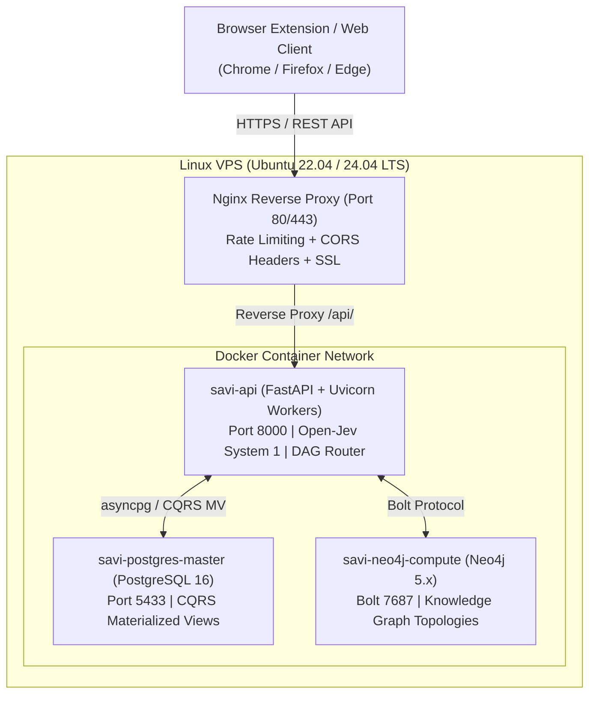

# SAVI Intelligence Platform: VPS Production Deployment Guide

This guide details how to modulate and deploy the entire SAVI Intelligence Platform onto any Virtual Private Server (VPS) — such as **DigitalOcean, Hetzner, AWS EC2, Linode/Akamai, OVH, or Google Compute Engine** — and connect it with the **SAVI Browser Extension**.

---

## 🏗️ VPS Architecture Overview

The VPS stack runs containerized via Docker Compose, isolated behind an Nginx reverse proxy:



---

## ⚡ Quick Start: One-Click Automated Provisioning

On your fresh Ubuntu/Debian VPS instance:

```bash
# 1. Clone your repository
git clone https://github.com/himanshu-anonymous/SAVI.git /opt/savi
cd /opt/savi

# 2. Make deployment script executable and run
chmod +x deploy/vps_setup.sh
./deploy/vps_setup.sh
```

The script will automatically:
- Install Docker Engine and the Docker Compose plugin.
- Configure UFW firewall rules (opening ports 22, 80, 443).
- Create `.env` from `.env.vps.example`.
- Build the SAVI Python Docker image and launch all 4 services (`postgres`, `neo4j`, `api`, `nginx`).
- Wait for the healthcheck to verify that all systems are operational.

---

## 🛠️ Manual Step-by-Step Deployment

If you prefer full control over each step:

### Step 1: Clone Repository & Create Environment Configuration
```bash
git clone https://github.com/himanshu-anonymous/SAVI.git /opt/savi
cd /opt/savi
cp .env.vps.example .env
```

Ensure your API keys (`FIRECRAWL_API_KEY`, `GEMINI_API_KEY`, `OPENAI_API_KEY`, `APIFY_API_KEY`) are present in `.env`.

### Step 2: Launch Docker Compose Mesh
```bash
docker compose -f docker-compose.vps.yml up -d --build
```

### Step 3: Verify Container Health
```bash
docker compose -f docker-compose.vps.yml ps
```
All containers (`savi-postgres-master`, `savi-neo4j-compute`, `savi-api`, `savi-nginx`) should report `Up (healthy)`.

### Step 4: Run Health Audit
```bash
curl http://localhost:8000/health
# or directly inspect full diagnostics:
curl http://localhost:8000/api/v1/system/health
```

---

## 🔒 Optional: Enabling Free SSL with Let's Encrypt (Certbot)

If you have a domain pointed to your VPS IP (e.g. `savi.yourdomain.com`):

```bash
# 1. Install Certbot
apt-get install -y certbot

# 2. Request certificate using webroot
certbot certonly --webroot -w /opt/savi/deploy/certbot/www -d savi.yourdomain.com

# 3. Add HTTPS block to deploy/nginx/savi-vps.conf pointing to /etc/letsencrypt/live/savi.yourdomain.com/
# 4. Reload Nginx:
docker compose -f docker-compose.vps.yml restart nginx
```

---

## 🔄 Systemd Auto-Start on VPS Reboot

To guarantee that SAVI automatically starts if the VPS reboots:

```bash
cp /opt/savi/deploy/systemd/savi.service /etc/systemd/system/savi.service
systemctl daemon-reload
systemctl enable savi.service
```

---

## 🧩 Connecting the Browser Extension to your VPS

1. Open your browser and go to `chrome://extensions/`.
2. Ensure **Developer mode** is enabled, click **Load unpacked**, and select the `extension/` directory.
3. Click the **SAVI** icon in the browser toolbar.
4. Click the ⚙️ gear icon in the top right.
5. In the **SAVI VPS Server URL** field, enter your VPS IP or domain:
   ```text
   http://YOUR_VPS_IP
   # or with domain/SSL:
   https://savi.yourdomain.com
   ```
6. Click **Save**.
7. The status indicator will turn green: 🟢 **VPS Online**.
8. Navigate to any news article (e.g. on Reuters, Bloomberg, BBC, NYT). The floating **⚡ SAVI Analyze** button will appear on the bottom-right of the page for instant verification!
