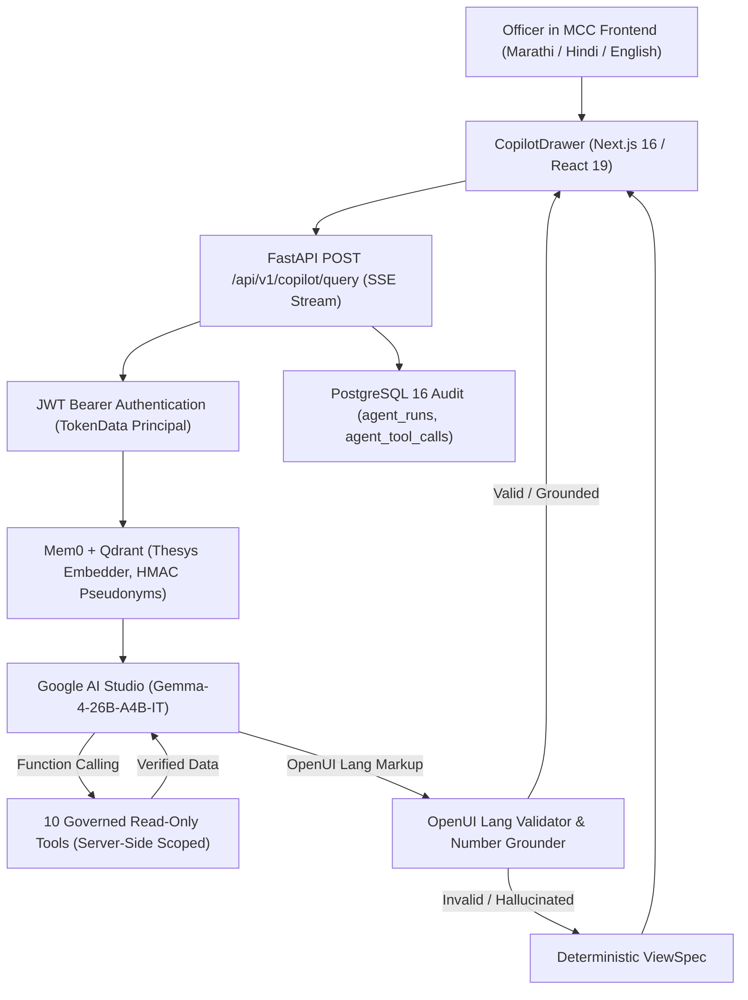

# Project EUREKA — DGIPR Open UI Copilot Documentation

## 1. Executive Summary

The **Open UI Copilot** is a governed, read-only data copilot and generative UI interface built for the Directorate General of Information and Public Relations (DGIPR) Maha-Command Center (MCC). It empowers government officers (State Admin, Division Heads, District Collectors, and DIOs) to ask questions in **Marathi (मराठी)**, **Hindi (हिंदी)**, or **English** and receive role-scoped governance metrics rendered as accessible OpenUI Lang components (KPI cards, data tables, bar charts, trend lines, and border adjacency graphs).

The copilot operates under strict governance rules:
- **Zero Hallucination / Zero Slop:** Every numerical literal displayed in the UI is verified against deterministic tool data. If a fabricated number is detected, the pipeline automatically repairs the markup or falls back to a deterministic ViewSpec.
- **Strict Read-Only Intelligence:** The copilot cannot execute SQL, Cypher, or write operations to Postgres, Neo4j, or message outboxes.
- **Identity & Role Scoping:** Identity and permissions originate strictly from the signed JWT bearer token principal (`TokenData`), never from user query text or model arguments.
- **Mem0 Preference Memory:** Remembers presentation preferences (e.g. preferred language, chart styles) using Mem0 + Qdrant and Thesys embeddings, with HMAC-SHA256 user pseudonymization and an allowlist filter that drops incident and numerical details.
- **Total Key Isolation:** Environment keys (`OPENUI_COPILOT_GEMINI_API_KEY` and `THESYS_API_KEY`) are read strictly within `backend/src/eureka/copilot/` and nowhere else in the codebase.

---

## 2. System Architecture

---

## 3. Environment Variables & Key Isolation

| Environment Variable | Scope & Isolation | Description |
| :--- | :--- | :--- |
| `OPENUI_COPILOT_GEMINI_API_KEY` | Isolated to `eureka/copilot/` | API key for Google AI Studio (`models/gemma-4-26b-a4b-it`) |
| `THESYS_API_KEY` | Isolated to `eureka/copilot/` | API key for Thesys Embedding service (`https://api.thesys.dev/v1/embed`) |
| `GEMMA_MODEL_ID` | Global Config | Model ID: `models/gemma-4-26b-a4b-it` |
| `EMBED_MODEL_ID` | Global Config | Embedding Model ID: `thesys-embed` |
| `NEXT_PUBLIC_COPILOT_ENABLED` | Frontend Next.js | Feature flag gating Copilot drawer entry in `DashboardLayout.tsx` |
| `COPILOT_MEMORY_ENABLED` | Backend Config | Toggles Mem0 user preference storage (default: `true`) |
| `COPILOT_KILL_SWITCH` | Backend Config | Emergency kill switch disabling Copilot query execution |

---

## 4. The 10 Governed Read-Only Domain Tools

Every tool takes a verified `CopilotPrincipal` and Pydantic arguments (`extra="forbid"`):

1. **`league_table(division?, sort_by?)`**: Ranked leaderboard across Maharashtra districts. Scoped by caller permissions.
2. **`district_profile(district_code)`**: Full performance summary and 4-pillar scores for a district.
3. **`pillar_breakdown(district_code, pillar_name?)`**: Detailed metrics for Information Volume (25 pts), TAT Speed (30 pts), Net Sentiment (25 pts), or Crisis SLA (20 pts).
4. **`trend(district_code, days?)`**: Historical daily composite index and sentiment trajectory.
5. **`compare_districts(district_codes)`**: Head-to-head comparison between authorized districts.
6. **`active_rumors(district_code?)`**: Unrefuted fact-check tickets and 90-minute SLA countdowns.
7. **`forecast(district_code, hours_ahead?)`**: Spatio-temporal STGNN diffusion forecast and rumor spread risk.
8. **`neighbors(district_code, max_hops?)`**: Physical border adjacency network (up to 2 hops) from the STGNN edge index.
9. **`division_rollup(division)`**: Aggregated metrics across all districts in an administrative revenue division.
10. **`dossier_summary(district_code)`**: Comprehensive executive intelligence dossier.

---

## 5. Security & Privacy Controls

### 5.1 Role-Based Access Scoping (RBAC)
- **State Admin / Cabinet Observer:** Statewide access across all 36 districts and revenue divisions.
- **Division Head:** Scoped strictly to districts within their assigned revenue division (e.g., Konkan).
- **District Collector & DIO:** Scoped strictly to their assigned district code (`district_code` in JWT). Querying any other district immediately returns `PERMISSION_DENIED` with zero data leakage.

### 5.2 User Privacy & Pseudonymization
- Real user IDs and names are never sent to Qdrant or vector stores.
- Identifiers are pseudonymized via `HMAC-SHA256(username, secret_salt)[:32]`.
- Post-extraction filters drop all numbers, statistics, and incident/crime descriptions from memory, retaining only presentation preferences (e.g. "Prefers Marathi language", "Prefers bar charts").
- "Forget Me" action purges all stored embeddings and preferences on demand.

### 5.3 Number Grounding & GIGW 3.0 Accessibility
- The generator enforces UX4G & GIGW 3.0 accessibility standards.
- Every chart (`BarChart`, `LineChart`) and network graph (`GraphView`) must include:
  1. A natural language text summary (`<Text content="..." />`).
  2. An accessible, screen-reader-friendly table alternative (`<DataTable ... />` with `scope="col"`).
- All numbers in generated markup are extracted and verified against tool results. Any unverified numerical literal causes immediate validation rejection and fallback to deterministic `ViewSpec`.

---

## 6. Verification & Automated Test Coverage

The Open UI Copilot includes comprehensive test suites across backend and frontend:

- **Backend Pytest (`backend/tests/test_copilot.py`):**
  - `test_key_isolation_grep_codebase`: Enforces key isolation across the entire repository.
  - `test_rbac_state_admin_access`, `test_rbac_collector_own_district`: Verifies authorized access.
  - `test_rbac_cross_district_refusal`, `test_rbac_compare_districts_refusal`: Verifies cross-district denial.
  - `test_rbac_division_head_scoping`, `test_rbac_active_rumors_scoping`: Scoping checks.
  - `test_extract_all_numbers`, `test_extract_numbers_from_openui`: Numeric parser validation.
  - `test_grounding_valid_numbers_passes`, `test_grounding_fabricated_numbers_rejected`: Number grounding.
  - `test_disallowed_html_tags_rejected`: XSS & HTML tag sanitization.
  - `test_user_pseudonymization`, `test_preference_filtering`: Privacy & HMAC verification.
  - `test_memory_fail_open_resilience`: Bounded fail-open memory handling.
  - `test_detect_language`, `test_generate_copilot_system_instruction`: Indic language routing.
  - `test_viewspec_builder_and_fallback`: Deterministic ViewSpec construction.
  - `test_all_10_tools_declared_and_mapped`: Catalog completeness.

- **Frontend Tests (`frontend/MCC/tests/copilot.test.mjs`):**
  - Component library exports.
  - GIGW 3.0 accessibility compliance (`scope="col"`, table captions, table toggle).
  - Copilot drawer accessibility (`role="dialog"`, `aria-label`).
  - Layout feature-flag gating (`NEXT_PUBLIC_COPILOT_ENABLED`).
