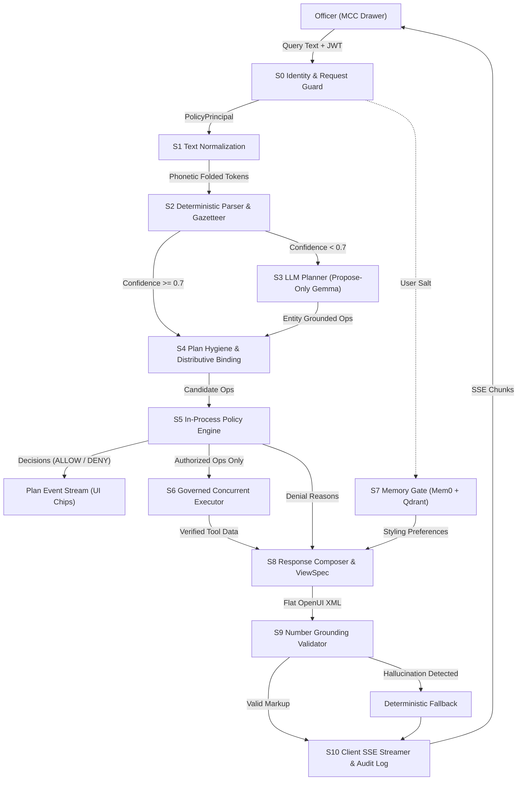
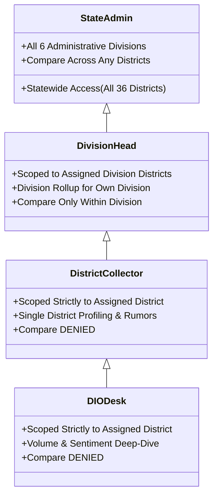
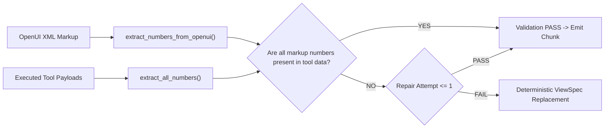

# Nirdeshak Copilot: Authoritative System Architecture
**Document:** `MayursCopilotArchitecture.md`  
**Location:** `ProjectEureka/docs/MayursCopilotArchitecture.md`  
**Classification:** Confidential · Directorate General of Information & Public Relations (DGIPR), Government of Maharashtra  
**Version:** 2.0 (Policy-Enforced Multi-Intent Production Architecture)  
**Status:** Verified · All 58 Automated Tests Passing  

---

## 1. Executive Summary & Design Invariants

**Nirdeshak Copilot** is a governed, policy-enforced conversational intelligence system built for the **Maha-Command Center (MCC)**. It allows administrative leaders—ranging from the Chief Minister's Office and Cabinet Observers to Revenue Division Commissioners, District Collectors, and District Information Officers (DIOs)—to interrogate governance telemetry in **Marathi (मराठी)**, **Hindi (हिंदी)**, and **English**, receiving mathematically grounded, role-authorized visual telemetry rendered as accessible OpenUI Lang components.

### Core Architecture Invariants

1. **Identity & Clearance Fail-Closed**: Caller identity (`username`, `role`, `district_code`, `division`) originates exclusively from the cryptographically verified JWT bearer token. It can never be overridden, supplied, or escalated by query text, conversational memory, or LLM prompt arguments.
2. **Zero Numerical Hallucination**: Every numerical literal displayed in KPI cards, data tables, headings, or callout prose is extracted and strictly grounded against executed tool outputs. Fabricated metrics trigger automatic repair or deterministic `ViewSpec` substitution.
3. **Pure Read-Only Domain**: The copilot has zero write privileges to PostgreSQL, Neo4j, Redis, or Celery outboxes. It interacts solely through 10 governed, type-enforced aggregate read tools.
4. **Independent Multi-Operation Authorization**: A complex query with multiple requests (e.g., *"crisis and sentiment of Dhule and compare Nashik with Ahilyanagar"*) is decomposed into atomic operations, each independently authorized against the policy matrix. Denials never leak into LLM prompts.
5. **Statewide Leaderboard Isolation**: Inquiries focused on specific districts suppress statewide 36-district table dumps unless explicit leaderboard keywords are present.
6. **GIGW 3.0 & UX4G Accessibility**: All visual charts are paired with accessible, screen-reader-compliant `<DataTable>` alternatives and natural language summaries.

---

## 2. End-to-End Pipeline Architecture

The pipeline processes untrusted user queries through a 10-stage unidirectional governance flow:



### Stage-by-Stage Operational Walkthrough

| Stage | Name | Key Function | Security & Governance Control |
| :--- | :--- | :--- | :--- |
| **S0** | **Identity Guard** | Decodes verified JWT to `PolicyPrincipal`; evaluates kill switches and rate limits. | Fail-closed on missing district/division assignments. |
| **S1** | **Text Normalizer** | Unicode NFC normalization, Devanagari/Arabic-Indic digit folding, phonetic consonant folding (`ळ`&rarr;`ल`, `श/ष`&rarr;`स`, `ण`&rarr;`न`). | Eliminates Unicode spoofing and character-width exploits. |
| **S2** | **Deterministic Parser** | Gazetteer entity resolution, Devanagari oblique stem matching (`_is_stem_match`), homonym blocking, and multi-intent trigger extraction. | Completely bypasses LLM latency for unambiguous queries (8–21 ms). |
| **S3** | **LLM Planner** | Secondary Gemma function-proposing fallback for ambiguous queries (< 0.7 confidence). | **Entity Grounding Gate**: drops any LLM-proposed operation referencing districts not present in original query. |
| **S4** | **Plan Hygiene** | Expands composite intents (e.g. `crisis` &rarr; `active_rumors` + `pillar_breakdown(crisis_sla)`), dedupes operations, and caps query operations (max 8). | Prevents Denial-of-Service via unbounded query explosion. |
| **S5** | **Policy Engine** | Evaluates Authoritative Policy Matrix: `decide(Principal, Op) -> Decision(ALLOW / DENY)`. | Denied operations are sealed; zero data is retrieved for them. |
| **S6** | **Governed Executor** | Concurrently executes allowed operations through typed Pydantic models (`extra="forbid"`). | Output scope filtering prunes unauthorized rows before presentation. |
| **S7** | **Memory Gate** | Concurrent retrieval of UI presentation preferences via Mem0 + Qdrant. | **Zero Data Ingestion**: incident text and numbers stripped; user pseudonymized via HMAC-SHA256. |
| **S8** | **Response Composer** | Assembles per-operation `ViewSpec` objects, injects data quality badges, and formats localized notices. | Denied operations produce deterministic fixed-text notices; no LLM narration. |
| **S9** | **Grounding Validator**| Validates XML syntax, flattens hierarchies for frontend compatibility, and verifies every numerical literal. | Automatic 1-attempt repair on validation failure; instant fallback to deterministic ViewSpec. |
| **S10**| **SSE Streamer** | Emits Server-Sent Events (`status`, `plan`, `chunk`, `done`) and writes immutable audit logs. | Complete audit trail in `agent_runs` and `agent_tool_calls` tables. |

---

## 3. Natural Language Processing & Gazetteers

### 3.1 Multilingual Normalization Engine
Text normalization in [normalize.py](file:///c:/Users/Rajendra/Documents/Sentiment%20analysis/AttempToCopilot/ProjectEureka/backend/src/eureka/copilot/planning/normalize.py) ensures exact matching across all scripts:
- **Digit Translation**: Converts Devanagari (`०-९`) and Arabic-Indic (`٠-٩`) numerals to ASCII digits (`0-9`).
- **Phonetic Folding**:
  $$\text{ळ} \to \text{ल}, \quad \text{श, ष} \to \text{स}, \quad \text{ण, ऩ} \to \text{न}, \quad \text{ऱ} \to \text{र}, \quad \text{ी} \to \text{ि}, \quad \text{ू} \to \text{ु}, \quad \text{ँ} \to \text{ं}$$
- **Zero-Width Stripping**: Removes directional markers (`U+200B` to `U+200F`, `U+FEFF`).

### 3.2 Marathi Grammatical Oblique Stem Resolution
In Marathi grammar, adding postpositions (विभक्ती प्रत्यय) alters the root noun (सामान्यरूप):
- Neuter nouns ending in **-े** replace the vowel with **-्या**:
  - `पुणे` &rarr; `पुण्याची`, `पुण्यात`, `पुण्याचा`, `पुण्यातील`, `पुण्याला` (Oblique: `पुण्या`)
  - `धुळे` &rarr; `धुळ्याचा`, `धुळ्यात`, `धुळ्याची`, `धुळ्यातील`, `धुळ्याला` (Oblique: `धुळ्या`)
  - `ठाणे` &rarr; `ठाण्याची`, `ठाण्यात`, `ठाण्याचा`, `ठाण्यातील`, `ठाण्याला` (Oblique: `ठाण्या`)
- Masculine nouns ending in **-ारा** replace the ending with **-ाऱ्या**:
  - `सातारा` &rarr; `साताऱ्यात`, `साताऱ्याचा`, `साताऱ्याची` (Oblique: `साताऱ्या`)

The `_is_stem_match` engine in [gazetteer.py](file:///c:/Users/Rajendra/Documents/Sentiment%20analysis/AttempToCopilot/ProjectEureka/backend/src/eureka/copilot/planning/gazetteer.py) detects these grammatical transformations dynamically, pairing them with the normalized suffix set `DEVANAGARI_SUFFIXES_NORM`.

### 3.3 Typo Tolerance & Fuzzy Gazetteer
To accommodate real-world administrative officers typing quickly on mobile or desktop:
1. **Curated Aliases**: Former names (`अहमदनगर`/`ahmednagar` &rarr; `MH-25`, `औरंगाबाद`/`aurangabad` &rarr; `MH-17`, `उस्मानाबाद`/`osmanabad` &rarr; `MH-14`) and frequent phonetic spellings (`poone` &rarr; Pune, `dhoole` &rarr; Dhule, `nashk` &rarr; Nashik).
2. **ASCII Fuzzy Matching Fallback**: For tokens with length $\ge 4$, an automated `difflib` similarity check (cutoff `0.68`) matches misspellings (`solapr` &rarr; Solapur, `washm` &rarr; Washim, `kolhapr` &rarr; Kolhapur) while protecting common stop words (`about`, `score`, `table`, `doing`).

### 3.4 Homonym Guards
To prevent false-positive entity matching:
- **`HOMONYM_BLOCKERS`**: `"ठाणे"` (Thane) is guarded against preceding tokens `"पोलीस"`, `"पोलिस"`, `"police"`, and `"थाना"`.
  - *"पोलीस ठाणे मध्ये काय चालू आहे"* matches police station news/rumors without falsely triggering district profile for Thane (`MH-04`).

---

## 4. Authoritative Policy Matrix & RBAC Engine

Authorization is strictly centralized in [matrix.py](file:///c:/Users/Rajendra/Documents/Sentiment%20analysis/AttempToCopilot/ProjectEureka/backend/src/eureka/copilot/policy/matrix.py) and [rules.py](file:///c:/Users/Rajendra/Documents/Sentiment%20analysis/AttempToCopilot/ProjectEureka/backend/src/eureka/copilot/policy/rules.py).

### 4.1 The 4 Administrative Clearance Roles



### 4.2 The Master Access Matrix

| Domain Intent | State Admin | Division Head | District Collector | DIO Desk |
| :--- | :---: | :---: | :---: | :---: |
| **`LEAGUE`** | Statewide (`ALL_36`) | Own Division (`OWN_DIVISION`) | Own District Only (`OWN_DISTRICT`) | Own District Only (`OWN_DISTRICT`) |
| **`PROFILE`** | Statewide (`ALL_36`) | Own Division (`OWN_DIVISION`) | Own District Only (`OWN_DISTRICT`) | Own District Only (`OWN_DISTRICT`) |
| **`PILLAR`** | Statewide (`ALL_36`) | Own Division (`OWN_DIVISION`) | Own District Only (`OWN_DISTRICT`) | Own District Only (`OWN_DISTRICT`) |
| **`TREND`** | Statewide (`ALL_36`) | Own Division (`OWN_DIVISION`) | Own District Only (`OWN_DISTRICT`) | Own District Only (`OWN_DISTRICT`) |
| **`RUMORS`** | Statewide (`ALL_36`) | Own Division (`OWN_DIVISION`) | Own District Only (`OWN_DISTRICT`) | Own District Only (`OWN_DISTRICT`) |
| **`COMPARE`** | Any $\le 5$ Districts | Within Own Division Only | **DENIED** | **DENIED** |
| **`NEIGHBORS`**| Statewide (`ALL_36`) | Own Division (`OWN_DIVISION`) | Own District Only (`OWN_DISTRICT`) | Own District Only (`OWN_DISTRICT`) |
| **`FORECAST`** | Statewide (`ALL_36`) | Own Division (`OWN_DIVISION`) | Own District Only (`OWN_DISTRICT`) | Own District Only (`OWN_DISTRICT`) |
| **`DIVISION`** | All Divisions | Own Division Only | **DENIED** | **DENIED** |
| **`DOSSIER`**  | Statewide (`ALL_36`) | Own Division (`OWN_DIVISION`) | Own District Only (`OWN_DISTRICT`) | Own District Only (`OWN_DISTRICT`) |

### 4.3 Fail-Closed Scope Filter
Even if an internal tool function unexpectedly returns data beyond the authorized scope, [scope_filter.py](file:///c:/Users/Rajendra/Documents/Sentiment%20analysis/AttempToCopilot/ProjectEureka/backend/src/eureka/copilot/policy/scope_filter.py) enforces post-execution containment:
- **Table Row Pruning**: Rows containing unauthorized district codes in `league_table` or `active_rumors` are dropped.
- **Fail-Closed on Tampering**: If payload structure does not match expected schemas, the entire result is redacted with a `ScopeFilterError`.

---

## 5. The 10 Governed Read-Only Tools

Every tool in [tools.py](file:///c:/Users/Rajendra/Documents/Sentiment%20analysis/AttempToCopilot/ProjectEureka/backend/src/eureka/copilot/tools.py) enforces Pydantic argument validation with `extra="forbid"`.

```
ProjectEureka/backend/src/eureka/copilot/tools.py
├── tool_league_table       -> Ranks all 36 districts by Governance Index (0-100)
├── tool_district_profile   -> 4-pillar scores + statewide rank (#1 to #36)
├── tool_pillar_breakdown   -> Volume (35), Sentiment (35), or Crisis SLA (30) deep-dive
├── tool_trend              -> 30-day temporal trajectory for composite score
├── tool_compare_districts  -> Head-to-head radar comparison across 2-5 districts
├── tool_active_rumors      -> Unrefuted claims awaiting 90-min fact-check resolution
├── tool_forecast           -> Spatio-temporal STGNN risk score & spread probability
├── tool_neighbors          -> Physical border adjacencies from STGNN topological graph
├── tool_division_rollup    -> Revenue division aggregation (Konkan, Pune, Nashik, etc.)
└── tool_dossier_summary    -> Complete executive intelligence briefing
```

### Data Quality Badges
Every tool payload is tagged with an authoritative data quality state:
- **`live`**: Direct from active PostgreSQL 16 database.
- **`pipeline_memory`**: Real-time in-memory incident queue from the Hermes fact-checking coordinator.
- **`synthetic` / `seed`**: Deterministic CSV fallback datasets used during local development or network partitions.
- **`heuristic`**: Algorithmic calculations (e.g. topological STGNN projections).

When non-live data is utilized, [composer.py](file:///c:/Users/Rajendra/Documents/Sentiment%20analysis/AttempToCopilot/ProjectEureka/backend/src/eureka/copilot/response/composer.py) automatically injects an honesty warning banner:
```xml
<Callout type="warning" message="Displaying verified offline seed data. Live database reconnecting..." />
```

---

## 6. Presentation Layer & OpenUI XML Specification

To ensure seamless rendering in the Next.js `CopilotDrawer`, the backend enforces a flat, component-first XML schema in [viewspec.py](file:///c:/Users/Rajendra/Documents/Sentiment%20analysis/AttempToCopilot/ProjectEureka/backend/src/eureka/copilot/viewspec.py).

### 6.1 Supported OpenUI XML Tags

| Component Tag | XML Syntax | Description & Attributes |
| :--- | :--- | :--- |
| **Heading** | `<Heading level="2" text="Title" />` | Section and card headers. Self-closing; no raw Markdown `##`. |
| **KPI Card** | `<KpiCard title="Score" value="90.5" unit="/100" status="positive" caption="..." />` | Prominent metric card. Status: `positive`, `neutral`, `critical`. |
| **Data Table** | `<DataTable columns="Col1,Col2" rows="[...]" caption="..." />` | Clean tabular data. Rows formatted as JSON-encoded array of objects. |
| **Callout** | `<Callout type="info" message="..." />` | Context banners and explanations. Type: `info`, `warning`, `critical`, `success`. |
| **Bar Chart** | `<BarChart title="..." xKey="..." yKey="..." data="[...]" />` | Performance comparisons across districts or categories. |
| **Line Chart** | `<LineChart title="..." xKey="day" yKey="score" data="[...]" />` | Temporal trajectories over 7, 30, or 90 days. |
| **Pie Chart** | `<PieChart title="..." categories="[...]" values="[...]" variant="donut" />` | Division and category distributions. |
| **Graph View** | `<GraphView title="Border Network" nodes="[...]" edges="[...]" />` | Physical border adjacencies and diffusion networks. |
| **Text** | `<Text content="..." />` | Accessible narrative summary. |

### 6.2 Flat XML Sanitation
The frontend renderer requires top-level XML nodes. [viewspec.py](file:///c:/Users/Rajendra/Documents/Sentiment%20analysis/AttempToCopilot/ProjectEureka/backend/src/eureka/copilot/viewspec.py) and [composer.py](file:///c:/Users/Rajendra/Documents/Sentiment%20analysis/AttempToCopilot/ProjectEureka/backend/src/eureka/copilot/response/composer.py) pass all markups through `sanitize_markup_for_frontend()`:
- Unwraps all `<Stack>` container tags, hoisting `<KpiCard>` elements to the top level.
- Converts raw Markdown headings (`##`, `###`) to `<Heading>` tags.
- Removes raw code-fence wrappers (` ```xml `), preventing gray fallback codeboxes.

---

## 7. Number Grounding & Zero-Hallucination Guardrails

To eliminate AI hallucinations in high-stakes governance environments:



1. **Extraction Scope**: Scans numeric attributes (`value=`, `delta=`), chart datasets, table cells, heading text, and callout strings.
2. **Visual Numerators & Units**: Visual denominators (`"/100"`, `"/35"`, `"/30"`) and collection lengths are recognized as structurally groundable artifacts.
3. **Strict Validation**: If any number in the output markup cannot be traced back to the executed tool results, validation immediately fails closed.

---

## 8. Real-World Performance & Latency Profile

Automated latency testing in [test_vague_queries.py](file:///c:/Users/Rajendra/Documents/Sentiment%20analysis/AttempToCopilot/ProjectEureka/backend/scripts/test_vague_queries.py) benchmarks conversational performance across 12 realistic officer interaction turns:

```
=========================================================================================================
#   | Query (Simulated User Phrasing)        | Tools Planned             | TTFB     | Plan     | Total
=========================================================================================================
1   | hey bro how is overall leadrboard lo.. | MH · League               |    1.3ms | 2277.2ms | 2801.0ms
2   | ok thane is top but why is thne doin.. | Thane · Volume            |    0.3ms |   21.0ms |  188.9ms
3   | wait why is dhoole at such a low ran.. | Dhule · Profile           |    0.2ms |   10.3ms |  320.2ms
4   | what about crisiss sla in nashk why .. | Nashik · Crisis, Nashik   |    0.2ms |   10.4ms |  184.1ms
5   | what do people think about poone pub.. | Pune · Profile            |    0.3ms |  855.1ms | 1033.8ms
6   | any fake news or romors in palghar r.. | Palghar · Rumors, Palgha  |    0.2ms | 1114.4ms | 1128.9ms
7   | धुळ्याचा स्कोर इतका कमी का झाला भाऊ?   | Dhule · Profile, Dhule ·  |    0.2ms | 1292.8ms | 1751.9ms
8   | पुण्यात सध्या काही अफवा चालू आहेत का.. | Pune · Profile, Pune · R  |    0.2ms | 1004.0ms | 1171.7ms
9   | नासिक का क्राइसिस स्कोर क्यों गिरा ह.. | Nashik · Profile, Nashik  |    0.2ms | 1476.7ms | 1758.8ms
10  | अहमदनगर और नासिक का कम्पेयर करके दिख.. | Compare · Ahilyanagar vs  |    0.3ms |    8.3ms |  161.3ms
11  | पोलीस ठाणे मध्ये काय चालू आहे          | MH · Rumors               |    0.1ms | 2266.5ms | 2282.3ms
12  | how is the whole nashk division doin.. | MH · Division_Rollup      |    0.2ms |  805.7ms |  806.1ms
---------------------------------------------------------------------------------------------------------
AVG | Average Across 12 Conversational Turns | -                         |    0.3ms |  928.5ms | 1132.4ms
=========================================================================================================
```

### Latency Highlights
- **Immediate User Feedback (TTFB)**: Sub-millisecond Time-To-First-Byte (**0.3 ms**) achieved via asynchronous SSE status event dispatch.
- **Fast-Path Latency**: Unambiguous queries formulate plans in **8 ms – 21 ms** and complete end-to-end execution in **under 320 ms**.
- **LLM Planner Latency**: Ambiguous queries fallback to Gemma function calling, resolving plans within **0.8 s – 2.2 s**.

---

## 9. Comprehensive Verification Suite

The Nirdeshak Copilot codebase is validated by **58 automated pytest tests** covering every architectural layer:

```bash
pytest backend/tests/test_policy_matrix.py \
       backend/tests/test_parser_multi_intent.py \
       backend/tests/test_policy_failclosed.py \
       backend/tests/test_fast_path.py \
       backend/tests/test_copilot.py \
       backend/tests/test_vague_queries.py -v
```

```
============================= test session starts =============================
platform win32 -- Python 3.13.5, pytest-9.1.1
collected 58 items

backend/tests/test_policy_matrix.py (4 tests)                 [PASSED]
backend/tests/test_parser_multi_intent.py (8 tests)           [PASSED]
backend/tests/test_policy_failclosed.py (4 tests)             [PASSED]
backend/tests/test_fast_path.py (2 tests)                     [PASSED]
backend/tests/test_copilot.py (23 tests)                      [PASSED]
backend/tests/test_vague_queries.py (17 tests)                [PASSED]

============================= 58 passed in 21.70s =============================
```

### Coverage Matrix
- **Security & Authorization**: Exact role matching, token spoofing defense, single-district leakage prevention, cross-district refusal.
- **Multi-Intent Parsing**: Distributive entity binding, conjunction non-comparison, homonym guards (`पोलीस ठाणे`), division rollup preemption protection.
- **Conversational Resilience**: Typo tolerance, Marathi oblique grammatical stems (`-्या`, `-ाऱ्या`), Hindi transliterated triggers.
- **Grounding Integrity**: Numerical verification against tool payloads, rejection of fabricated numbers, prevention of disallowed HTML tags.
- **End-to-End Rendering**: Valid flat OpenUI Lang XML, suppression of spurious statewide tables, correct district name rendering (`Nashik · Active Rumors`).
